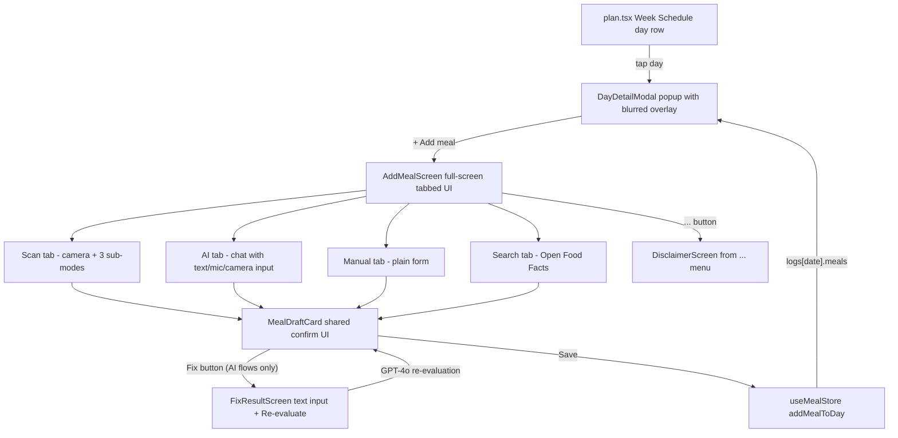

# Day Detail Modal + Add Meal Experience

## Big-picture flow



## Locked-in decisions

| Area | Decision |
|---|---|
| Add Meal screen style | **Full-screen takeover** with its own header. Not a bottom sheet. |
| Top header | Back arrow / app name placeholder + small logo / "..." button (opens Disclaimer) |
| App name / assistant name | **No name yet** — use placeholder string `"AppName"` in one constants file. No customizable assistant nickname feature for now. |
| Bottom tab bar | 4 tabs: Scan, AI, Manual, Search. Active tab uses **light green accent** (existing app color). |
| Scan tab | 3 sub-modes in a pill row above camera controls: **Scan** (camera identifies food via vision), **Upload** (pick from photo library), **Barcode** (UPC lookup). Camera viewfinder with corner brackets, big white capture button, flash toggle, camera-flip. |
| AI tab | Empty state: big "Describe what you ate" + subtext "Or tap the mic to talk". Bottom input bar with **text + mic + camera** icons. Streaming replies. |
| Manual tab | Plain form: name, time, calories, macros. |
| Search tab | Debounced Open Food Facts search → tap result → quantity input → draft card. |
| Confirmation | Shared `MealDraftCard`. Editable fields: name, time, calories, macros, **recurrence (Once / Daily / Weekly)**, "Save to library" toggle. Save closes back to DayDetailModal. |
| Save behavior | All saves go through `addTemplate` (existing store action). One-off → `{ type: 'once', date: selectedDate }`. Daily → `{ type: 'daily' }`. Weekly → `{ type: 'weekly', days: [dayOfWeek] }`. Existing `resolveDayFromTemplates` materializes them as `MealEntry` rows with `status: 'pending'`. |
| Default status | `pending` (= planned). User marks eaten on the day's view later. |
| Header placeholder | Emoji + "AppName" (e.g. 🌱 + "AppName") in `constants/app.ts` — one-line swap when finalized. |
| Edit existing meal | Tapping a meal in the DayDetailModal list opens `MealDraftCard` pre-filled with that meal's data. Fix button works (sends current data + photo if available to GPT-4o for re-evaluation). Save uses `updateTemplate` (not `addTemplate`). |
| Old inline expand | **Removed**. Day rows in Week Schedule open the new DayDetailModal on tap (no inline expansion). The "+ Day meal" header button is **kept** as a shortcut — opens `AddMealScreen` directly for today's date. |
| Date range | Any past or future date can have meals added/edited. No restriction. |
| AI chat persistence | Chat resets every time AddMealScreen closes. Not persisted across sessions. |
| Web fallback | Scan tab + AI camera button show a "Not available on web — use Mobile app" message when running in browser. Other tabs work normally on web. |
| Fix button | Only on draft cards from AI flows (Scan / Upload / AI tab). Opens `FixResultScreen`: header "Fix Result", instruction "Describe what's wrong with the result", text input, **"Re-evaluate"** button. Re-evaluation sends `fix text + original photo + current draft + chat history` to GPT-4o, replaces the draft on return. |
| AI provider | OpenAI: GPT-4o for chat + vision + Fix re-evaluation, Whisper for dictation |
| Voice | Dictation only (mic transcribes into text field). No TTS reply, no continuous chat. |
| AI context | Daily goals, today's logged meals, saved library, user's name |
| API key | `.env` with `expo-constants` for now. `// TODO: backend proxy before public release` comment at the call site. |
| Disclaimer | Opens from "..." in header. Permanent long-form health & AI disclaimer + references page. |
| Meal naming | Always actual food name (e.g. "Chicken stir-fry"), never "Breakfast" |

## New files

### `components/DayDetailModal.tsx`
Props: `date: string | null`, `onClose: () => void`. React Native `Modal` with `BlurView` (expo-blur) covering the screen. Popup card centered, ~92% width, ~85% height.

Top to bottom:
- **Header**: full date ("Monday, May 12") + close X
- **Nutrition ring**: large circular arc showing `totalCalories / goals.dailyCalories`. Center text "1240 / 2200 kcal". Below: 3 horizontal macro bars (protein/carbs/fats vs `goals.protein` etc).
- **Meal list**: `entry.name` (actual food name), `entry.time`, kcal + macros. **Tap to edit** → opens `MealDraftCard` pre-filled (Save uses `updateTemplate`, Fix re-evaluates via AI). **Swipe to delete** → `removeMealFromDay` + global undo.
- **Empty state**: "No meals added yet" + "Tap + Add meal to get started"
- **"+ Add meal" button** → opens `AddMealScreen`

### `components/AddMealScreen.tsx`
Full-screen modal (`presentation: 'fullScreenModal'`).

Layout:
- **Top header bar**: ← back / center: small logo + "AppName" placeholder / right: "..." button (opens `DisclaimerScreen`)
- **Tab content area** (one of: ScanTab / AITab / ManualTab / SearchTab)
- **Bottom tab bar**: 4 tabs with icon + label. Active = light green. Tabs: Scan, AI, Manual, Search.

### `components/addMeal/ScanTab.tsx`
- Top: camera viewfinder with **4 corner brackets** (matches reference image)
- Above bottom controls: **3-pill sub-mode row**: Scan / Upload / Barcode
  - **Scan**: live camera feed, capture sends frame to GPT-4o vision → draft card
  - **Upload**: closes camera, opens `expo-image-picker`, pick photo → GPT-4o vision → draft card
  - **Barcode**: switches camera to barcode mode, on detect → Open Food Facts lookup → draft card
- **Bottom controls row**: flash toggle (left), big white capture button (center), camera-flip (right)
- Camera permission handled on first open

### `components/addMeal/AITab.tsx`
Two states:

**Empty (no messages yet)**:
- Large centered text: "Describe what you ate"
- Subtext: "Or tap the mic to talk"
- Input bar pinned at bottom

**Active (chat in progress)**:
- Scroll view of alternating user / AI bubbles (streamed)
- Inline `MealDraftCard` appears when AI has enough info

**Input bar** (always visible at bottom):
- Text field (placeholder: "Describe a meal...")
- Camera icon → opens image picker → attaches photo to next message
- Mic icon → records via `expo-av` → Whisper transcribes → fills text field

### `components/addMeal/ManualTab.tsx`
Simple form:
- Name (text input)
- Time (time picker, defaults to current time)
- Calories (number)
- Protein / Carbs / Fats (numbers)
- Save button → goes to `MealDraftCard` for confirmation (or skip directly to save — TBD during build)

### `components/addMeal/SearchTab.tsx`
- Search input at top (placeholder: "Search foods...")
- Debounced fetch to `https://world.openfoodfacts.org/cgi/search.pl`
- Flat list of results: product name + kcal/100g
- Tap result → quantity input (grams) → scaled macros → `MealDraftCard`

### `components/addMeal/MealDraftCard.tsx` (shared)
Used by all 4 tabs.

- Tappable fields (tap any to edit inline):
  - **Name** (text)
  - **Time** (time picker, defaults to current time)
  - **Calories**, **Protein**, **Carbs**, **Fats** (numbers)
  - **Recurrence** (segmented: Once / Daily / Weekly)
- Toggle: "Save to library too?"
- **Action row**:
  - From AI flows (Scan / Upload / AI / interpreted Barcode): `[Cancel]  [Fix]  [Save]`
  - From Manual / Search / direct Barcode: `[Cancel]  [Save]`
- Save → builds a `MealTemplate` from the fields → `addTemplate(template)` → (optionally) `saveToLibrary(...)` → `resolveDayFromTemplates(selectedDate)` → closes back to DayDetailModal

### `components/addMeal/FixResultScreen.tsx`
Modal that opens when user taps Fix:
- Header: "Fix Result" + close X
- Instruction text: "Describe what's wrong with the result and we'll re-evaluate"
- Multi-line text input
- "Re-evaluate" button (with loading state) → sends `{ fixText, originalPhoto, currentDraft, chatHistory }` to GPT-4o → returns new draft → closes back to `MealDraftCard` with updated values

### `components/addMeal/DisclaimerScreen.tsx`
Opens from "..." in header.
- Header: "Disclaimer" + close X
- Long-form scrollable text (placeholder content for now — user will provide real text)
- Sections: Health Disclaimer / AI Limitations / Data Sources / References

### `ai/aiClient.ts`
Wraps OpenAI behind a clean interface:
```typescript
export interface AIClient {
  chat(messages: ChatMessage[], opts?: { image?: string }): AsyncIterable<string>;
  parseMeal(input: { text?: string; image?: string }, context: DayContext): Promise<MealDraft>;
  fixMeal(input: { fixText: string; image?: string; currentDraft: MealDraft }, context: DayContext): Promise<MealDraft>;
  transcribe(audioUri: string): Promise<string>;
}

export const aiClient: AIClient = OPENAI_API_KEY
  ? createOpenAIClient(OPENAI_API_KEY)
  : createStubClient();
```
Stub returns canned responses so the entire UI works without a key during dev.

### `ai/prompts.ts`
System prompt that:
- Knows user's `goals`, today's logged meals, saved `library`, user `profile.name`
- Generates short food-name title (3–5 words, e.g. "Chicken stir-fry")
- Asks for time if not given (defaults to current when adding for today)
- Returns structured JSON: `{ name, time, calories, protein, carbs, fats }`
- Has a separate "Fix" prompt that takes the previous draft + user's correction and returns a refined version

### `ai/types.ts`
Shared types: `ChatMessage`, `MealDraft`, `DayContext`.

### `constants/app.ts` (new)
```typescript
export const APP_NAME = 'AppName';   // TODO: replace when finalized
export const APP_LOGO = '🌱';        // TODO: replace emoji with real logo asset
```
Single source of truth so renaming the app + logo is a one-line change. Used in the Add Meal header and anywhere else app branding shows.

### `app.config.ts` (new) + `.env`
- Add `OPENAI_API_KEY` to `.env` (gitignored)
- `app.config.ts` exposes it via `extra: { openaiApiKey: process.env.OPENAI_API_KEY }`
- `aiClient.ts` reads `Constants.expoConfig?.extra?.openaiApiKey`
- `// TODO: replace with backend proxy before shipping publicly` at the call site

## Modified files

### [`app/(tabs)/plan.tsx`](app/(tabs)/plan.tsx)
- Add `dayModalDate: string | null` state
- Week Schedule day row `onPress` → `setDayModalDate(iso)` (replaces inline expand)
- Mount `<DayDetailModal date={dayModalDate} onClose={() => setDayModalDate(null)} />` at the screen root

### [`store/types.ts`](store/types.ts)
Add user profile only (no assistant config yet):
```typescript
export interface UserProfile {
  name: string;            // for friendlier AI greetings
}

export interface AppStore {
  // ...existing fields
  profile: UserProfile;
  updateProfile: (patch: Partial<UserProfile>) => void;
}
```

### [`store/useMealStore.ts`](store/useMealStore.ts)
- Add `profile` to initial state (and to AsyncStorage persisted shape)
- Add `updateProfile` action
- Existing `addMealToDay` already does what we need

### [`app/settings.tsx`](app/settings.tsx)
Add a **Profile** section above existing "Nutrition goals":
- Your name (text input)

## New packages
- `expo-blur` — frosted background behind the popup
- `expo-camera` — camera viewfinder + barcode scanning + photo capture
- `expo-image-picker` — photo library picker (Upload sub-mode)
- `expo-av` — voice recording for Whisper dictation
- `openai` — official SDK for chat + vision + Whisper

## Why this structure works
- **Vision input is grouped** in Scan tab (3 sub-modes), so the photo capture experience is consistent and self-contained
- **AI tab is conversational** — clean separation from "I have a photo" vs "I want to type / talk it out"
- **All 4 tabs converge on `MealDraftCard`** — one place to fix bugs, one consistent confirmation pattern
- **Fix button only on AI-flow cards** — Manual / Search / direct Barcode don't need Re-evaluate (no AI was involved)
- **`FixResultScreen` is a focused single-purpose screen** — not a full chat, so the user types one correction and gets one updated draft back. Less friction than chatting.
- **`constants/app.ts`** means renaming the app or swapping the logo is a one-line change when you finalize the name
- **No new fields on `MealEntry`** — keeps existing storage compatible

## Suggestions to consider (not yet decided)
- **Macros-aware AI suggestions** — AI can see remaining macros and suggest meals that fit the gap
- **Bulk parsing** — "I had pasta with chicken, salad, and a coke" → 3 separate draft cards in sequence
- **Save to library toggle** on draft card → quick re-add later
- **Per-meal AI history** — tap a logged meal to see the original AI conversation that created it
- **Recents row in AI tab empty state** — small horizontal strip of recently logged meals for one-tap re-add
- **Live food identification preview** in Scan mode (advanced, v2)

## Ready to build?
All blocking decisions are locked. Once you give the go-ahead, I'll execute in roughly this order:
1. Install packages + .env setup
2. Store additions (profile)
3. DayDetailModal (so you see the new entry point first)
4. AddMealScreen shell + all 4 tabs (with stubbed AI)
5. Real OpenAI client + dictation
6. Fix flow + Disclaimer screen
7. Settings additions + plan.tsx wiring
