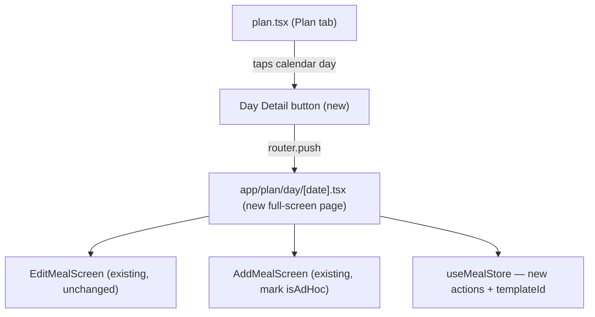

# Plan Tab — Day Detail & Related Changes

## What changes



## Phase 1 — Data model changes

### [`store/types.ts`](store/types.ts)

Extend `MealEntry`:
```ts
export interface MealEntry {
  // ...existing fields
  templateId?: string;   // id of the MealTemplate that generated this entry
  isAdHoc?: boolean;     // true if added outside the original plan structure
}
```

### [`store/useMealStore.ts`](store/useMealStore.ts)

- In `resolveDayFromTemplates`: when creating a new `MealEntry` from a template, add `templateId: template.id` to the entry (only if no entry with that `templateId` already exists for the day, to prevent duplicates on re-resolution).
- Add new action `removeDayMealWithScope(date: string, mealId: string, scope: 'this' | 'future' | 'all')`:
  - `'this'` → `removeMealFromDay(date, mealId)` only
  - `'future'` → `removeMealFromDay(date, mealId)` + find the template via `templateId`, set `template.recurrence.untilDate` to the day before `date`
  - `'all'` → `removeMealFromDay(date, mealId)` + `removeTemplate(templateId)`
- Declare `removeDayMealWithScope` in `AppStore` interface in `types.ts`

## Phase 2 — Plan tab cleanup

### [`app/(tabs)/plan.tsx`](app/(tabs)/plan.tsx)

**Remove:**
- The entire `weekWrap` block and all week-schedule JSX
- `weekExpanded` state
- `getDayProgress` callback
- `weekDates`, `weekStartIso`, `mondayOfWeek`, `shiftIso` helpers (only used by week schedule)
- `dayDetailDate` state and `<DayDetailModal>` usage
- `DayDetailModal` import

**New Day Detail button** — inserted between the calendar card and `<PlannedIngredientsSection />`:
```tsx
// Reads selected day's meals from logs for the preview summary
const dayMeals = logs[selectedDate]?.meals ?? [];
const dayCal = dayMeals.reduce((s, m) => s + m.calories, 0);
const dayLabel = toMidnight(selectedDate).toLocaleDateString('en-US', { weekday: 'long', month: 'short', day: 'numeric' });

<TouchableOpacity
  style={styles.dayDetailBtn}
  onPress={() => router.push({ pathname: '/plan/day/[date]', params: { date: selectedDate } })}
  activeOpacity={0.85}
>
  <View style={{ flex: 1 }}>
    <Text style={styles.dayDetailLabel}>{dayLabel}</Text>
    <Text style={styles.dayDetailMeta}>
      {dayMeals.length} meals · {dayCal} cal
    </Text>
  </View>
  <Text style={styles.dayDetailChevron}>›</Text>
</TouchableOpacity>
```

Also keep the `miniMonthAnchor` / `shiftMonth` logic since the calendar is unchanged.

## Phase 3 — New Day Detail page

### New [`app/plan/day/[date].tsx`](app/plan/day/[date].tsx)

- Route receives `date` from `useLocalSearchParams`
- Full-screen with back arrow (→ `router.back()` returns to Plan tab)
- Header shows day name and full date
- Total calories for the day (sum of all meals)
- Meal list sorted by `time` (`[...meals].sort((a,b) => a.time.localeCompare(b.time))`)
- Each meal row shows: time, name, calories, macros, and:
  - `isAdHoc === true` → subtle `"Added"` tag in `COLORS.textMuted`
  - `status === 'completed'` → a small greyed checkmark (display-only)
  - Tap row → open `EditMealScreen` in `edit` mode
  - X button → `handleRemove(entry)`:
    - Look up `templates.find(t => t.id === entry.templateId)`
    - If template exists and `template.recurrence.type !== 'once'`: show `Alert` with 3 options ("This meal", "This and future meals", "All recurring meals") → calls `removeDayMealWithScope`
    - Otherwise: simple `Alert.alert("Remove meal?", ...)` → `removeMealFromDay`
- Empty state when no meals
- Footer "+ Add meal" button → open `AddMealScreen` with `date` pre-filled; on save the entry gets `isAdHoc: true`

Register the screen in [`app/_layout.tsx`](_layout.tsx):
```tsx
<Stack.Screen name="plan/day/[date]" options={{ presentation: 'modal', headerShown: false, animation: 'slide_from_bottom' }} />
```

## Phase 4 — "Added" tag on Home tab

### [`app/(tabs)/index.tsx`](app/(tabs)/index.tsx)

The Home tab already sorts meals (`sortedMeals = [...meals].sort((a, b) => a.time.localeCompare(b.time))`). No sorting fix needed.

In the `MealCard` render (or wherever the meal list maps), pass `isAdHoc` down:
- Check [`components/MealCard.tsx`](components/MealCard.tsx) — if it already accepts extra props, pass through; otherwise add a `isAdHoc?: boolean` prop that renders a small muted `"Added"` text below the meal name.

When `AddMealScreen` or the Home "+" add creates a meal, the entry passed to `addMealToDay` must include `isAdHoc: true`. The `AddMealScreen` already receives `date`; I need to check where it calls `addMealToDay` and add the flag there.

## Phase 5 — Mark ad-hoc meals at creation time

### [`components/addMeal/AddMealScreen.tsx`](components/addMeal/AddMealScreen.tsx)

Find where it calls `addMealToDay(date, entry)` and add `isAdHoc: true` to the entry object. This covers both the Plan tab Day Detail page's add flow and the Home tab's "+ Add meal" flow, since both go through `AddMealScreen`.

## Files changed

**Modified:**
- [`store/types.ts`](store/types.ts) — `templateId?`, `isAdHoc?` on `MealEntry`; `removeDayMealWithScope` in `AppStore`
- [`store/useMealStore.ts`](store/useMealStore.ts) — `resolveDayFromTemplates` sets `templateId`; new `removeDayMealWithScope` action
- [`app/(tabs)/plan.tsx`](app/(tabs)/plan.tsx) — remove week schedule, add Day Detail button
- [`app/_layout.tsx`](app/_layout.tsx) — register `plan/day/[date]` route
- [`app/(tabs)/index.tsx`](app/(tabs)/index.tsx) — show `isAdHoc` "Added" tag on meal rows
- [`components/MealCard.tsx`](components/MealCard.tsx) — accept and render `isAdHoc` prop
- [`components/addMeal/AddMealScreen.tsx`](components/addMeal/AddMealScreen.tsx) — set `isAdHoc: true` on created entries

**New:**
- [`app/plan/day/[date].tsx`](app/plan/day/[date].tsx) — full Day Detail page
