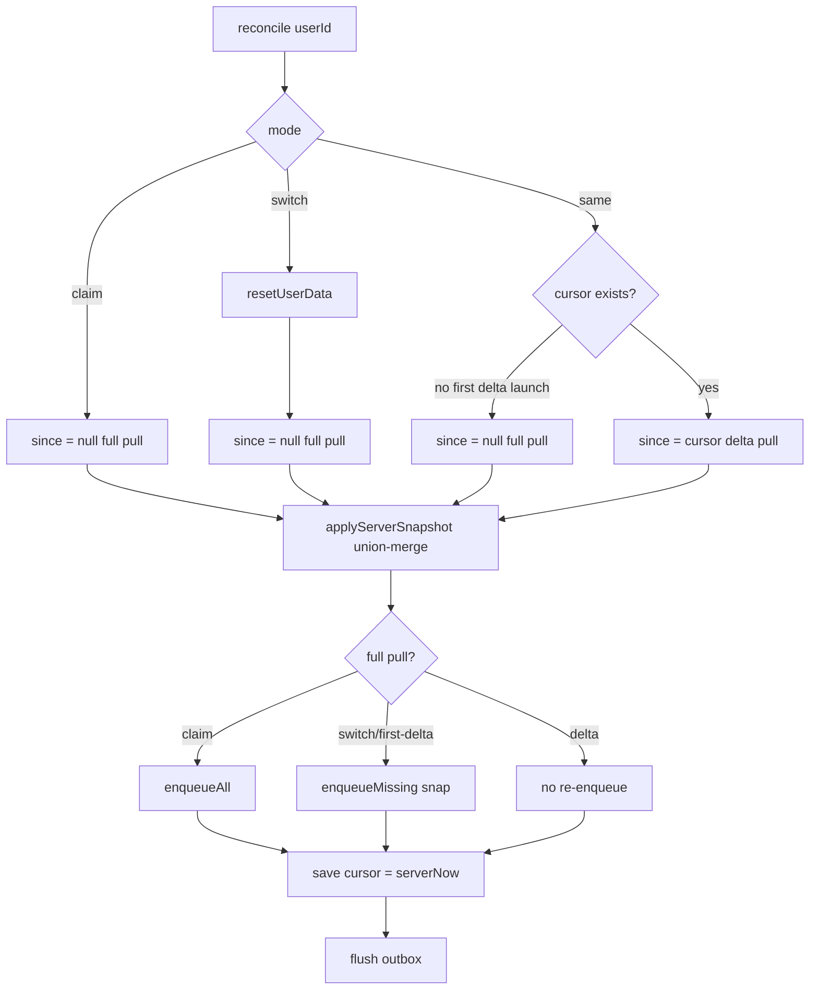

## Delta sync on login (incremental pull)

### Findings recap
- Full pull every time: `pullAll` in [meal-app/lib/sync/repository.ts](meal-app/lib/sync/repository.ts) does `.select('*').eq('user_id', ...)` on every table; the engine only stores `LAST_USER_KEY` (no timestamp). Needs fixing.
- Cache-first: already correct (persist hydration + tabs gate on hydration/auth, union-merge in `applyServerSnapshot`). No change.

### Model
Single-device high-water-mark: pull rows with `updated_at > cursor`, union-merge into local, advance the cursor to server time on success. No tombstones. Cross-device hard-delete propagation is explicitly out of scope (documented).

### Reconcile decision


### 1. Schema migration (new file `supabase/migrations/<ts>_delta_sync.sql`)
- Add `updated_at timestamptz not null default now()` + a `set_updated_at` BEFORE UPDATE trigger (function `public.set_updated_at()` already exists) to the delta-driving tables that lack it: `weight_logs`, `saved_recipes`, `kitchen_items`, `cart_items`.
- Add composite indexes `(user_id, updated_at)` on `meal_logs`, `weight_logs`, `saved_recipes`, `kitchen_items`, `cart_items`, `planned_ingredients`, and `(updated_at)` on `recipes` to keep filtered pulls fast.
- Add an RPC for skew-free cursors:

```sql
create or replace function public.server_now() returns timestamptz
  language sql stable as $$ select now(); $$;
grant execute on function public.server_now() to authenticated;
```

Child tables (`meal_log_ingredients`, `recipe_ingredients`, `recipe_steps`) need no `updated_at` — they are refetched for whichever changed parents come back in the delta.

### 2. Repository: `pullSince(userId, since)` in [meal-app/lib/sync/repository.ts](meal-app/lib/sync/repository.ts)
- Refactor `pullAll` to `pullSince(userId, since: string | null)`; keep `pullAll = pullSince(userId, null)`.
- When `since` is set, add `.gt('updated_at', since)` to `users`, `weight_logs`, `meal_logs`, `kitchen_items`, `cart_items`, `planned_ingredients`.
- Meals: children fetched by the returned changed meal ids (already the pattern), so unchanged meals aren't touched.
- Saved recipes/recipes pairing (a recipe's content can change without its `saved_recipes` row changing): collect affected recipe ids = union of `saved_recipes` changed-since `recipe_id` and user-owned `recipes` changed-since `id`; then fetch the `saved_recipes` rows, `recipes`, `recipe_ingredients`, `recipe_steps` for those ids and build `SavedRecipe`s. Empty delta -> empty arrays (union-merge keeps local).
- Add `serverNow(): Promise<string>` calling `supabase.rpc('server_now')`, falling back to `new Date().toISOString()` on error.

### 3. Engine cursor logic in [meal-app/lib/sync/engine.ts](meal-app/lib/sync/engine.ts)
- New key `sync:lastPulledAt:${userId}`.
- In `reconcile`: read cursor; compute `fullPull = mode !== 'same' || cursor === null`; `since = fullPull ? null : cursor`.
- Capture `const stamp = await serverNow()` BEFORE the pull; call `pullSince(userId, since)`.
- Keep the `claim` guard (`delete snap.profile; delete snap.goals`).
- After `applyServerSnapshot` + `rebaseline`: `enqueueAll()` for claim, `enqueueMissing(snap)` for other full pulls (switch / first-delta-launch), nothing for delta pulls. This gates the existing `enqueueMissing` (added previously) so it never re-uploads everything against a partial delta, and still handles the UUID-healing case on the first post-upgrade launch (no cursor yet -> full pull).
- On success, persist the cursor: `AsyncStorage.setItem(cursorKey(userId), stamp)` (rows written during the pull carry `updated_at > stamp` and are caught next round — no loss).

### 4. Docs
- Update [meal-app/supabase/README.md](meal-app/supabase/README.md): list the new migration and state the single-device delta model + that cross-device hard deletes are not yet propagated (would need `deleted_at` tombstones).

### Notes / caveats
- `applyServerSnapshot` already union-merges and never clears, so a partial delta merges cleanly; no store changes needed.
- You will need to run `supabase db push` for the new migration (the client filters/RPC assume the columns and `server_now()` exist; until pushed, the RPC call falls back to device time and the `updated_at` filters would error — so push before shipping).
- Multi-device delete propagation intentionally excluded per the single-device model.