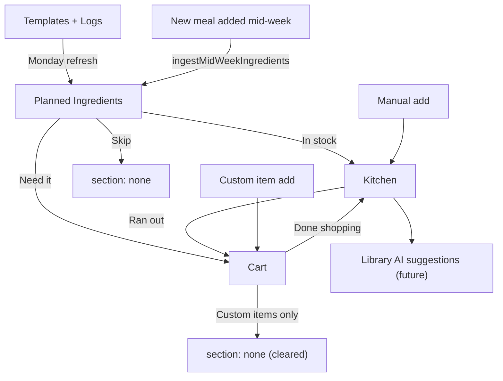

# Grocery Tab — Full Build Plan

## MVP Simplifications (vs spec)

- **AI categorization** replaced by keyword map in `constants/ingredientCategories.ts`. Covers common ingredients; AI can override later.
- **Shared ingredient entity** implemented as name-keyed state (normalized lowercase name as key). No app-wide refactor to ingredients registry.
- **Mid-week alerts** implemented as in-app badge on tab icon + dismissible banner inside the Grocery tab. `expo-notifications` deferred.
- **Onboarding walkthrough** implemented as a one-time dismissible tip banner, not a full overlay.

---

## Files to Create / Modify

- `constants/ingredientCategories.ts` — new: keyword-to-category map + classifier function
- `store/types.ts` — add `GroceryStore` type and extend `AppStore`
- `store/useMealStore.ts` — add grocery slice with all actions
- `app/(tabs)/grocery.tsx` — full rewrite
- `app/(tabs)/_layout.tsx` — add unsorted badge count to Grocery tab icon

---

## 1. Data Types (`store/types.ts`)

Add after existing interfaces:

```typescript
export type IngredientCategory =
  | 'Proteins'
  | 'Carbs & Grains'
  | 'Fruits & Vegetables'
  | 'Dairy'
  | 'Oils & Fats'
  | 'Spices & Seasonings'
  | 'Condiments'
  | 'Other';

export type GrocerySection = 'planned' | 'kitchen' | 'cart' | 'none';

export interface GroceryItem {
  key: string;           // normalized lowercase name (the shared key)
  name: string;          // display name (first occurrence wins)
  category: IngredientCategory;
  section: GrocerySection;
  isCustom?: boolean;    // true for manually added Cart items that don't move to Kitchen
  struckThrough?: boolean; // Cart only — user tapped to indicate bought
  mealNames?: string[];  // which meals use this ingredient (for Skip warning)
  updatedAt: string;     // ISO timestamp
}

export interface GroceryState {
  weekStart: string;                     // ISO of Monday that populated Planned
  items: Record<string, GroceryItem>;    // key = normalized name
  hasSeenTip: boolean;                   // dismisses the onboarding banner
  cartOldWeekItems: string[];            // keys of Cart items from last week pending keep/remove decision
}
```

Extend `AppStore` with grocery state + all actions:

```typescript
grocery: GroceryState;
refreshGroceryWeek:           (weekStart: string) => void;
sortIngredient:               (key: string, to: 'kitchen' | 'cart') => void;
skipIngredient:               (key: string) => void;
moveKitchenToCart:            (key: string) => void;
toggleCartStrikethrough:      (key: string) => void;
addManualCartItem:            (name: string) => void;
addManualKitchenItem:         (name: string) => void;
removeGroceryItem:            (key: string) => void;
doneShopping:                 () => void;
resolveOldCartItems:          (decisions: Record<string, 'keep' | 'remove'>) => void;
dismissGroceryTip:            () => void;
ingestMidWeekIngredients:     (ingredients: { name: string; mealName: string }[]) => void;
cleanupRemovedMealIngredients:(mealIngredientNames: string[], remainingMealNames: string[]) => void;
```

---

## 2. Category Classifier (`constants/ingredientCategories.ts`)

```typescript
const KEYWORD_MAP: Record<string, IngredientCategory> = {
  // Proteins
  chicken: 'Proteins', beef: 'Proteins', salmon: 'Proteins', tuna: 'Proteins',
  egg: 'Proteins', eggs: 'Proteins', tofu: 'Proteins', turkey: 'Proteins',
  'protein powder': 'Proteins', shrimp: 'Proteins', pork: 'Proteins',
  // Carbs & Grains
  rice: 'Carbs & Grains', oats: 'Carbs & Grains', pasta: 'Carbs & Grains',
  bread: 'Carbs & Grains', quinoa: 'Carbs & Grains', 'sweet potato': 'Carbs & Grains',
  potato: 'Carbs & Grains', 'rice cakes': 'Carbs & Grains', flour: 'Carbs & Grains',
  // Fruits & Vegetables
  banana: 'Fruits & Vegetables', spinach: 'Fruits & Vegetables', broccoli: 'Fruits & Vegetables',
  // Dairy
  'greek yogurt': 'Dairy', yogurt: 'Dairy', milk: 'Dairy', cheese: 'Dairy', butter: 'Dairy',
  // Oils & Fats
  'olive oil': 'Oils & Fats', 'coconut oil': 'Oils & Fats', oil: 'Oils & Fats',
  'peanut butter': 'Oils & Fats', almonds: 'Oils & Fats', avocado: 'Oils & Fats',
  // Spices & Seasonings
  salt: 'Spices & Seasonings', pepper: 'Spices & Seasonings', paprika: 'Spices & Seasonings',
  // Condiments
  'soy sauce': 'Condiments', ketchup: 'Condiments', mustard: 'Condiments',
};

export function classifyIngredient(name: string): IngredientCategory {
  const lower = name.trim().toLowerCase();
  return KEYWORD_MAP[lower] ?? 'Other';
}
```

---

## 3. Store Slice (`store/useMealStore.ts`)

Key logic for each action:

**`refreshGroceryWeek(weekStart)`**
- If `grocery.weekStart !== weekStart`: trigger old-cart-items popup by setting `cartOldWeekItems` to keys of all Cart items that are not `struckThrough`.
- Clear all `planned` items from `items`. Re-derive this week's ingredients from templates (7 days). For each normalized name: if already in `kitchen`, skip. If already in `cart`, skip. Otherwise add/update as `planned`.

**`sortIngredient(key, to)`**
- Move item from `planned` to `kitchen` or `cart`. If `to === 'kitchen'` and item already exists in kitchen, silently no-op.

**`skipIngredient(key)`**
- Called after user confirms Skip warning. Set `section: 'none'` (removed from view).

**`doneShopping()`**
- All `cart` items where `struckThrough === true` and `isCustom !== true` move to `kitchen`.
- Custom struck-through items: set `section: 'none'` (cleared, no persistence per spec).
- Non-struck-through Cart items remain in Cart.

**`ingestMidWeekIngredients(ingredients)`**
- For each ingredient: normalize name. If already in `kitchen`, skip. If already in `cart`, skip. If `section === 'none'` (was skipped), add back as `planned` (per spec: skip is not permanent). Otherwise add as `planned`.

**`cleanupRemovedMealIngredients(mealIngredientNames, remainingMealNames)`**
- For each name in `mealIngredientNames`: if ingredient is also used by any name in `remainingMealNames` (check other active meals), skip it. If in `planned`, set `section: 'none'` (auto-remove, no popup). If in `cart`, do nothing — caller handles the popup with `removeGroceryItem`.

---

## 4. Grocery Screen (`app/(tabs)/grocery.tsx`)

Full-screen layout, always shows all three sections even when empty.

```
SafeAreaView
  ─ Header: "Grocery" + week label
  ─ Tip Banner (dismissible, shown until hasSeenTip = true)
  ─ ScrollView
      ─ Section: Planned Ingredients
          ─ Badge: "X items to sort" or "All sorted"
          ─ Each item: name + meal tag + [In stock] [Need it] [Skip] buttons
          ─ Empty state: "Your plan's ingredients will appear here on Monday"
      ─ Section: Kitchen
          ─ Items grouped by category with section headers
          ─ Each item: name + [→ Cart] button (ran out)
          ─ [+ Add item] footer row with inline TextInput
          ─ Empty state: "Add what's in your kitchen"
      ─ Section: Cart
          ─ Each plan-derived item: name (tap = strikethrough)
          ─ Each custom item: name + "(custom)" label + tap = strikethrough
          ─ [+ Add custom item] footer row with inline TextInput
          ─ [Done shopping] button with hint "Tap when you're back from the store"
          ─ Empty state: "Your shopping list is empty"
  ─ Old-cart-items Modal (keep/remove popup for leftover last-week Cart items)
  ─ Skip-confirm Alert (confirms skip with meal name)
  ─ Remove-from-cart Alert (when meal removed from plan, shows affected Cart items with Keep option)
```

---

## 5. Tab Badge (`app/(tabs)/_layout.tsx`)

Add `tabBarBadge` to the Grocery tab driven by the count of `planned` items in grocery state:

```typescript
const plannedCount = useMealStore(s =>
  Object.values(s.grocery.items).filter(i => i.section === 'planned').length
);
// On Tabs.Screen for grocery:
tabBarBadge: plannedCount > 0 ? plannedCount : undefined,
```

---

## 6. Mid-week Trigger Point

When `addMealToDay` or `addTemplate` is called, the caller (EditMealScreen / ManualTab) should call `ingestMidWeekIngredients` with the new meal's ingredients. This is wired in `EditMealScreen.tsx` create mode and `MealDraftCard.tsx` after save.

---

## Data Flow Diagram

