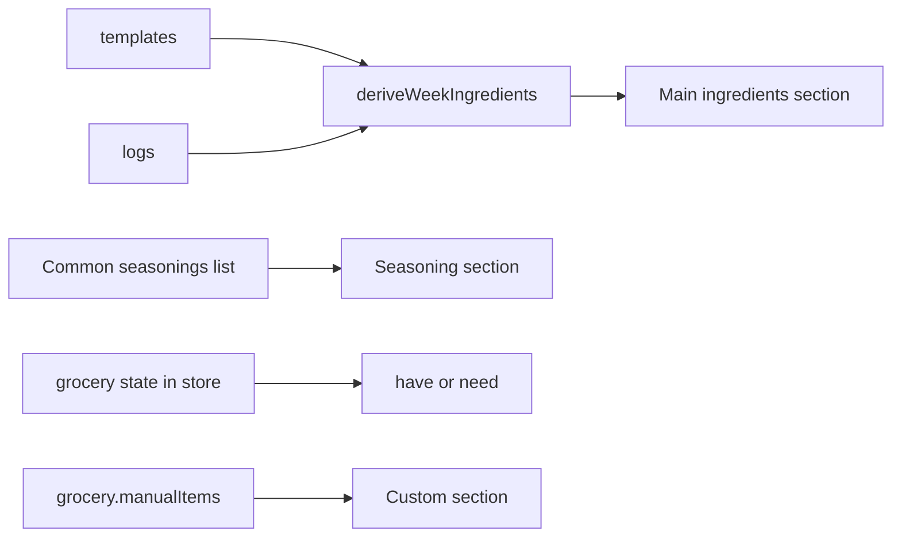

# Grocery Tab v1

## Scope

In: auto-derived weekly ingredients, have/need toggles, seasoning check, manual items, week auto-reset.
Out (v2+): budget, prices, weekly popup notification, recipe suggestions, sharing.

## Design Decisions Locked

- **Mental model**: unified checklist with have/need toggle on every row. "Need to buy" count at top.
- **Aggregation**: same-name ingredients summed across all of the week's meals (one row per ingredient, total quantity).
- **Week scope**: Monday to Sunday of the currently-viewed week. Auto-resets when Monday rolls over.
- **Seasoning section**: separate list of common seasonings (hardcoded). If a meal ingredient name matches a known seasoning, it's shown in the seasoning section only (not duplicated in main list).
- **Manual items**: persist for the current week, reset on Monday rollover.

## Data Flow



## Files to Change

- [meal-app/store/types.ts](meal-app/store/types.ts) — add `GroceryState` type and extend `AppStore`.
- [meal-app/store/useMealStore.ts](meal-app/store/useMealStore.ts) — add `grocery` slice with actions: `toggleIngredientStatus`, `toggleSeasoningStatus`, `addManualGroceryItem`, `removeManualGroceryItem`, `toggleManualItemStatus`, `resetGroceryWeek`. Auto-reset on week change via a derived `getCurrentGroceryWeek` helper.
- [meal-app/app/(tabs)/grocery.tsx](meal-app/app/(tabs)/grocery.tsx) — full rewrite from stub.
- [meal-app/constants/seasonings.ts](meal-app/constants/seasonings.ts) — new file with hardcoded common seasonings list.

## Store Shape Addition

```typescript
interface GroceryState {
  weekStart: string;                                    // ISO of current week's Monday
  ingredientStatus: Record<string, 'have' | 'need'>;    // key = lowercased ingredient name
  seasoningStatus: Record<string, 'have' | 'out'>;      // key = seasoning name
  manualItems: { id: string; name: string; status: 'have' | 'need' }[];
}
```

Default for any unseen ingredient: `'need'`.
Default for any seasoning not yet toggled: `'have'`.

## UI Structure (single screen)

```
HEADER
  "Grocery"
  "Week of May 18 – May 24"

SUMMARY PILL
  "Need to buy: 7 items"

SECTION: Ingredients (collapsible, default expanded)
  Each row: name, quantity (e.g. "450g"), have/need toggle button.
  Empty state: "No ingredients planned for this week."

SECTION: Seasonings (collapsible, default expanded)
  Each row: seasoning name, have/out toggle.
  Items marked "out" count toward "Need to buy".

SECTION: Custom items (collapsible, default collapsed if empty)
  Each row: name, have/need toggle, swipe-to-delete.
  Footer button: "+ Add item" → small inline input row.
```

## Derivation Logic

```typescript
function deriveWeekIngredients(
  weekStart: string,
  logs: Record<string, DailyLog>,
  templates: MealTemplate[],
): { name: string; totalQty: number; unit: string }[] {
  const days = Array.from({ length: 7 }, (_, i) => shiftIso(weekStart, i));
  const map = new Map<string, { name: string; totalQty: number; unit: string }>();

  days.forEach(iso => {
    const dayLog = logs[iso];
    const sourceMeals = dayLog
      ? dayLog.meals.map(m => m.ingredients)
      : templates.filter(t => isTemplateApplicableOnDate(t, iso)).map(t => t.ingredients);
    sourceMeals.flat().forEach(ing => {
      const key = ing.name.trim().toLowerCase();
      if (COMMON_SEASONINGS_LOWER.has(key)) return;          // skip seasonings
      if (!map.has(key)) map.set(key, { name: ing.name, totalQty: 0, unit: ing.unit });
      map.get(key)!.totalQty += ing.quantity;
    });
  });

  return Array.from(map.values()).sort((a, b) => a.name.localeCompare(b.name));
}
```

## Auto-Reset on Week Change

When the screen mounts (or app foregrounds), check if `grocery.weekStart` is the current Monday's ISO. If not, dispatch `resetGroceryWeek(currentMonday)` which clears `ingredientStatus`, resets `seasoningStatus` to all `'have'`, and clears `manualItems`.

## Persistence

All grocery state is part of the existing zustand persist slice (`meal-app-store-v2`). No migration needed since adding new optional fields.