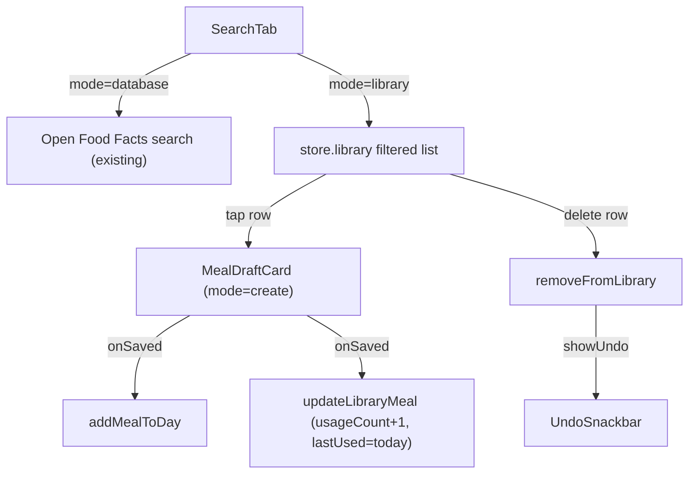

# Library in Search Tab

## Concept

The Search tab inside `AddMealScreen` gets a **Database | Library** segmented toggle at the top. Switching to Library shows the user's personal saved meals. No new bottom tab is needed; the existing `library.tsx` stub can stay as a placeholder.

```
AddMealScreen → Search tab
┌─────────────────────────────┐
│  [ Database  |  Library  ]  │  ← new toggle
├─────────────────────────────┤
│  Database mode (existing):  │
│  [🔍 Search foods...     ]  │
│  Banana         89 kcal/100g│
│  Apple          52 kcal/100g│
│  ...                        │
├─────────────────────────────┤
│  Library mode (new):        │
│  [🔍 Filter saved meals...] │
│  Chicken stir-fry           │
│  520 kcal · 42P 55C 8F      │
│  Used 3×  ·  2 days ago   ✕ │← swipe or ✕ to delete
│  ...                        │
└─────────────────────────────┘
          ↕ tap row
  MealDraftCard overlay (mode="create", date=today, initial=savedMeal)
```

## Data flow



## Files changed

- [`components/addMeal/SearchTab.tsx`](meal-app/components/addMeal/SearchTab.tsx) — add `Database | Library` toggle; Library mode renders saved meals list with filter, delete, and tap-to-reuse
- [`store/types.ts`](meal-app/store/types.ts) — add `updateLibraryMeal: (meal: SavedMeal) => void` to `AppStore`
- [`store/useMealStore.ts`](meal-app/store/useMealStore.ts) — implement `updateLibraryMeal`
- [`app/(tabs)/library.tsx`](meal-app/app/(tabs)/library.tsx) — minimal update (redirect message or leave stub)

## Key decisions

- **Toggle position**: segmented control at the very top of `SearchTab`, above the search input. Active mode = `'database' | 'library'` local state, defaults to `'database'` so existing behavior is unchanged on open.
- **Reuse flow**: tap → `MealDraftCard` directly (fastest path, same as `ManualTab`). `onDraftReady` callback already exists on `SearchTab` — reuse it for library rows too.
- **Delete**: ✕ button on the right of each library row (simpler than swipe; consistent with `DayDetailModal` meal rows). Undo via `showUndo`.
- **Filter**: debounced `TextInput` (same 350ms pattern as current database search). Filters `name` case-insensitively.
- **usageCount**: on `onSaved` (after `MealDraftCard` saves), call `updateLibraryMeal` with `usageCount + 1` and `lastUsed = toIsoDate(new Date())`.
- **Store action**: `updateLibraryMeal` is a simple map — avoids the remove+re-add pattern and keeps list order stable.

## Store addition (minimal)

```ts
// store/types.ts — AppStore interface
updateLibraryMeal: (meal: SavedMeal) => void;

// store/useMealStore.ts
updateLibraryMeal: meal =>
  set(state => ({
    library: state.library.map(m => m.id === meal.id ? meal : m),
  })),
```
