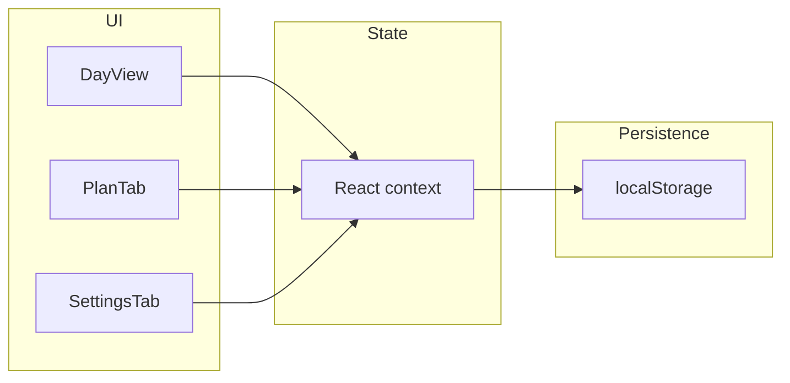

# Meal Plan Adherence Tracker — implementation plan

## Context

Your workspace ([`/Users/alex/Documents/Projects/Cursor Files`](/Users/alex/Documents/Projects/Cursor%20Files)) has no existing app files, so this is a **from-scratch** SPA. The plan below matches your described UX and constraints.

## Recommended stack

- **Vite + React + TypeScript** — fast dev, simple deploy as static files.
- **Tailwind CSS** — quick layout for minimal dashboard, rings/bars, cards.
- **localStorage** — single JSON blob (version key + migrations) for offline persistence; no backend.

If you prefer **Next.js** or **vanilla HTML/JS**, the data model and UI breakdown stay the same; only project scaffolding changes.

## Data model (single source of truth)

Persist one structured object, e.g. `mealTracker.v1`:

- **`macroGoals`**: target calories, protein (g), carbs (g), fats (g), daily water (cups).
- **`templates`**: `{ weekday: Meal[], weekend: Meal[] }` where each **Meal** has `id`, `label` (e.g. “Breakfast”), optional **`scheduledTime`** (`HH:mm` — drives red “missed” state), and **`items`** (foods with per-item macros).
- **`dailyLog`**: map `YYYY-MM-DD` → `{ mealChecks: Record<mealId, boolean>, waterCups: number }`.
  - **Meal IDs**: derive stable IDs from template + index (or UUID when user adds a meal) so checkboxes survive edits carefully — document rule: changing template applies **from tomorrow** or **explicit reset** to avoid corrupting history (simplest v1: template edits affect **future days only**; past days keep snapshot — optional v2).

**Streak**: define precisely as *consecutive calendar days (ending today or yesterday?) where every meal scheduled for that day was checked by end of day*. Implement “ending today” for UX: if today incomplete, streak counts through **last fully compliant day**. Edge cases: empty plan → streak 0 or N/A; document in UI copy.

**Week dots (consistency)**: last 7 days relative to viewed day — each dot = fraction of planned meals checked that day (or binary “perfect day”) — your copy says “consistency at a glance”; **fraction filled** or **color intensity** works well.

## Feature wiring

| Feature | Behavior |
|--------|----------|
| **Day view** | Single column: header (date, streak), summary ring/bar vs goals, week dots, meal list, water row. |
| **Navigate days** | Prev/next arrows + **touch swipe** (`pointer` events or a tiny swipe helper) on main panel. |
| **Meal cards** | Collapsed: name, time, macro strip, check circle. Expanded: food rows + subtotal; totals contribute to **daily** sums (sum checked meals only, or all planned — **checked-only** matches “adherence”). |
| **Missed highlight** | If `now > scheduledTime` on viewed day (today only, or past days treat as end-of-day) and meal unchecked → **red border/label**. |
| **Water** | Horizontal dots or segmented control; tap sets cups up to goal; persist in `dailyLog`. |
| **Plan tab** | Toggle weekday/weekend; list meals; add/remove/reorder; edit foods/macros; set meal times. |
| **Settings tab** | Numeric inputs for macro + water goals. |
| **Template choice per day** | Default: Mon–Fri → weekday, Sat–Sun → weekend (timezone-aware via `Intl` / local date). |

## UI composition (minimal dashboard)

- **Top**: macro summary — **ring** (calories vs goal) or **stacked bar** (P/C/F) + optional small goal chips; keep one focal graphic to avoid clutter.
- **Below**: scrollable meal cards; sticky mini header optional on mobile.

Light mode only: neutral background, one accent for checks/streak, red only for missed.

## Persistence & safety

- Load on mount; debounced save (e.g. 300ms) on state change.
- **Schema version** field; migration function if you add fields later.
- Optional **Export / Import JSON** in Settings (low effort, high escape hatch) — nice-to-have after core works.

## Testing & manual QA

- Change system date edge cases (month rollover) — use pure date strings `YYYY-MM-DD` in local TZ.
- First-time empty plan → friendly empty states on Today + Plan.

## Deliverables (file-level sketch)

New project root (example):

- [`package.json`](package.json), [`vite.config.ts`](vite.config.ts), [`tailwind.config.js`](tailwind.config.js), [`index.html`](index.html)
- [`src/main.tsx`](src/main.tsx), [`src/App.tsx`](src/App.tsx)
- [`src/storage.ts`](src/storage.ts) — load/save, versioning
- [`src/state.tsx`](src/state.tsx) or hooks — reducer/context for log + templates + goals
- [`src/domain/streak.ts`](src/domain/streak.ts), [`src/domain/dailyTotals.ts`](src/domain/dailyTotals.ts), [`src/domain/templates.ts`](src/domain/templates.ts) — pure functions (easier to test)
- [`src/components/DayView.tsx`](src/components/DayView.tsx), [`MealCard.tsx`](src/components/MealCard.tsx), [`WeekDots.tsx`](src/components/WeekDots.tsx), [`WaterTracker.tsx`](src/components/WaterTracker.tsx), [`PlanEditor.tsx`](src/components/PlanEditor.tsx), [`SettingsPanel.tsx`](src/components/SettingsPanel.tsx), [`BottomTabs.tsx`](src/components/BottomTabs.tsx)

No README unless you ask (per your preference to avoid unsolicited markdown).

## Architecture sketch

