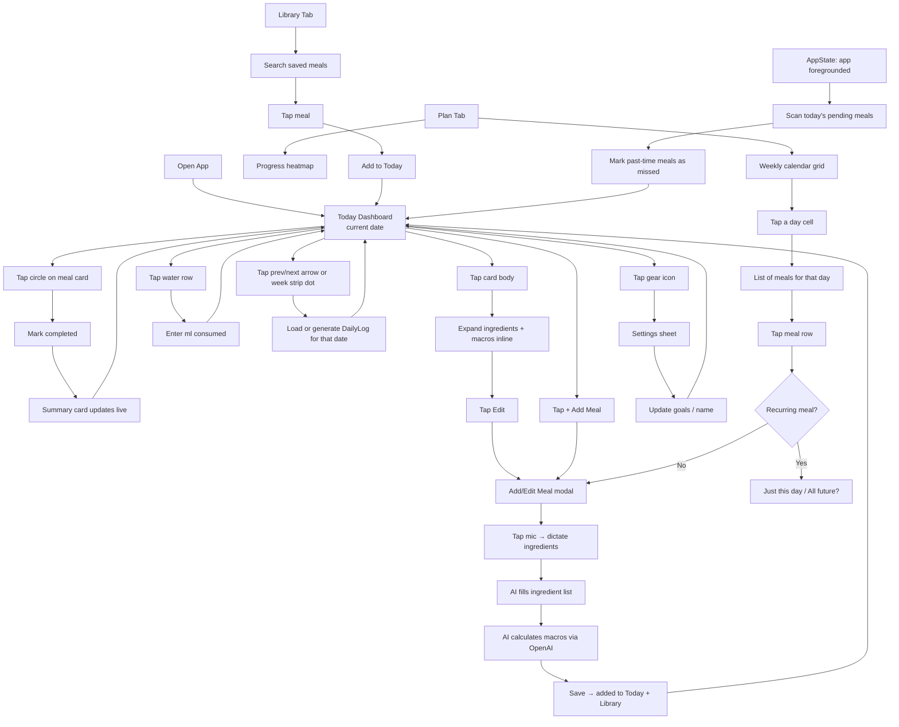

# Meal & Nutrition Tracking App — Full Product & Architecture Plan

## Product Summary

A personal mobile app for daily meal planning and nutrition tracking. The core daily loop: open the app → see today's scheduled meals → mark meals eaten → watch macros update live → build a streak over time. Dark, minimal, fast. Designed to feel habitual, not clinical.

---

## Current State (Already Built)

- Expo Router, 2 tabs (`index.tsx`, `explore.tsx`)
- `index.tsx`: dashboard with 4 mock meals, tap-to-complete, live macro totals derived from completed meals
- Installed: `react-native-reanimated`, `react-native-gesture-handler`, `react-native-safe-area-context`, `expo-haptics`
- No persistence, no real store, no navigation beyond tabs

---

## All Confirmed Decisions

| Topic | Decision |
|---|---|
| Calorie progress | Consumed (completed meals) vs goal only |
| Macro display | Progress bars/rings showing actual vs goal |
| Water logging | Tap row → manual ml input |
| Meal completion | Circle toggles complete; card body tap opens detail |
| Meal sort | Always auto-sorted by scheduled time |
| Meal card default | Collapsed; tap to expand ingredients + full macros |
| Day navigation | Prev/next arrows only (no swipe gesture) |
| Add meal from Today | Always today only (one-off) |
| Macro entry | Manual top-level OR auto-calculated from ingredients |
| Ingredient entry | Free-text, AI calculates macros via OpenAI |
| Voice entry | Tap mic button (no hold), dictate, AI parses ingredients + macros |
| Quick-add meals | From Meal Library (saved/previously created meals) |
| Plan tab layout | Weekly calendar grid — tap a day to view/edit |
| Plan progress | Heatmap shown at top of Plan tab, labeled "Progress" |
| Plan label on dashboard | "[Name]'s [Weekday] Plan" |
| Template edit propagation | App asks: "Update just this day?" or "All future instances?" |
| Missed meals | Auto-flagged when time passes; user can still complete them after |
| Streak reset | Resets to 0 on a fully missed day |
| Heatmap metric | % of planned meals completed per day |
| AI macro calc | OpenAI API from ingredient names + quantities |
| AI meal alternatives | AI suggests swaps based on similar macros |
| Bottom tabs | 4 tabs: Today / Plan / Grocery / Library |
| Settings location | Gear/hamburger icon in the app header (not a tab) |
| Color scheme | Dark, charcoal (not pure black — match reference image tone) |
| Platform | iOS + Android; developer tests on iOS |
| Grocery list | Own tab, auto-generated from current week's planned meals |
| Grocery — pantry | Phase 6: pantry awareness, diff against stock, manual add/remove |
| Library sort | Most frequently used (by use count) |
| Week strip | Current week only, no scroll — arrows move one day at a time |
| App opens to | Always Today, current date |
| User accounts | Single-user for now (name in Settings); auth added later |
| Onboarding | Deferred to a later phase |
| Notifications | Global on/off toggle; one per scheduled meal time |

---

## All Screens

### 1. Today (Dashboard) — `app/(tabs)/index.tsx`

**Header row:**
- App name / greeting label: "[Name]'s [Weekday] Plan"
- Streak badge: e.g. "🔥 5 day streak"
- Gear icon → opens Settings sheet

**Week strip:**
- Mon–Sun dots; current day highlighted; tapping any dot jumps to that date

**Date row:**
- `← Today, May 6 →` with prev/next arrows; any past or future date is navigable

**Summary card:**
- Calories: large consumed number / goal, with a progress bar
- Macro progress bars (or rings): Protein / Carbs / Fats / Water — each shows `Xg / goalg` with a filled bar
- "Show more" chevron reveals extended nutrients (fiber, sodium, potassium) — collapsed by default

**Water row:**
- Tap anywhere on it → opens a number input sheet to log ml for the day

**Meal list:**
- Section header: "MEALS" with "+ Add Meal" button on the right
- Each card (collapsed by default):
  - Circle (completion toggle) · Meal name · Time · Calories
  - "missed" badge if auto-flagged
  - Tap card body → expands to show ingredients list + macro breakdown
  - Completed: green left border, strikethrough name, checkmark in circle
  - Missed: red left border, red "missed" pill, still tappable to complete

---

### 2. Plan — `app/(tabs)/plan.tsx`

**Progress section (top):**
- Label: "Progress"
- GitHub-style heatmap calendar (past 6 months)
- Shade = % of planned meals completed that day
- Streak summary: current streak, best streak

**Weekly calendar grid (below Progress):**
- 7 columns (Mon–Sun), current week shown by default
- Each cell shows the number of meals scheduled that day
- Tap a day cell → expands list of meals for that day
- Each meal row shows: name, time, and recurrence label
- Tap a meal row → opens Add/Edit Meal modal
- "+ Add" button per day
- Swipe left on a meal → delete with confirmation

---

### 3. Grocery — `app/(tabs)/grocery.tsx`

- Auto-generated from all meal templates scheduled for the **current calendar week (Mon–Sun)**
- Flat list for Phase 3; grouped by category in a later phase
- Each item shows: ingredient name, total quantity needed, and which meal(s) it belongs to
- Tap an item to check it off (in-basket / purchased)
- "Refresh" regenerates the list from current week's templates
- **Phase 6 — Pantry awareness:**
  - User maintains a pantry list (fridge + shelf items)
  - Grocery list diffs against pantry: only shows items not already in stock
  - User can mark pantry items as used up or restock them
  - Grocery suggestions are filtered accordingly

---

### 4. Library — `app/(tabs)/library.tsx`

- Saved Meal Library: every meal ever created is saved here
- Default sort: **most frequently used** (use count tracked per meal)
- Search bar at top
- Each row: meal name, calorie count, macro summary, use count
- Tap → opens meal detail (view + edit + delete)
- "Add to Today" button on each card for quick-log
- Future: favourite meals, AI-generated alternatives

---

### 5. Add / Edit Meal Modal — `app/meal/[id].tsx`

- Slides up as a modal stack screen
- Fields:
  - Meal name (text input)
  - Scheduled time (time picker)
  - Calories (number input — optional if using ingredient calculation)
  - Protein / Carbs / Fats (manual number inputs)
- Ingredients section:
  - Free-text list (add one at a time: "200g chicken breast")
  - Mic button → tap to start voice dictation → AI fills ingredients list
  - "Calculate macros with AI" button → sends ingredient list to OpenAI → fills macro fields
- Recurrence: this modal is for today-only adds; recurrence is managed in the Plan tab
- Save / Delete buttons
- Saved meal is also added to Meal Library automatically

---

### 6. Meal Detail View — expandable within card

- Not a separate screen — expands inline on the Today card
- Shows: full ingredient list with quantities, per-macro breakdown, scheduled time
- "Edit" button in expanded state → opens Edit Meal modal

---

### 7. Settings Sheet — `app/settings.tsx`

- Accessible via gear icon in the header (slides up as modal)
- Display name (used in plan label)
- Daily calorie goal
- Macro targets (protein g, carbs g, fats g, water ml)
- Extended nutrients: toggle fiber / sodium / potassium visibility
- Notifications: global on/off toggle
- Future: theme toggle, account/auth

---

## Core User Flows



---

## Core Data Models

### `RecurrenceRule`
```typescript
type DayOfWeek = 'mon' | 'tue' | 'wed' | 'thu' | 'fri' | 'sat' | 'sun';

type RecurrenceRule =
  | { type: 'once';   date: string }
  | { type: 'daily' }
  | { type: 'weekly'; days: DayOfWeek[] }
```

### `MealTemplate`
Lives in the Plan. The canonical definition of a repeating meal.
```typescript
interface MealTemplate {
  id: string;
  name: string;
  time: string;             // "07:30" 24h
  calories: number;
  ingredients: Ingredient[];
  macros: {
    protein: number;
    carbs: number;
    fats: number;
  };
  recurrence: RecurrenceRule;
  savedToLibrary: boolean;
}
```

### `Ingredient`
```typescript
interface Ingredient {
  id: string;
  name: string;
  quantity: number;
  unit: string;             // "g" | "ml" | "cup" | "piece"
  macros?: {                // populated by AI calc
    protein: number;
    carbs: number;
    fats: number;
    calories: number;
    fiber?: number;
    sodium?: number;
    potassium?: number;
  };
}
```

### `MealEntry`
A snapshot of a meal on a specific day. Decoupled from its template so past days never change.
```typescript
interface MealEntry {
  id: string;
  templateId?: string;      // link to source template if generated from one
  name: string;
  time: string;
  calories: number;
  ingredients: Ingredient[];
  macros: { protein: number; carbs: number; fats: number; };
  status: 'pending' | 'completed' | 'missed';
}
```

### `DailyLog`
```typescript
interface DailyLog {
  date: string;             // "2026-05-06" ISO date, used as store key
  meals: MealEntry[];
  waterMl: number;
}
```

### `SavedMeal`
Entry in the Meal Library.
```typescript
interface SavedMeal {
  id: string;
  name: string;
  calories: number;
  ingredients: Ingredient[];
  macros: { protein: number; carbs: number; fats: number; };
  lastUsed: string;         // ISO date
}
```

### `UserGoals`
```typescript
interface UserGoals {
  displayName: string;
  dailyCalories: number;
  protein: number;          // g
  carbs: number;            // g
  fats: number;             // g
  waterMl: number;
  extendedTargets: {
    fiber?: number;
    sodium?: number;
    potassium?: number;
  };
  visibleNutrients: Array<'fiber' | 'sodium' | 'potassium'>;
  notificationsEnabled: boolean;
}
```

### `AppStore` (Zustand)
```typescript
interface AppStore {
  logs:       Record<string, DailyLog>;
  templates:  MealTemplate[];
  library:    SavedMeal[];
  goals:      UserGoals;
  streak:     number;

  // Daily actions
  toggleMealStatus: (date: string, mealId: string) => void;
  markMealMissed:   (date: string, mealId: string) => void;
  logWater:         (date: string, ml: number) => void;
  addMealToDay:     (date: string, entry: MealEntry) => void;
  removeMealFromDay:(date: string, mealId: string) => void;
  editMealOnDay:    (date: string, entry: MealEntry) => void;

  // Plan / template actions
  addTemplate:    (t: MealTemplate) => void;
  updateTemplate: (t: MealTemplate, applyToFuture: boolean) => void;
  removeTemplate: (id: string) => void;
  resolveDayFromTemplates: (date: string) => void;

  // Library
  saveToLibrary:      (meal: SavedMeal) => void;
  removeFromLibrary:  (id: string) => void;

  // Settings
  updateGoals: (goals: UserGoals) => void;
  recalcStreak: () => void;
}
```

---

## Key UI Behaviours

- **Summary card** — calories and macros derive only from `completed` meals. Each shows a filled progress bar (e.g. `48g / 165g`) so the user always sees both consumed and goal.
- **Card expansion** — meal cards are collapsed by default (name + time + calories + status only). Tapping the card body toggles an inline expansion showing the ingredient list and individual macro bars. Circle always stays outside the expansion zone.
- **Auto-missed** — on every `AppState` change to `active` (app foreground), the store scans today's `pending` meals whose `time` is in the past and sets their `status` to `missed`. Missed meals can still be tapped to `completed`.
- **Day resolution** — when a date is navigated to that has no `DailyLog` yet, `resolveDayFromTemplates` runs: it checks which templates' recurrence rules match that date and creates `MealEntry` snapshots for each.
- **Plan label** — dashboard reads `[goals.displayName]'s [currentDayName] Plan` (e.g. "Alex's Wednesday Plan").
- **Template edit propagation** — when editing a recurring template, a bottom sheet asks "Update just [date]?" / "Update all future dates?". Choosing a single date creates a one-off override `MealEntry` for that day; choosing future updates the template and reruns `resolveDayFromTemplates` for unmodified future days.
- **Streak** — on app open, counts consecutive calendar days (going backwards from yesterday) where `DailyLog.meals` has at least 1 `completed` entry.
- **Heatmap shade** — for each day cell: `completedMeals / totalMeals` → maps to 4 shade levels (0%, 1–33%, 34–66%, 67–100%). Empty days with no meals planned show as neutral/empty.
- **Grocery list** — generated by collecting all `Ingredient` entries from templates whose recurrence matches the next 7 days, deduped by ingredient name.
- **AI macro calculation** — "Calculate macros with AI" button posts the ingredient list as a prompt to OpenAI. Response is structured JSON mapping each ingredient to protein/carbs/fats/calories. These values populate the form fields and are stored per-ingredient.
- **Voice entry** — tapping the mic button opens the device microphone (using `expo-av` or `expo-speech`). After the user taps stop, the transcript is sent to OpenAI which parses it into a structured ingredient list and fills the form.
- **Extended nutrients** — hidden behind a "Show more" chevron below the main macro row. Toggling visibility persists to `UserGoals.visibleNutrients`.
- **Week strip** — shows current calendar week only (Mon–Sun). The strip does not scroll. Prev/next arrows move one day at a time; the highlighted dot follows the current date. The strip always shows the week containing the currently viewed day.
- **Color scheme** — dark charcoal background (approx `#1C1C1E` / `#2C2C2E`), not pure black. White and light-gray text. Accent: green for completed, red for missed, blue for primary actions.

---

## Recommended File Structure

```
app/
  _layout.tsx                    ← root stack
  settings.tsx                   ← Settings modal screen
  (tabs)/
    _layout.tsx                  ← tab bar: Today | Plan | Grocery | Library
    index.tsx                    ← Today dashboard
    plan.tsx                     ← Plan (progress + weekly calendar)
    grocery.tsx                  ← Grocery list
    library.tsx                  ← Meal Library
  meal/
    [id].tsx                     ← Add / Edit Meal modal

store/
  useMealStore.ts                ← Zustand store (all state + actions)
  types.ts                       ← All shared TypeScript interfaces

components/
  MealCard.tsx                   ← Expandable meal card
  MacroPill.tsx                  ← Coloured macro label
  MacroBar.tsx                   ← Labelled progress bar (actual / goal)
  SummaryCard.tsx                ← Calories + macro bars block
  WeekStrip.tsx                  ← Mon–Sun day selector
  WaterRow.tsx                   ← Water ml progress + tap-to-log
  NutrientExpander.tsx           ← Expandable extended nutrients section
  HeatmapCalendar.tsx            ← Adherence grid
  WeekCalendarGrid.tsx           ← Plan tab week grid

constants/
  theme.ts                       ← Colours, spacing, typography
```

---

## AI Integration Points

| Feature | Trigger | API call | Output |
|---|---|---|---|
| Macro auto-calc | Tap "Calculate macros" in meal form | OpenAI: ingredient list → JSON macros | Fills protein/carbs/fats/calories fields |
| Voice ingredient entry | Tap mic, speak, tap stop | OpenAI: transcript → structured ingredient list | Populates ingredient rows in form |
| Meal alternative suggestions | Tap "Suggest swap" on a meal card | OpenAI: meal macros + preferences → alternative meal | Shows suggested meal with option to add to today |

---

## State Management

**Zustand + `persist` middleware → AsyncStorage**

- One store file (`useMealStore.ts`) holds all state
- `persist` from `zustand/middleware` auto-syncs to AsyncStorage on every write
- All screens and components read via selectors — no prop drilling
- `zustand` is the only new package needed for state (already has `react-native-async-storage` available via Expo)

---

## Build Phases

### Phase 1 — Foundation
1. Refactor folder structure; extract `MealCard`, `MacroPill` to `/components`
2. Swap `SafeAreaView` to `react-native-safe-area-context`; apply dark charcoal theme
3. Install Zustand; create `store/types.ts` and `store/useMealStore.ts` with persist middleware
4. Seed store with current mock data; remove all `useState` from `index.tsx`
5. Redesign tab bar: Today / Plan / Grocery / Library
6. Add gear icon to dashboard header → opens Settings modal
7. Week strip + prev/next day navigation; `resolveDayFromTemplates` runs on date change

### Phase 2 — Core Daily Interactions
8. Summary card with calorie + macro progress bars
9. Meal card inline expand/collapse
10. Add/Edit Meal modal (manual macro entry, free-text ingredients)
11. Water ml logging (tap row → input sheet)
12. Auto-missed detection via `AppState` listener

### Phase 3 — Plan, Grocery & Library
13. Plan tab: progress heatmap at top + weekly calendar grid
14. Template recurrence system; edit propagation prompt
15. Grocery tab: auto-generated from templates for next 7 days
16. Library tab: saved meals, search, quick-add to Today
17. Settings modal: name, goals, visible nutrients, notifications toggle

### Phase 4 — Streak & Extended Nutrients
18. Streak calculation from daily logs
19. Expandable extended nutrients section on dashboard (fiber, sodium, potassium)

### Phase 5 — AI Features
20. OpenAI macro auto-calculation from ingredient list
21. Voice entry: mic tap → transcript → OpenAI parse → fill form
22. AI meal swap suggestions

### Phase 6 — Notifications
23. `expo-notifications`: schedule a notification per meal time based on templates
24. Global on/off toggle in Settings

### Phase 7 — Auth & Onboarding
25. User onboarding flow (name, calorie goal, macro targets)
26. Authentication + user accounts (1 user per account)
