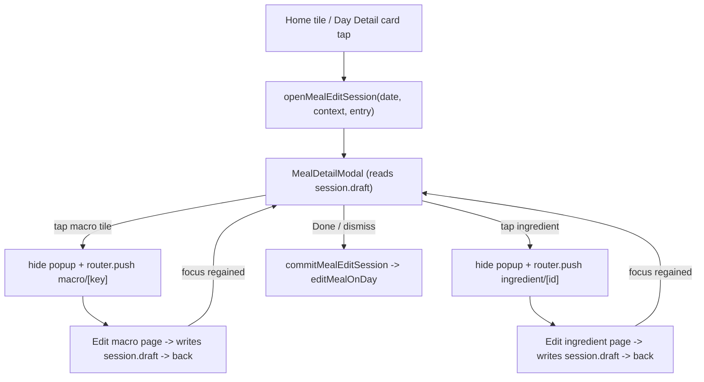

## Key decisions (confirmed)
- Meal-level macros are independent, editable values (with a sync-calories prompt); ingredients store their own nutrition. No auto-summing.
- Build full secondary-nutrient support: a Profile picker, optional targets, per-meal/per-ingredient values.
- Tapping a Day Detail meal card body (not Swap/X) opens the popup; the simplified Edit Meal form is used only by the Manual create tab.

## Architecture: popup + edit-routes + session
RN `<Modal>` popups render above pushed routes, so the macro/ingredient edit pages (full-screen routes) require dismissing the popup first, then re-showing on return. A shared Zustand `mealEditSession` holds the working draft so the popup and edit routes operate on the same data.

## 1. Data model and store
[store/types.ts](meal-app/store/types.ts):
- Add `NutrientKey = 'fiber' | 'sugar' | 'sodium' | 'potassium' | 'cholesterol' | 'saturatedFat'`.
- `Ingredient`: add optional `calories?`, `macros?: Macros`, `servings?: number`, `nutrients?: Partial<Record<NutrientKey, number>>` (keep `quantity`/`unit`).
- `MealEntry`: add `servings?: number`, `nutrients?: Partial<Record<NutrientKey, number>>`.
- `UserGoals`: add `secondaryTargets?: Partial<Record<NutrientKey, number>>`.
- `UserProfile`: add `trackedNutrients?: NutrientKey[]`.
- `AppStore`: add `mealEditSession: MealEditSession | null` and actions `openMealEditSession`, `updateMealDraft(patch)`, `updateDraftIngredient(id, patch)`, `removeDraftIngredient(id)`, `commitMealEditSession`, `closeMealEditSession`.

[store/useMealStore.ts](meal-app/store/useMealStore.ts): implement the session actions (commit calls existing `editMealOnDay`); default `trackedNutrients` (e.g. fiber/sugar/sodium); add `merge` fallbacks for `trackedNutrients`, `goals.secondaryTargets`, and `mealEditSession: null`.

New [constants/nutrients.ts](meal-app/constants/nutrients.ts): `NUTRIENT_META` mapping each key to a label and unit (g/mg), plus the selectable list.

## 2. Progress ring
Add `react-native-svg` via `npx expo install react-native-svg`. New [components/ProgressRing.tsx](meal-app/components/ProgressRing.tsx): SVG arc showing value vs remaining target (used by the macro edit page). Hidden when no target.

## 3. Meal rating util
New [utils/mealRating.ts](meal-app/utils/mealRating.ts): `rateMeal({ calories, macros }, goals)` returning `{ label, color }`, generalized from `rateForGoals` in [components/addMeal/ScanTab.tsx](meal-app/components/addMeal/ScanTab.tsx). Used for the popup health badge (optionally refactor ScanTab to reuse it).

## 4. Shared meal form
New [components/MealForm.tsx](meal-app/components/MealForm.tsx): name, time (iOS spinner via existing `@react-native-community/datetimepicker`), calories, P/C/F, ingredients (name/quantity/unit, remove, + add). Props for initial values and `onSubmit`. Extracted from the current [components/EditMealScreen.tsx](meal-app/components/EditMealScreen.tsx) form body.

## 5. Simplify Edit Meal (Section 1)
Rewrite [components/EditMealScreen.tsx](meal-app/components/EditMealScreen.tsx) as a thin modal (Cancel/Save header) wrapping `MealForm`. Remove the Edit/AI tab switcher, AI Adjust pane, "Repeat this meal" recurrence toggle, and "Save to library" toggle.

## 6. Manual tab pure-manual (Section 2)
Rewrite [components/addMeal/ManualTab.tsx](meal-app/components/addMeal/ManualTab.tsx) to render `MealForm` inline (empty). On save: `addMealToDay(today, entry)` + `ensureRecipeSaved({ ...entry, source: 'manual' })` so it lands in Recently Added, then `onCreated()`.

## 7. AI describe tab (Section 3)
Rewrite [components/addMeal/AITab.tsx](meal-app/components/addMeal/AITab.tsx): top live nutrition card (cal/P/C/F starting 0), estimated-ingredients list (empty), text+voice input (keep `expo-av` transcription), submit/estimate button (shell via existing `aiClient`), conversational refine loop, non-editable card/ingredients, bottom Log button -> `addMealToDay(today, draft, adhoc)` then return Home. Update [components/addMeal/AddMealScreen.tsx](meal-app/components/addMeal/AddMealScreen.tsx) so the AI tab self-logs (drop the `MealDraftCard` path for source `ai`; keep it for scan).

## 8. Universal meal detail popup (Sections 5, 8)
New [components/MealDetailModal.tsx](meal-app/components/MealDetailModal.tsx) - centered floating card over a dimmed backdrop (model styling on the orphaned [components/DayDetailModal.tsx](meal-app/components/DayDetailModal.tsx)), driven by `mealEditSession.draft`. Contents:
- Bookmark (top-left, filled when a matching `SavedRecipe.favourited`; toggles via `toggleFavouriteRecipe`/`removeSavedRecipe`).
- Trash (top-right): home context -> confirm + `removeMealFromDay`; plan context -> confirm to empty slot for that day (+ option to Swap via `setPendingSwap`).
- Time tag (tap -> spinner), name (tap -> inline edit), serving counter (+/-) that scales calories, macros, nutrients, and ingredient values proportionally.
- Health badge via `rateMeal`; muted "Added" tag only in home context when `isAdHoc`.
- Swipeable macro pager: page 1 = Calories (large) + P/C/F; page 2 = tracked secondary nutrients; page dots. Each tile tap hides popup and pushes the macro edit route.
- Ingredient rows (name, calories, portion); each tap hides popup and pushes the ingredient edit route.
- Bottom Fix Issue (in-popup state transition to a correction text input -> shell re-evaluate -> back) and Done (commit + close).

## 9. Macro edit route (Section 6)
New [app/meal-edit/macro/[key].tsx](meal-app/app/meal-edit/macro/[key].tsx): title `Edit {label}`; `ProgressRing` card showing this value vs remaining daily target (`goals.dailyCalories`/`protein`/`carbs`/`fats` or `goals.secondaryTargets[key]`, remaining = target minus other meals that day); pre-filled numeric input (auto keyboard); Revert (to on-mount value) and Done. Done writes to `session.draft`; if a P/C/F macro changed, show Sync/Don't-sync calories prompt (calories = 4P+4C+9F). No ring when no target. Register route in [app/_layout.tsx](meal-app/app/_layout.tsx).

## 10. Ingredient edit route (Section 7)
New [app/meal-edit/ingredient/[id].tsx](meal-app/app/meal-edit/ingredient/[id].tsx): title `Edit Ingredient`, back + trash (delete from draft, confirm); prominent name; horizontal measurement chips (Portion, G, Cup, Serving, Tbsp, Oz - no conversion); Number of Servings counter with pencil; macro tiles (Calories large + P/C/F, page dots for secondary) editable inline; Done writes to draft and returns. Register route in [app/_layout.tsx](meal-app/app/_layout.tsx).

## 11. Home tiles (Section 4)
Simplify [components/MealCard.tsx](meal-app/components/MealCard.tsx): remove inline expand/ingredients/inline edit+remove; show time, name, calories, completion circle. Circle tap -> `onToggle`; body tap -> `onOpenDetail`. Update [app/(tabs)/index.tsx](meal-app/app/(tabs)/index.tsx) to open the popup via `openMealEditSession('home', entry)` and render `MealDetailModal`; remove `EditMealScreen` usage.

## 12. Day Detail interactions (Section 8)
[app/plan/day/[date].tsx](meal-app/app/plan/day/[date].tsx): keep Swap and X on each `SlotBlock`; card-body tap and "Other meals" row tap open the popup (plan context) instead of `EditMealScreen`; render `MealDetailModal`.

## 13. Profile secondary-nutrient picker (Section 3 ref)
[app/profile/nutrition-goals.tsx](meal-app/app/profile/nutrition-goals.tsx): add a "Nutrients to track" multi-select (from `NUTRIENT_META`) saved to `profile.trackedNutrients`, plus optional target inputs saved to `goals.secondaryTargets`.

## Notes
- AI estimation and Fix Issue remain placeholder shells until AI is wired.
- Closing the popup (Done or backdrop) commits the draft; immediate actions (bookmark, trash) apply right away.
- Serving scaling stores absolute current values and multiplies by new/old ratio.