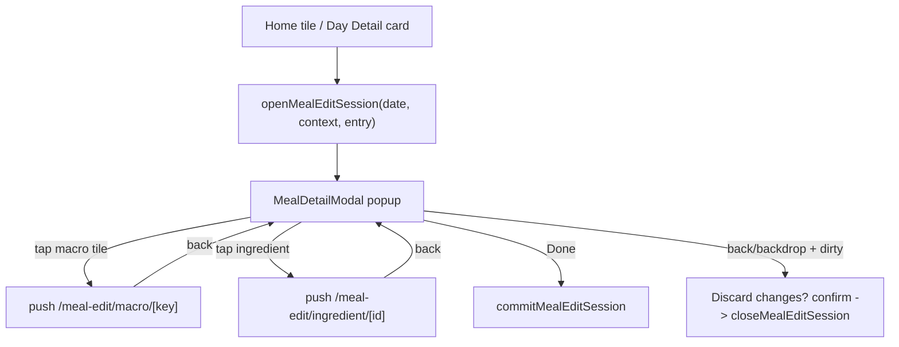

## Decision (locked by user)
Keep the meal detail as a centered floating popup with a contained image tile; macro/ingredient edits use push-navigation routes that slide on top (popup hides via `useIsFocused`, reappears on return). This architecture already exists in [components/MealDetailModal.tsx](meal-app/components/MealDetailModal.tsx) and the routes under [app/meal-edit](meal-app/app/meal-edit). This spec mostly enhances them plus two bug fixes.

## 1. Data model + photo plumbing
- [store/types.ts](meal-app/store/types.ts): add `photoUri?: string` to `MealEntry` (the popup image tile reads/writes this; serving scaling etc. unaffected).
- [components/addMeal/AddMealScreen.tsx](meal-app/components/addMeal/AddMealScreen.tsx): in the scan `logImmediately` branch (currently builds an entry with `ingredients: []` and no photo) include `photoUri: draft`/`src.photoUri`, and pass `photoUri` through the `MealDraftCard` create path so scanned photos persist on the logged meal.
- No `MealEditSession` change needed: dirty-state is derived by comparing `session.draft` to the still-uncommitted entry in `logs[date].meals` (commit only happens on Done).

## 2. Health grade (Good / Okay / Poor)
- [utils/mealRating.ts](meal-app/utils/mealRating.ts): add `rateMealGrade({calories, macros}, goals): { label: 'Good'|'Okay'|'Poor'; color }` (green/orange/red) using calorie-share + protein heuristics. Keep existing `rateMeal` (Scan badge) untouched. Popup badge switches to `rateMealGrade`.

## 3. Redesign the popup ([components/MealDetailModal.tsx](meal-app/components/MealDetailModal.tsx))
New layout inside the card:
- Header row: back arrow (left), centered "Nutrition" title, three-dots (right). Back arrow runs the discard guard.
- Image tile: rounded, padded, contained (not full-bleed). If `draft.photoUri` show `<Image>`; else neutral tile with centered upload icon; tapping placeholder opens the photo action sheet (Take Photo / Upload Photo).
- Row below image: bookmark (left, filled when matching favourited `SavedRecipe`), time pill next to it (tap -> spinner), meal name (tap -> inline edit), servings stepper on the right (scales calories/macros/nutrients/ingredients, already implemented in `changeServings`).
- Health grade badge under the name; "Added" tag only when `context === 'home' && draft.isAdHoc`.
- Macro pager (see Section 6) + page dots; ingredients list (name / calories / portion, tappable rows, no Add More).
- Bottom Fix Issue + Done. Fix Issue becomes a nested keyboard-safe popup (Section 5). Done = `close(true)` (commit). Backdrop press and back arrow = discard guard.
- Discard guard: if `JSON.stringify(draft)` differs from the committed entry in `logs[date]`, show "Discard changes?" Alert (Discard -> `closeMealEditSession`; Keep editing -> stay); if unchanged, just `closeMealEditSession`.

## 4. Three-dots menu ([components/MealDetailModal.tsx](meal-app/components/MealDetailModal.tsx))
Anchored popover/menu opened from the header three-dots:
- Add Photo (when no photo) -> Take/Upload. Change Photo (when photo exists) -> expands inline to Take Photo / Upload Photo / Remove Photo. Uses `expo-image-picker` (`launchCameraAsync` / `launchImageLibraryAsync`, already a dependency in [ScanTab.tsx](meal-app/components/addMeal/ScanTab.tsx)); writes `updateMealDraft({ photoUri })` or clears it.
- Report Food -> nested popup with multiline input + Cancel/Report (shell; Report just closes + toast).
- Delete Food (red): reuses current trash logic — home context confirm + `removeMealFromDay`; plan context "empty this slot" with an option to Swap via `setPendingSwap` + navigate to `recipes/saved`.

## 5. Fix Issue popup (keyboard-safe)
Replace the inline `fixMode` block with a nested `<Modal transparent>` containing a `KeyboardAvoidingView` so the text input + Cancel/Re-evaluate stay above the keyboard. On submit, keep the existing `aiClient.fixMeal` shell call -> `updateMealDraft` -> close the inner popup; the meal card updates in place.

## 6. Macro pager overlap fix (Bug)
Root cause: page child width is a precomputed `PAGE_W` constant while `pagingEnabled` snaps to the ScrollView's actual frame width; any mismatch bleeds page 2's first tile into page 1.
- In [components/MealDetailModal.tsx](meal-app/components/MealDetailModal.tsx) and [app/meal-edit/ingredient/[id].tsx](meal-app/app/meal-edit/ingredient/[id].tsx): measure the pager width via `onLayout` (state), size each page `View` to that measured width, and compute the active page from `contentOffset.x / measuredWidth`.
- Restructure each page to match the spec: Calories as a full-width larger tile, then Protein/Carbs/Fats in a 3-up row; page 2 secondary nutrients in their own contained grid. Tiles sized from the measured page width so they never overflow the page boundary.

## 7. Saved Recipes tab highlight flicker fix (Bug)
In [components/recipes/SavedRecipesView.tsx](meal-app/components/recipes/SavedRecipesView.tsx) the per-frame `onScroll` calls `setActiveIndex(Math.round(x/pageWidth))` during the animated `scrollTo`, so the underline bounces (e.g. 1 -> 0 -> 1).
- Drive the underline with an `Animated.Value` that animates (timing ~200ms) to the active tab, decoupled from live scroll.
- Set `activeIndex` only on tab tap and on `onMomentumScrollEnd` (swipes); stop updating it from the continuous `onScroll`. Result: one clean motion, no flicker.

## 8. Edit routes (minor)
- [app/meal-edit/macro/[key].tsx](meal-app/app/meal-edit/macro/[key].tsx): already has the progress ring, number input, Revert/Done, and the macro->calories Sync prompt. Tweak the ring caption to read "{value} out of {target} left today" to match the reference; no-target nutrients keep ring hidden. (Largely as-is.)
- [app/meal-edit/ingredient/[id].tsx](meal-app/app/meal-edit/ingredient/[id].tsx): apply the same measured-width pager fix and Calories-large + P/C/F layout; otherwise as-is (name, measurement chips, servings, trash, Done).

## Notes
- AI features (Fix Issue, Report Food) remain shells.
- Bookmark and Delete apply immediately; all other edits commit on Done and are revertible via the discard guard.
- Photo edits are part of the draft (saved on Done, reverted on discard).