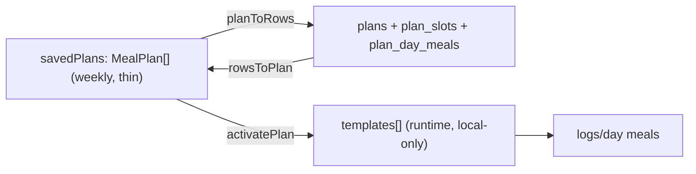

# Plan syncing (plans / plan_slots / plan_day_meals)

Extends the existing Phase 2 sync layer to a new top-level entity `plans`, treating `plan_slots` + `plan_day_meals` as its children (exactly like `saved_recipes` fans out to `recipes`/`recipe_ingredients`/`recipe_steps`). Decisions locked: (A) keep the normalized 3-table schema + add `recipe_name`/`recipe_ref` columns, set `recipe_id` only when it resolves to a real UUID; (B) auto-reactivate the active plan on restore only when local `templates[]` is empty, after logs are pulled, preserving already-logged meals.

## What syncs vs what doesn't

- Sync: user plans in `savedPlans` (`source === 'user'`). Each `MealPlan` -> one `plans` row + synthesized `plan_slots` + `plan_day_meals`.
- Do NOT sync: the premade catalog `plans: PlanTemplate[]` (read-only seed, like seed meals). `templates[]` is not synced (it is a client-derived runtime artifact re-materialized by re-activation).
- Active pointer: canonical = `plans.is_active` (id-based, matches schema). Local `profile.activePlanName` maps to/from it.

## 1. DB migration (new file `supabase/migrations/20260718010000_plan_sync.sql`)

- `plan_day_meals`: `add column recipe_name text`, `add column recipe_ref text` (nullable; preserve local id/sentinel + name so custom/AI/empty meals round-trip losslessly even when `recipe_id` is null).
- `plan_slots`: add `updated_at timestamptz not null default now()` + `set_updated_at` trigger (it currently lacks both, blocking delta pulls).
- Indexes for delta reads: `plans (user_id, updated_at)`, `plan_slots (plan_id, updated_at)`, `plan_day_meals (plan_id, updated_at)`.
- No new unique constraints needed: child rows are delete-then-reinsert per plan push. Update `supabase/README.md` to require pushing this migration before shipping.

## 2. Sync types ([lib/sync/types.ts](meal-app/lib/sync/types.ts))

- Add `'plans'` to the `SyncTable` union.
- Add `entityKey.plan: (planId: string) => `plans:${planId}``.

## 3. Mappers ([lib/sync/mappers.ts](meal-app/lib/sync/mappers.ts))

- `planToRows(userId, plan, isActive)` -> `{ planRow, slotRows, dayMealRows }`:
  - `planRow`: `{ id: plan.id, user_id, name, is_active }`.
  - Synthesize `plan_slots` from distinct `(slotName, time)` pairs across `plan.days`; assign a fresh UUID per slot, `sort_order` by time, `is_custom=false`.
  - `plan_day_meals`: one row per `PlanDayMeal`, `day_of_week = dayIdx` (keep local Mon=0 convention; self-contained so read/write match), `plan_slot_id` -> synthesized slot UUID, `recipe_name = m.recipeName`, `recipe_ref = m.recipeId`, and `recipe_id = resolvePlanRecipeUuid(m.recipeId)`.
  - `resolvePlanRecipeUuid(ref)`: `premadeUuidForSlug(ref)` if premade slug; else `isUuid(ref) ? ref : null` (a user saved recipe's server `recipes.id` equals its `SavedRecipe.id` per [mappers.ts:237](meal-app/lib/sync/mappers.ts)). Sentinels/`custom-*` -> null.
- `rowsToPlan(planRow, slotRows, dayMealRows)` -> `{ plan: MealPlan, isActive: boolean }`: rebuild `days[0..6]` grouped by `day_of_week`, each `PlanDayMeal = { slotName: slot.slot_name, time: slot.slot_time, recipeId: recipe_ref ?? recipe_id ?? '__empty__', recipeName: recipe_name ?? '' }`; sort each day by time.

## 4. Repository ([lib/sync/repository.ts](meal-app/lib/sync/repository.ts))

- `pushItem` new `case 'plans'`:
  - delete: `delete from plans where id = ? and user_id = ?` (cascades slots + day_meals).
  - upsert: if `is_active` true, first `update plans set is_active=false where user_id=? and id<>?` (keeps the `plans_one_active_per_user` partial unique index satisfied regardless of push order); `upsert(planRow, { onConflict: 'id' })`; then `delete` + reinsert `plan_slots` and `plan_day_meals` for this `plan_id` (mirrors the saved_recipes child fan-out at [repository.ts:100-117](meal-app/lib/sync/repository.ts)).
- `pullSince` new `plans` block:
  - full pull (`since==null`): select all `plans` for user; join `plan_slots` + `plan_day_meals` by `plan_id`; build `MealPlan[]` + capture the active plan's name.
  - delta: union changed plan ids from `plans`, `plan_slots`, `plan_day_meals` (all `.gt('updated_at', since)`), then rebuild those plans fully (same "affected-set then rebuild" pattern as saved_recipes at [repository.ts:211-269](meal-app/lib/sync/repository.ts)).
  - Note the recipe-FK ordering caveat: a plan referencing a not-yet-pushed user recipe would FK-fail and dead-letter, then self-heal on the next flush once the recipe lands; `recipe_ref`/`recipe_name` mean no data is lost meanwhile. `enqueueAll`/`enqueueMissing` will enqueue saved_recipes before plans to minimize this.

## 5. ServerSnapshot + merge ([store/types.ts](meal-app/store/types.ts), [store/useMealStore.ts](meal-app/store/useMealStore.ts))

- `ServerSnapshot`: add `plans?: MealPlan[]` and `activePlanName?: string`.
- `applyServerSnapshot`: add a dirty-guarded union-by-id merge for `snapshot.plans` into `savedPlans` (skip any plan whose `entityKey.plan(id)` is in `dirtyKeys`), mirroring the `savedRecipes` block at [useMealStore.ts:1673](meal-app/store/useMealStore.ts). Set `profile.activePlanName = snapshot.activePlanName` when present and the active plan is not locally dirty.

## 6. Projector ([lib/sync/projector.ts](meal-app/lib/sync/projector.ts))

- Add `PlanSnap { hash, plan }`, `planHash(plan, isActive)` (include `is_active` so activation flips are detected), `buildPlans(state)` iterating `savedPlans.filter(p => p.source !== 'premade')`, keyed by `plan.id`, with `isActive = plan.name === state.profile.activePlanName`.
- Add `plans` map + `prevSavedPlansRef` + `prevActivePlanName` guards; wire into `rebaseline()`, `enqueueAll()`, `enqueueMissing(snapshot)` (serverPlanIds set), and `onChange()` (trigger `diffPlans` when `savedPlans` ref changes OR `profile.activePlanName` changes).
- `diffPlans`/`upsertPlan`: standard upsert-on-hash-change + delete-on-missing (like `diffMeals` at [projector.ts:204](meal-app/lib/sync/projector.ts)); `upsertPlan` enqueues `{ table:'plans', op:'upsert', entityKey: entityKey.plan(id), payload: { plan, isActive } }`.

## 7. Store: UUID ids + guarded reactivation ([store/useMealStore.ts](meal-app/store/useMealStore.ts))

- Plan ids must be UUIDs (they become `plans.id`). Change creation sites to `newId()`: `saveCurrentPlanAs` ([useMealStore.ts:1480](meal-app/store/useMealStore.ts)) and any plan built in `app/plan/build.tsx`.
- Persist `version` 4 -> 5 with a `migrate` step that rewrites non-UUID `savedPlans[].id` to `newId()` (same approach as the meal-id heal), so existing local plans get syncable ids.
- New action `hydrateActivePlanIfNeeded()`: if `profile.activePlanName` set AND `templates.length === 0`, find the plan by name in `savedPlans` (fallback to premade `plans[]`), then run a non-destructive activation: build `templates[]` via the existing bucketing logic in `activatePlan` ([useMealStore.ts:1299-1359](meal-app/store/useMealStore.ts)), but MERGE today's materialized meals with existing `logs[today].meals` (existing/synced meals win by slot/time) and never delete past/future logs. Refactor the shared bucketing out of `activatePlan` so both paths reuse it.

## 8. Engine ([lib/sync/engine.ts](meal-app/lib/sync/engine.ts))

- In `reconcile`, after `applyServerSnapshot(snap, ...)` and `rebaseline()`, call `useMealStore.getState().hydrateActivePlanIfNeeded()` so the active plan re-materializes future days only when `templates[]` is empty and only after logs have been merged in.

## Edge cases and known limits (surface in code comments)

- Premade-active plans: if the active plan is a premade (not in `savedPlans`), its active-ness will not round-trip cross-device via `is_active`. Logged meals still sync; on a new device the identical premade catalog exists and re-activation repopulates future days. Easy future upgrade: add `users.active_plan_name` if premade-active must roam.
- Name-based active pointer is fragile with duplicate plan names; unchanged here. `renameSavedPlan`/`removeSavedPlan` do not update `activePlanName` today (pre-existing bug, out of scope).
- `day_of_week` uses the local Mon=0 convention within plan tables (differs from meal_logs; self-contained so consistent read/write is all that matters).

## Verification

- Build a plan, activate it, confirm `plans`/`plan_slots`/`plan_day_meals` rows appear with correct `is_active`, `recipe_ref`, `recipe_name`, and `recipe_id` set only for premade/UUID recipes.
- Activate a second plan; confirm exactly one `is_active=true` (no unique-index error).
- Log out / log back in on a wiped cache: plan catalog + active badge restore; with empty `templates[]`, future days repopulate; already-logged (synced) meals are preserved, not duplicated/wiped.
- Custom/AI-card and empty-slot meals round-trip with names intact (via `recipe_ref`/`recipe_name`).