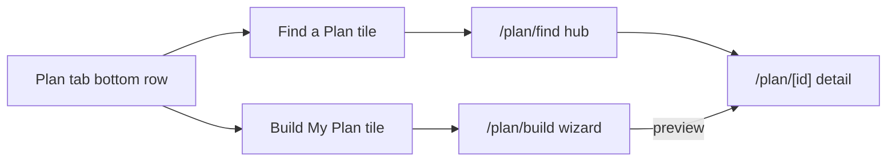

# Plan Tab — Build My Plan & Find a Plan

## Architectural decisions

- **Meal slots**: store `mealSlots: { id, name, time }[]` on `UserProfile` with a 5-slot default (Breakfast 7:30, Mid-morning Snack 10:30, Lunch 13:00, Afternoon Snack 15:30, Dinner 19:00). Editable in the first step of Build My Plan.
- **Meal sources**: reuse the existing recipe seed catalogue. Each slot maps to a `RecipeCategory` (`Snack` slots → `Snacks`, the rest → `Breakfast` / `Lunch` / `Dinner` by name match, defaulting to `Lunch`).
- **Active plan model**: the user's `templates[]` slice **is** the active plan. We add `profile.activePlanName?: string` to give it a label and a `savedPlans: MealPlan[]` slice for snapshots. Activating a plan replaces `templates[]` and sets `activePlanName`.

## Phase 1 — Data models

Extend [`store/types.ts`](store/types.ts):

```ts
export interface MealSlot { id: string; name: string; time: string; }

export type PlanCategory = 'Balanced' | 'High Protein' | 'Low Carb'
  | 'High Fiber' | 'Keto' | 'Mediterranean';

// One day's meals in a plan: ordered list of recipe references.
export interface PlanDayMeal {
  slotName: string;          // "Breakfast"
  time: string;              // "07:30"
  recipeId: string;          // refers to RecipeTemplate.id
  recipeName: string;
}

// A persisted plan (either premade or saved by the user).
export interface MealPlan {
  id: string;
  name: string;
  description?: string;
  disclaimer?: string;
  category?: PlanCategory;
  // 7 days, Monday=0. Each day is an ordered list of meals.
  days: PlanDayMeal[][];
  targets?: { calories: number; protein: number; carbs: number; fats: number };
  savedAt: string;
  source: 'premade' | 'user';
}

// Premade catalogue uses the same shape as MealPlan with source='premade'.
export type PlanTemplate = MealPlan;
```

`UserProfile` gains:
```ts
  mealSlots: MealSlot[];
  activePlanName?: string;
```

`UserGoals` unchanged.

`AppStore` adds:
```ts
  plans: PlanTemplate[];         // seeded
  savedPlans: MealPlan[];        // user snapshots

  activatePlan: (plan: MealPlan) => void;
  saveCurrentPlanAs: (name: string) => MealPlan;
  renameSavedPlan: (id: string, name: string) => void;
  removeSavedPlan: (id: string) => void;
```

## Phase 2 — Store actions

Update [`store/useMealStore.ts`](store/useMealStore.ts):

- `DEFAULT_PROFILE.mealSlots` = the 5-slot default.
- `plans: PLAN_SEED`, `savedPlans: []` in initial state.
- `activatePlan(plan)`: builds `MealTemplate[]` from `plan.days` by walking each weekday's meals, creating a `weekly` recurrence with the matching day in `days[]`, looking up macros/ingredients from `recipes[]` by `recipeId`. Replaces `templates`, sets `profile.activePlanName = plan.name`, then for each meal walks `ingestMidWeekIngredients` so all unique ingredients land in Planned Ingredients (the existing flow already skips items in Kitchen).
- `saveCurrentPlanAs(name)`: snapshots the current `templates[]` back into a `MealPlan` (reverse-mapping templates to days by `recurrence.days[]` and matching `recipeId` where available), pushes into `savedPlans`, returns the new plan.
- `renameSavedPlan(id, name)`, `removeSavedPlan(id)`: trivial.
- `merge`: backfill `mealSlots`, `plans`, `savedPlans`.

## Phase 3 — Seed catalogue

New `constants/planSeed.ts` with ~12 plans across 6 categories. Each plan references existing recipe IDs from `constants/recipeSeed.ts`. Shape per plan:
```ts
{
  id: 'plan-balanced-1',
  name: 'Balanced Weekday',
  description: '5-meal balanced split aimed at maintenance.',
  disclaimer: 'These meals are starting points — adjust portions to your needs.',
  category: 'Balanced',
  targets: { calories: 2200, protein: 165, carbs: 220, fats: 65 },
  days: [
    // Monday
    [
      { slotName: 'Breakfast', time: '07:30', recipeId: 'rcp-bf-oats-berries', recipeName: 'Oats & Berries' },
      { slotName: 'Mid-morning Snack', time: '10:30', recipeId: 'rcp-sn-yogurt-honey', recipeName: 'Greek Yogurt with Honey' },
      // …
    ],
    // …7 days
  ],
}
```

## Phase 4 — Plan tab updates

Edit [`app/(tabs)/plan.tsx`](app/(tabs)/plan.tsx):

- Make **Week schedule** collapsible: tap the `Week schedule` title to toggle. Default expanded.
- `PlannedIngredientsSection` is already collapsible — leave as is.
- New row at the bottom of the scroll view:
```
[ Build My Plan ]  [ Find a Plan ]
```
Two equal-width tiles, accent colours (green primary / purple secondary), matching the Recipes tab `ActionTile` style.



## Phase 5 — Build My Plan flow

New file `app/plan/build.tsx` — single-screen wizard with internal `step` state, mirroring the Edit Goal pattern.

Profile completeness guard: on mount, if `profile.goalType` is undefined → show inline empty-state card with `Complete profile` CTA routing to `/profile/edit-goal`. Block the wizard until set.

Steps:
1. **Confirm meal slots** — render `profile.mealSlots` with add/remove rows; user can edit names/times. Saves to profile on continue.
2. **Per-slot picker** (loops 1× per slot):
   - Header: slot name (e.g., "Breakfast") and slot index ("Step 2 of 5").
   - Card stack: 4 recipe cards drawn from `recipes` filtered by category-from-slot, ranked by simple goal-aware score (protein × multiplier for muscle-gain goals, fibre keywords for "gut health" stretch goal, etc.) and filtered by `profile.allergies` / `dietaryRestrictions`.
   - "Show more" button — appends 3 more from remaining pool, with shuffle.
   - "Describe what you want" — `TextInput` at the bottom. On submit, runs the same fake-generation routine as `app/ai/custom.tsx` (keyword score + light name mutation) and prepends one custom card.
   - Skip row: text reads `No ${slotName}` per the spec. Tap removes that slot from the wizard's resulting plan.
3. **Assembly** (no UI step — runs invisibly after last slot): for each slot the user picked, generate 7-day variations:
   - Day-N meal = the picked recipe with `daysOffset` rotation through the same category bucket. So if the user picks `rcp-bf-oats-berries`, days 1–7 are `[oats-berries, greek-yogurt-bowl, veggie-omelette, protein-pancakes, oats-berries, avocado-toast, greek-yogurt-bowl]` — cycling siblings within the same category.
   - After building `days[][]`, total per-day macros are summed; if they undershoot user `goals.dailyCalories` by >300 kcal we tag the plan with `targets` and a note. No portion auto-scaling for MVP.
4. **Preview** — 7 day cards (Mon–Sun), each with meals and total kcal:
   - Tap any meal → opens a single-slot picker overlay (reuses the same picker UI) → swap.
   - Sticky footer with `Activate Plan` button.

On Activate → check `templates.length > 0`. If yes → `Alert` with three options:
- **Save and replace** — prompt for a name (defaults to current plan name or `"Plan saved <date>"`) → `saveCurrentPlanAs(name)` → `activatePlan(newPlan)`.
- **Replace** — `activatePlan(newPlan)`.
- **Cancel**.

If no existing templates → `activatePlan(newPlan)` directly.

## Phase 6 — Find a Plan flow

New files:
- `app/plan/find.tsx` — header + horizontal scrollable category rows + Saved Plans row at the bottom. Reuses `components/recipes/CategoryRow.tsx`-like layout but for plans:
  - Build a small `components/plans/PlanCard.tsx` (compact + row variants) similar to `RecipeCard`.
  - Category list: `['Balanced','High Protein','Low Carb','High Fiber','Keto','Mediterranean']`, plus a final "Saved Plans" row reading `savedPlans` (rename/delete via long-press → `Alert`).
- `app/plan/category/[type].tsx` — vertical list of plans in that category.
- `app/plan/[id].tsx` — detail page:
  - Name + description + disclaimer banner.
  - Macro chips + daily calorie target.
  - "Meals in this plan" — preview list of distinct recipes (links to `/recipe/[id]`).
  - Sticky footer: `Start Plan` button.
  - Start Plan → same replace-flow alert as Build My Plan, then `activatePlan(plan)`.

Important nuance from the spec: when activating a premade plan, **do not** auto-save its recipes into `savedRecipes`. The existing `addRecipeToToday` / `addRecipeToPlan` actions auto-save, so `activatePlan` builds templates directly from `recipes[]` + `plan.days` **without** calling those actions.

## Phase 7 — Routes

Register in [`app/_layout.tsx`](app/_layout.tsx) as `slide_from_bottom` modals:
```
plan/build
plan/find
plan/category/[type]
plan/[id]
```

## Phase 8 — File map

New files (8):
- `constants/planSeed.ts`
- `components/plans/PlanCard.tsx`
- `app/plan/build.tsx`
- `app/plan/find.tsx`
- `app/plan/category/[type].tsx`
- `app/plan/[id].tsx`

Modified files (4):
- `store/types.ts`
- `store/useMealStore.ts`
- `app/(tabs)/plan.tsx` (collapsible week schedule + bottom buttons)
- `app/_layout.tsx`

## Out of scope (deliberately)

- Real AI generation. All "suggestions" come from the existing recipe catalogue + keyword score; same shape of fakery as `/ai/custom.tsx`.
- Goal-specific score tuning beyond a simple "muscle-gain → protein", "lose-weight → calorie-budget aware" pair of nudges.
- Portion scaling to exactly hit `goals.dailyCalories`. Plans display per-day kcal as-is and warn if off.
- Editing the premade plans themselves.
- Reordering or editing the `mealSlots` outside of the Build My Plan wizard step (the wizard editor is the only configurator for MVP).