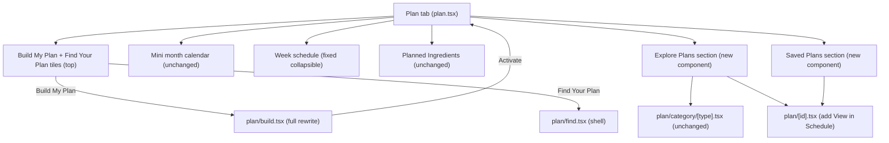

# Plan Tab — Full Rebuild

## Architecture overview



## Phase 1 — Type + store changes

### [`store/types.ts`](store/types.ts)
Add `skipped?: boolean` to `MealSlot`:
```ts
export interface MealSlot {
  id: string;
  name: string;
  time: string;
  skipped?: boolean;   // if true, slot is excluded from Build My Plan and daily schedule
}
```

### [`store/useMealStore.ts`](store/useMealStore.ts)
- Add `skipped: false` to each entry in `DEFAULT_MEAL_SLOTS`
- In the `persist.merge` function, backfill `skipped: false` on each slot if the field is missing

## Phase 2 — Plan tab restructure ([`app/(tabs)/plan.tsx`](app/(tabs)/plan.tsx))

**Removals:**
- Remove the `+ Add` button from the header row (`headerBtn` / `headerBtnText`)
- Remove the `+ Day meal` button from inside the Week schedule section
- Remove the `bottomTilesRow` (Build/Find tiles currently at bottom)
- Remove unused state: `modalVisible`, `headerAddVisible`, `editingTemplate`, and all related form state (name, time, calories, protein, carbs, fats, etc.) — the old template creation modal is entirely replaced by the `AddMealScreen` flow already accessible from `DayDetailModal`
- Remove the two `<Modal>` blocks (template form modal + time prompt modal)

**New layout order:**
1. Header row (title "Plan" + ProfileIcon + CartIcon — no + Add button)
2. Build My Plan + Find Your Plan tiles (reuse existing `ActionTile`, just moved to top)
3. Mini month calendar (unchanged)
4. Week schedule section (fixed collapsible — see Phase 3)
5. `<PlannedIngredientsSection />` (unchanged)
6. `<ExplorePlansSection />` (new component)
7. `<SavedPlansSection />` (new component)

## Phase 3 — Week schedule collapsible fix ([`app/(tabs)/plan.tsx`](app/(tabs)/plan.tsx))

Currently the collapsed state renders weirdly because the title lives inside a `sectionCard` container with `sectionTitleRow`. Rebuild it to use the **exact same pattern** as [`components/grocery/PlannedIngredientsSection.tsx`](components/grocery/PlannedIngredientsSection.tsx):

```tsx
// Matches PlannedIngredientsSection pattern exactly
<View style={styles.sectionWrap}>         // same as wrap: card bg, rounded, border, padding
  <Pressable
    style={styles.sectionHeaderRow}
    onPress={() => setWeekExpanded(v => !v)}
    hitSlop={6}
  >
    <Text style={styles.sectionTitle}>Week schedule</Text>
    <Text style={styles.chevron}>{weekExpanded ? '▾' : '▸'}</Text>
  </Pressable>

  {!weekExpanded && (
    <Text style={styles.collapsedHint}>
      {weekDates.length} days in current week
    </Text>
  )}

  {weekExpanded && (
    <View style={styles.body}>
      {/* day cards */}
    </View>
  )}
</View>
```

## Phase 4 — Explore Plans section (new [`components/plans/ExplorePlansSection.tsx`](components/plans/ExplorePlansSection.tsx))

Reads `plans: PlanTemplate[]` from the store. Groups by `category`. Renders horizontal `PlanCard` rows with "See all" links per category — identical pattern to `CategoryRow` in the Recipes tab.

- "See all" → `router.push({ pathname: '/plan/category/[type]', params: { type: cat } })`
- Tapping a card → `router.push({ pathname: '/plan/[id]', params: { id: plan.id } })`

## Phase 5 — Saved Plans section (new [`components/plans/SavedPlansSection.tsx`](components/plans/SavedPlansSection.tsx))

Reads `savedPlans` and `profile.activePlanName` from the store. Renders a vertical list of `PlanCard` (row variant) with:
- Plan name
- Creation date formatted as "My Plan — May 29"
- "Current" tag if `plan.name === profile.activePlanName`
- Tap → `router.push('/plan/[id]?id=...')`
- Long-press on **user** plans (`source === 'user'`) → Alert with Rename + Delete options
- Long-press on **premade** plans (`source === 'premade'`) → no delete option, only Rename
- Delete shows a confirmation Alert before calling `removeSavedPlan`

## Phase 6 — Meal Time Slots in Personal Details

### [`store/types.ts`](store/types.ts)
Already updated in Phase 1 (`skipped?: boolean` on `MealSlot`).

### New [`components/plans/MealSlotModal.tsx`](components/plans/MealSlotModal.tsx)
A `Modal` (or full-screen bottom sheet) that presents:
- Title row: "Meal Time Slots" + close button
- Fixed list of 5 slots (no add/remove). For each slot:
  - Slot name (fixed label, not editable)
  - Time displayed as a tappable chip — tapping opens `DateTimePicker` in `time` mode (spinner on iOS)
  - Skip toggle (`Switch` component)
- Save button → calls `updateProfile({ mealSlots: edited })`

### [`app/profile/personal-details.tsx`](app/profile/personal-details.tsx)
Add a new `FormSection` row at the bottom (before the Save button) labeled "MEAL SCHEDULE". A single tappable row "Meal time slots →" that sets local state `showSlotsModal = true` and renders `<MealSlotModal />`.

## Phase 7 — Build My Plan complete rewrite ([`app/plan/build.tsx`](app/plan/build.tsx))

The existing file is a complete replacement. New step model:

```
slots-guard → pick[0] → summary[0] → pick[1] → summary[1] → ... → preview → activate
```

**State shape:**
```ts
type WizardStep =
  | { kind: 'pick'; slotIdx: number; pageIdx: number }
  | { kind: 'summary'; slotIdx: number }
  | { kind: 'preview' };

// Per-slot: array of selected RecipeTemplate[]
type Selections = RecipeTemplate[][];
```

**Key behaviours by step:**

- **All-slots-skipped guard**: `if (activeSlots.length === 0)` show inline card with link to `/profile/personal-details` and dismiss button
- **Pick step**: 
  - Pages of 4 recipe cards + "Find more" card at end (cap 3 auto-generated pages then show Describe message instead)
  - "Describe what you want" `TextInput` always visible; generates unlimited pages on submit (faked generation re-uses keyword matching from `ai/custom.tsx` pattern)
  - Page indicator dots at top
  - Tap card → toggle selection (visual highlight); counter in header updates
  - "No {slotName}" skip row at bottom
  - "Continue" in header: if 0 selected → no-op, if 1 selected → single-meal Alert (with "Select more" / "Continue anyway"), otherwise → go to summary step
- **Summary step**:
  - Lists all selections for this slot with per-item swap (→ returns to pick step for that slot with current selections preserved)
  - "Add more" → returns to pick step
  - Running calorie + macro averages
  - Continue → next slot's pick step (or preview if last slot)
  - Back → previous slot's summary (or previous slot's pick step if first slot)
- **Preview step**:
  - 7 collapsible day cards (day name + total kcal in header)
  - Meal distribution: rotate selections per slot across 7 days by index
  - Tap meal → quick swap inline picker (show other selections for that slot)
  - "Find different meal" → opens pick step in swap mode; on confirm returns to preview
  - "Activate Plan" sticky footer → same Alert flow (Save and replace / Replace / Cancel)
  - Auto-saves with name `My Plan — May 29` using `saveCurrentPlanAs`

## Phase 8 — Find Your Plan shell ([`app/plan/find.tsx`](app/plan/find.tsx))

Replace entire body content with:
- Coming soon illustration + text explaining the guided preference flow is being built
- Nicely designed bridge card at the bottom: "None of these fit? Try Build My Plan instead →" → `router.replace('/plan/build')`
- Keep existing header/back-arrow pattern

## Phase 9 — Plan detail page update ([`app/plan/[id].tsx`](app/plan/[id].tsx))

Determine if this plan is the active one by checking `profile.activePlanName === plan.name`. If yes:
- Footer button says "View in Schedule" → calls `router.dismissAll()` (the Plan tab is the underlying screen and the week schedule is visible)

If no:
- Footer button says "Start Plan" (existing behaviour)

## Files changed

**Modified (6):**
- [`store/types.ts`](store/types.ts) — `MealSlot.skipped?`
- [`store/useMealStore.ts`](store/useMealStore.ts) — default slot skipped values, persist merge backfill
- [`app/(tabs)/plan.tsx`](app/(tabs)/plan.tsx) — layout reorder, remove buttons, fix week schedule, add section components
- [`app/plan/build.tsx`](app/plan/build.tsx) — full rewrite
- [`app/plan/find.tsx`](app/plan/find.tsx) — replace with shell
- [`app/plan/[id].tsx`](app/plan/[id].tsx) — "View in Schedule" vs "Start Plan" logic
- [`app/profile/personal-details.tsx`](app/profile/personal-details.tsx) — meal slots row

**New (3):**
- [`components/plans/ExplorePlansSection.tsx`](components/plans/ExplorePlansSection.tsx)
- [`components/plans/SavedPlansSection.tsx`](components/plans/SavedPlansSection.tsx)
- [`components/plans/MealSlotModal.tsx`](components/plans/MealSlotModal.tsx)

**Unchanged:**
- [`app/plan/category/[type].tsx`](app/plan/category/[type].tsx)
- [`components/grocery/PlannedIngredientsSection.tsx`](components/grocery/PlannedIngredientsSection.tsx)
- [`constants/planSeed.ts`](constants/planSeed.ts)

## Out of scope (deferred)
- Post-onboarding popup (deferred until onboarding is built)
- Backend-managed plan templates (seeded data serves as stand-in)
- Find Your Plan guided preference flow (shell only for now)
- Weekly auto-repeat (already handled by `weekly` recurrence type on templates)
