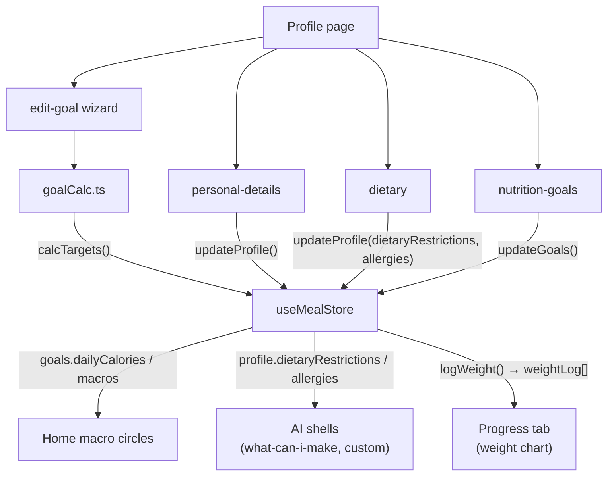

# Profile & Settings — Implementation Plan

## Current state

- [`app/profile.tsx`](app/profile.tsx) — stub with placeholder card + two "Coming soon" dietary rows + a link to settings
- [`app/settings.tsx`](app/settings.tsx) — single flat form: name field + calories/protein/carbs/fats inputs
- `UserProfile` in [`store/types.ts`](store/types.ts) — only `name`, `dietaryRestrictions`, `allergies`
- `UserGoals` — only `dailyCalories`, `protein`, `carbs`, `fats`

---

## Phase 1 — Data models

**Extend [`store/types.ts`](store/types.ts):**

New exported types:
```ts
export type GoalType = 'lose_weight' | 'maintain' | 'gain_muscle' | 'lean_bulk';
export type ActivityLevel = 'sedentary' | 'lightly_active' | 'moderately_active' | 'very_active' | 'extra_active';
export type WeightUnit = 'lbs' | 'kg';
export type Gender = 'male' | 'female' | 'other';

export interface WeightLogEntry { date: string; weightKg: number; }
```

Extend `UserProfile`:
```ts
  age?: number;
  heightCm?: number;
  weightKg?: number;
  gender?: Gender;
  activityLevel?: ActivityLevel;
  goalType?: GoalType;
  weightUnit: WeightUnit;
  subscription: 'free' | 'premium';
  email?: string;
  firstName?: string;
  lastName?: string;
  mealRemindersEnabled: boolean;
  remindMinutesBefore: 5 | 10 | 15 | 30;
```

Extend `UserGoals`:
```ts
  waterTargetCups: number;
  isCalculated?: boolean;   // true when set by Edit Goal flow
```

Add to `AppStore`:
```ts
  weightLog: WeightLogEntry[];
  logWeight: (weightKg: number) => void;
```

**New file `constants/goalCalc.ts`** — pure Mifflin-St Jeor engine:
- `calcBMR(weightKg, heightCm, age, gender)` → number
- `calcTDEE(bmr, activityLevel)` → number (multipliers 1.2 → 1.9)
- `calcTargets(tdee, goalType, pace)` → `{ calories, protein, carbs, fats, waterTargetCups }`
  - pace is `'slow' | 'moderate' | 'aggressive'` mapping to kcal deficit/surplus
  - macro splits vary by goal (e.g. lose\_weight: 40% P / 35% C / 25% F)

---

## Phase 2 — Store actions

Update [`store/useMealStore.ts`](store/useMealStore.ts):
- Extend `DEFAULT_PROFILE` with all new fields (safe defaults: `weightUnit: 'lbs'`, `subscription: 'free'`, `mealRemindersEnabled: true`, `remindMinutesBefore: 15`)
- Extend `DEFAULT_GOALS` with `waterTargetCups: 8`
- Add `weightLog: []` to initial state
- Implement `logWeight(weightKg)` — pushes `{ date: today, weightKg }` to `weightLog` AND sets `profile.weightKg = weightKg`
- Update `merge` in persist config to fill in all new profile defaults

---

## Phase 3 — Profile page rebuild

**[`app/profile.tsx`](app/profile.tsx)** — full replacement:

```
Header:  ← back arrow   "Profile"   ⚙ gear (→ /settings)

User info card:
  Default silhouette icon (text emoji or SVG placeholder, no photo upload)
  Name + subscription badge (Free/Premium)
  Weight (tappable → inline Alert.prompt to update)
  Goal display (e.g. "Lose Weight") (tappable → /profile/edit-goal)

Sections (grouped card rows, ›  arrow):
  BODY & GOALS
    Edit Goal           → /profile/edit-goal
    Personal Details    → /profile/personal-details
  NUTRITION
    Dietary & Allergies → /profile/dietary
    Nutrition Goals     → /profile/nutrition-goals
  PREFERENCES
    Weight Unit  [lbs | kg toggle — inline, no sub-page]
```

Weight unit toggle updates `profile.weightUnit` directly via `updateProfile`. All weight displays across the app read this value.

---

## Phase 4 — Profile sub-pages

### `app/profile/personal-details.tsx`
Form: First name, Age (number), Height (cm or in — respects weightUnit), Weight (tappable saves via `logWeight`), Gender (radio), Activity Level (radio with 5 options). Save button at bottom.

### `app/profile/dietary.tsx`
Two sections:
- **Food Preferences** (radio — single select): No preference, Vegetarian, Vegan, Pescetarian
- **Allergies** (multi-toggle switches): No allergies, Gluten intolerant, Wheat intolerant, Lactose intolerant, Allergic to milk, Allergic to egg, Allergic to shellfish, Allergic to fish, Allergic to nuts

On save, if active templates exist → `Alert` "Changing preferences may affect your current plan. Continue?" → Keep / Change.

Saves to `profile.dietaryRestrictions` (the single selected preference) + `profile.allergies` (toggled items). These feed the AI shells already reading those fields.

### `app/profile/nutrition-goals.tsx`
Single page, all editable:
- Daily calories (kcal)
- Protein (g), Carbs (g), Fats (g)
- Water target (cups)
- If `goals.isCalculated` is `true`, show banner: "These targets were calculated based on your goal. Editing manually will override the recommendation."

On save → `updateGoals({ ...values, isCalculated: false })`.

### `app/profile/edit-goal.tsx`
Multi-step wizard with internal `step` state (no separate routes):

```
Step 1: Goal selection   — 4 option tiles (Lose Weight / Maintain / Gain Muscle / Lean Bulk)
Step 2: Confirm weight   — pre-filled from profile.weightKg, editable
Step 3: Activity level   — 5 radio options (same as Personal Details)
Step 4: Pace preference  — 3 chips (Slow / Moderate / Aggressive)
                           label text changes by goal type
Step 5: Results summary  — two-column: "Current" vs "New" for calories, protein, carbs, fats, water
                           Manual tweak option: inline editable fields toggle
Step 6: Confirm          — "Update meal plan to match new targets?" Alert
                           Yes → updateGoals(newTargets, isCalculated: true), update profile fields
                           No  → just save targets
```

Navigation: ← back between steps, ✕ to cancel (with Alert guard if any step was completed).

---

## Phase 5 — Settings page rebuild

**[`app/settings.tsx`](app/settings.tsx)** — full replacement. Header: `← back` (→ Profile), title "Settings". No ✕ close.

Sections (grouped card rows):

```
ACCOUNT
  Account Settings  → /settings/account

NOTIFICATIONS
  Notifications     → /settings/notifications

HELP
  Help              → /settings/help

─────────────────────────
Log Out             (plain text row, no arrow, no red)
```

Log Out taps → `Alert` "Log out?" → confirm → `updateProfile({ name: '' })` (clear session shell) → `router.replace('/(tabs)')`.

---

## Phase 6 — Settings sub-pages

### `app/settings/account.tsx`
Scrollable form: Email, First Name, Last Name, Change Password (shell → shows "Coming soon" toast), Unit System (lbs/kg toggle — same as Profile), Language (row → /settings/coming-soon), Data Consent (row → /settings/coming-soon), Export My Data (row → /settings/coming-soon), Delete Account (red text row → /settings/account-delete-confirm). Save button.

### `app/settings/account-delete-confirm.tsx`
Explanation text as per spec. Two buttons: Cancel (back) and Delete Account (red). Delete → clears store via `updateProfile` reset + `router.replace('/(tabs)')` shell.

### `app/settings/notifications.tsx`
- Meal reminders toggle (Switch, default on)
- "Remind me before meal time" — four-option selector (5 / 10 / 15 / 30 min), visible only when toggle is on
- Saves via `updateProfile({ mealRemindersEnabled, remindMinutesBefore })`

### `app/settings/help.tsx`
List rows: FAQ (→ coming-soon), About Us (→ coming-soon), Contact Support (→ coming-soon), Feedback (→ /settings/feedback), Terms of Service (→ coming-soon), Privacy Policy (→ coming-soon).

### `app/settings/feedback.tsx`
Multi-line `TextInput`, character count, Submit button. On submit → shows success toast via `useToastStore`. (No network call for MVP; data stays local.)

### `app/settings/coming-soon.tsx`
Reads `?title=` param. Shows title in header, body: "This feature is coming soon."

---

## Phase 7 — Route registration

Register all new screens in [`app/_layout.tsx`](app/_layout.tsx) as `slide_from_bottom` modals:
```
profile/edit-goal, profile/personal-details, profile/dietary, profile/nutrition-goals
settings/account, settings/account-delete-confirm, settings/notifications
settings/help, settings/feedback, settings/coming-soon
```

---

## File map

New files (16):
- `constants/goalCalc.ts`
- `app/profile/edit-goal.tsx`
- `app/profile/personal-details.tsx`
- `app/profile/dietary.tsx`
- `app/profile/nutrition-goals.tsx`
- `app/settings/account.tsx`
- `app/settings/account-delete-confirm.tsx`
- `app/settings/notifications.tsx`
- `app/settings/help.tsx`
- `app/settings/feedback.tsx`
- `app/settings/coming-soon.tsx`

Modified files (5):
- `store/types.ts`
- `store/useMealStore.ts`
- `app/profile.tsx`
- `app/settings.tsx`
- `app/_layout.tsx`

---

## Data flow


