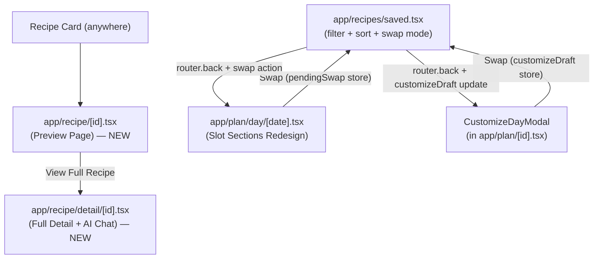

# Recipe & Day Detail Redesign

## Architecture Overview



## Data model changes — `store/types.ts` and `store/useMealStore.ts`

- `RecipeTemplate`: add `difficulty?: 'Easy' | 'Medium' | 'Hard'`
- `SavedRecipe`: add `difficulty?: 'Easy' | 'Medium' | 'Hard'`
- `MealEntry`: add `slotId?: string` — set when a meal is added through a specific slot's "+" action, used to map entries back to sections in the redesigned Day Detail
- `MealPlan`: no type change needed — custom plan slots are stored as `PlanDayMeal` entries with `recipeId: '__empty__'` as a placeholder until a recipe is assigned
- Store additions: two new state slices for cross-screen swap coordination:
  ```ts
  pendingSwap: { type: 'daily'; date: string; slotName: string } | null
  customizeDraft: { planId: string; draftPlan: MealPlan } | null
  ```
- New store actions: `setPendingSwap`, `clearPendingSwap`, `setCustomizeDraft`, `clearCustomizeDraft`, `swapMealInDay(date, slotName, recipe)` — replaces the matching `MealEntry` in `logs[date]` for that slot

## 1. `constants/recipeSeed.ts` — add `difficulty`

Add `difficulty: 'Easy' | 'Medium' | 'Hard'` to all 20 premade recipes. Assign based on cook time and step count (≤15 min / ≤3 steps = Easy, ≤30 min = Medium, else Hard).

## 2. Recipe preview page — `app/recipe/[id].tsx` (replace current)

Current `[id].tsx` becomes the preview. Remove the footer Add to Plan / Add to Today buttons entirely. New layout:
- Header: `←` back, spacer, `♡` / `♥` favourite bookmark top right
- Hero: large placeholder area with plate icon (no image field on the model — use existing emoji/icon placeholder)
- Recipe name (large), category tag pill, cook time
- Macro bar: P / C / F chips (same as current)
- "Key ingredients" — first 3–4 ingredients from `ingredients[]` listed briefly
- Footer: single full-width **"View Full Recipe"** button → `router.push('/recipe/detail/[id]', { id })`

No Add to Plan, no Add to Today anywhere on this page.

## 3. Full recipe detail — `app/recipe/detail/[id].tsx` (new file)

Full screen page. Add route in `app/_layout.tsx`:
```tsx
<Stack.Screen name="recipe/detail/[id]" options={{ presentation: 'card' }} />
```

Layout:
- Header: `←` back, recipe name, `♡` / `♥` bookmark top right
- Hero placeholder
- Category tag + difficulty badge (Easy / Medium / Hard) in an info bar row
- Calories + cook time
- Macro chips
- Ingredients section — full list with quantities
- Steps section — numbered
- Floating FAB (circular, bottom-right, `position: 'absolute'`) — opens AI chat panel

**AI chat panel:** `useState<boolean>(chatOpen)` + `Animated.spring` slide-up from bottom. Panel occupies ~50% of screen height; recipe scroll remains visible above. Uses `ChatShell` message format. Recipe context injected as first assistant message on open. Conversation persists in local state (cleared on unmount). Shell responses only (no real AI yet).

## 4. Remove Add to Plan / Add to Today

- `app/recipe/[id].tsx` — remove footer (replaced in step 2)
- `app/ai/what-can-i-make.tsx` — remove `cardActions` View (lines 156–171); keep "Add missing to Cart" and favourite/save actions
- `app/ai/custom.tsx` — remove `cardActions` View (lines 233–247); keep Save / favourite action

## 5. Saved Recipes page — `app/recipes/saved.tsx`

Add above the existing tabs row:
- **Filter chips** (horizontal scroll): All · Breakfast · Snacks · Lunch · Dinner — filters both tabs by `category`
- **Sort row**: New (default, `addedAt` desc) / A–Z (name alpha) toggle

When opened with route params `?swapFilter=Breakfast` (from swap flow), auto-select that chip.

When opened with route param `?swapMode=true`, show a "Select a recipe to swap in" banner. Tapping a recipe card in this mode:
- Reads `pendingSwap` or `customizeDraft` from store
- Executes the appropriate swap action (`swapMealInDay` for daily, `setCustomizeDraft` update for plan)
- Clears the pending context
- Calls `router.back()`

Empty state adds a "Create new recipe" button (navigates to `/ai/custom`).

## 6. Day Detail redesign — `app/plan/day/[date].tsx`

Replace the flat sorted list with **slot sections**:
- Top: macro summary card (calories, P/C/F totals)
- Section per non-skipped `profile.mealSlot`:
  - Section header: slot name + time (subtle)
  - If `logs[date]` has a `MealEntry` where `entry.slotId === slot.id` (or time match fallback): show `MealRow` with **Swap** button
  - If empty: show empty state card with **"+ Add [slot name]"** button
- Swap button sets `pendingSwap = { type: 'daily', date, slotName: slot.name }` then navigates to `/recipes/saved?swapMode=true&swapFilter=[category]`
- "Add [slot name]" button sets `pendingSwap` and navigates to Saved Recipes in swap mode
- Any `MealEntry` not matching a slot (e.g. ad-hoc entries with no `slotId`) rendered in a trailing "Other" section
- Footer: `+ Add meal` still opens `AddMealScreen` (ad-hoc, non-slot entry)

## 7. Customize Plan day view — `CustomizeDayModal` in `app/plan/[id].tsx`

Replace flat list with slot sections, mirroring section 6 layout:
- Sections derived from: default `profile.mealSlots` names ∪ unique `slotName` values in `draftPlan.days[dayIdx]` — sorted by time
- Each section shows the plan's `PlanDayMeal` entry for that slot (matched by `slotName`) or an empty state if `recipeId === '__empty__'` or no entry
- **No ✕ remove buttons** on meal rows — swap only
- Swap button: saves `customizeDraft` to store, navigates to `/recipes/saved?swapMode=true&swapFilter=[category]`
- Footer button changes: **"Add meal slot"** (not "Add meal")
  - Opens inline popup (small `Modal`, transparent backdrop) with:
    - Text input: slot name
    - Time: `DateTimePicker` in time mode (iOS scroll wheel)
    - "Add" confirms → pushes `PlanDayMeal` with `recipeId: '__empty__'` to that day → slot section appears empty, ready for swap

On return from Saved Recipes in swap mode, `CustomizeDayModal` reads updated `customizeDraft` from store and re-renders.

## 8. Manual entry meal type — `components/EditMealScreen.tsx`

In create mode only, add a category selector after the Name field in the Basics section:
- Row of 4 tappable chips: Breakfast · Snack · Lunch · Dinner
- Selected chip stored in local state, passed into `MealEntry` as `category` on save
- `MealEntry` type: add `category?: RecipeCategory` (if not already present)

## 9. RecipeCard consistency — `components/recipes/RecipeCard.tsx`

Ensure all variants show:
- Placeholder icon (existing plate emoji / icon) when no image
- Category tag pill
- Calories

This may require passing a `category` prop to the compact variant and rendering a small pill badge.

## Key files

- [`store/types.ts`](store/types.ts) — data model additions
- [`store/useMealStore.ts`](store/useMealStore.ts) — new actions + state slices
- [`constants/recipeSeed.ts`](constants/recipeSeed.ts) — add difficulty
- [`app/recipe/[id].tsx`](app/recipe/[id].tsx) — becomes preview
- `app/recipe/detail/[id].tsx` — new full detail
- [`app/_layout.tsx`](app/_layout.tsx) — register new route
- [`app/recipes/saved.tsx`](app/recipes/saved.tsx) — filter/sort/swap mode
- [`app/plan/day/[date].tsx`](app/plan/day/[date].tsx) — slot section redesign
- [`app/plan/[id].tsx`](app/plan/[id].tsx) — CustomizeDayModal redesign
- [`app/ai/what-can-i-make.tsx`](app/ai/what-can-i-make.tsx) — remove action buttons
- [`app/ai/custom.tsx`](app/ai/custom.tsx) — remove action buttons
- [`components/EditMealScreen.tsx`](components/EditMealScreen.tsx) — category chips
- [`components/recipes/RecipeCard.tsx`](components/recipes/RecipeCard.tsx) — category tag on compact variant
