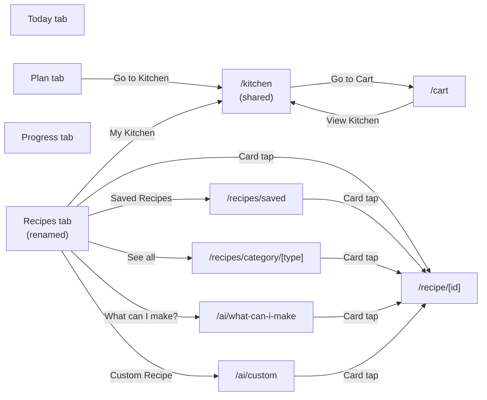

# Recipes Tab — Implementation Plan

## Route layout

All new screens are stack-pushed modals (`presentation: 'modal'`, `slide_from_bottom`) for consistency with Cart/Profile/Notifications. Back arrow always uses `router.back()`.

## Phase 1 — Rename Library → Recipes, extract Kitchen

- Rename [app/(tabs)/library.tsx](app/(tabs)/library.tsx) → `app/(tabs)/recipes.tsx`, update [app/(tabs)/_layout.tsx](app/(tabs)/_layout.tsx) so the tab is `name="recipes"` with label "Recipes" (icon stays 📚 for now; can swap later).
- Create `app/kitchen.tsx` — full-screen route that renders the existing [components/grocery/KitchenSection.tsx](components/grocery/KitchenSection.tsx) inside a header with back arrow + cart icon. No new Kitchen logic needed.
- Register `kitchen` in [app/_layout.tsx](app/_layout.tsx) Stack.
- Update navigation callers:
  - [components/grocery/PlannedIngredientsSection.tsx](components/grocery/PlannedIngredientsSection.tsx): "Go to Kitchen" → `router.push('/kitchen')`.
  - [app/cart.tsx](app/cart.tsx): "View Kitchen" → `router.push('/kitchen')` (replace the current `router.replace('/(tabs)/library')` + nav-source dance).
- Delete [store/useNavSourceStore.ts](store/useNavSourceStore.ts) and the Library back-arrow block — every Kitchen entry point becomes a clean push/back stack now.

## Phase 2 — Data models, store slice, seed catalog

Extend [store/types.ts](store/types.ts):

- `RecipeCategory = 'Breakfast' | 'Lunch' | 'Dinner' | 'Snacks'`
- `RecipeTemplate` (premade catalog): `id, name, category, calories, cookTimeMin, macros, ingredients, steps[]`
- `SavedRecipe` (replaces `SavedMeal` slice — see compatibility note): adds `cookTimeMin, steps, category, favourited, addedAt, source: 'premade'|'ai'|'manual'`. Keep old `usageCount`/`lastUsed` as optional for compat.
- `UserProfile`: add `dietaryRestrictions: string[]`, `allergies: string[]` (empty by default; AI shell reads these).
- New `AppStore` slices: `recipes: RecipeTemplate[]` (premade catalog), `savedRecipes: SavedRecipe[]`.

New actions:
- `favouriteRecipe(id)` / `unfavouriteRecipe(id)` / `isRecipeFavourited(id)`
- `addRecipeToToday(recipe)` — creates `MealEntry` at "now" on today's log, calls `ingestMidWeekIngredients`, saves to `savedRecipes` if not already there.
- `addRecipeToPlan(recipe, date, time)` — creates a one-off `MealTemplate` for `date`, calls `ingestMidWeekIngredients`, saves to `savedRecipes`.

Seed `constants/recipeSeed.ts` with ~20 starter recipes (4–6 per category) covering realistic ingredients/macros, e.g. Breakfast: Oats & Berries, Greek Yogurt Bowl, Veggie Omelette, Avocado Toast; Lunch: Chicken Caesar Salad, Tuna Wrap, Quinoa Bowl, Turkey Sandwich; Dinner: Chicken Stir-Fry, Salmon & Rice, Beef Tacos, Pasta Primavera; Snacks: Hummus & Carrots, Protein Smoothie, Apple & Almonds, Greek Yogurt with Honey.

Compatibility note: rather than break `library: SavedMeal[]` (which `EditMealScreen` and `MealDraftCard` may touch), I'll keep that slice as-is and add `savedRecipes` as a parallel slice purpose-built for the Recipes tab. We can unify later.

## Phase 3 — Recipes tab UI

Build `app/(tabs)/recipes.tsx` top-to-bottom:

1. Header: title "Recipes" + ProfileIcon + CartIcon (matches the per-tab icon rule for Library set earlier).
2. **Search bar** — `<TextInput>` with placeholder "Search recipes…". Substring (case-insensitive) match against `recipes` + `savedRecipes`. When `query.length > 0`, replace the rest of the screen body with results. Empty results → CTA card "No results — want me to create this recipe for you?" → routes to `/ai/custom?seed=<query>`.
3. **Action tile row** (`<ActionTile>` x 2): tall card, accent gradient, icon, title, subtitle.
   - "What can I make?" — subtitle "Based on your kitchen." → `/ai/what-can-i-make`
   - "Custom Recipe" — subtitle "Describe anything." → `/ai/custom`
4. **Nav tile row** (`<NavTile>` x 2): shorter folder-style card with count badge.
   - "Saved Recipes" — count = `savedRecipes.length` → `/recipes/saved`
   - "My Kitchen" — count = kitchen item count → `/kitchen`
5. **Category rows**: `['Breakfast','Lunch','Dinner','Snacks']`. Each row has a header `<Text>Breakfast</Text>` with a right-aligned `See all` link → `/recipes/category/breakfast`. Horizontal `<FlatList>` of `<RecipeCard variant="compact">`.

New components in `components/recipes/`:
- `RecipeCard.tsx` — variants: `compact` (horizontal card for rows), `row` (full-width list row), `ai` (slimmer chat card). Always shows name + kcal + cook time + heart toggle.
- `ActionTile.tsx`, `NavTile.tsx`, `CategoryRow.tsx`.

Sizing: action tile height tuned so first category row peeks above the fold on a typical iPhone screen (per spec: "user sees food when they open the tab").

## Phase 4 — Sub-pages

- `app/recipes/saved.tsx` — header with back arrow + title "Saved Recipes". Reuses the swipable-tabs pattern from the old Grocery card: two tabs (`Favourites`, `Recently Added`) with active underline, horizontal `ScrollView pagingEnabled`, dot indicators. Inside each page, vertical list of `<RecipeCard variant="row">`. Filters: Favourites = `s => s.favourited`; Recently Added = sort by `addedAt` desc.
- `app/recipes/category/[type].tsx` — header back arrow + category name. Vertical list of all `recipes` matching `category`. Same `RecipeCard variant="row"`.
- `app/recipe/[id].tsx` — Full recipe page: name, calorie hero, macro chips (P/C/F), cook time, ingredient list with measurements, numbered cooking steps, sticky footer with `Add to Plan` / `Add to Today` / heart. Receives `id` and looks it up in either `recipes` (premade) or `savedRecipes` (generated/favourited).

Register all three in [app/_layout.tsx](app/_layout.tsx) Stack as modal screens.

## Phase 5 — AI chat shells (faked but fully interactive)

Shared `components/ai/ChatShell.tsx` — header (back arrow + title + optional persistent disclaimer), message list (`user` / `assistant` / `card` bubble types), input row with text field + voice/camera shells (already exist), suggestion-chip row for clarifying questions.

`app/ai/what-can-i-make.tsx`:
- On mount: reads `grocery.items` filtered to `section === 'kitchen'`. If `< 3` kitchen items → empty-state bubble "Add what's in your kitchen and we'll suggest meals you can make right now" + "Go to Kitchen" link.
- Otherwise: after a 600 ms delay, picks 3–5 recipes from the seed catalog whose `ingredients` are mostly satisfied by kitchen items. Renders them as `RecipeCard variant="ai"` bubbles. Missing minor ingredients (single non-protein/carb item) shown inline with "Add to Cart" chip; recipes missing a *core* ingredient are excluded.
- "Show more" button appends 2–3 more suggestions if catalog still has matches.
- Card actions: Add to Plan, Add to Today, Favourite — all wired to the new store actions.

`app/ai/custom.tsx`:
- Accepts optional `?seed=<text>` from search-empty-state CTA; pre-fills the input.
- On submit: 0–3 chip questions (e.g. "How long do you have?" → chips `<15m`, `15-30m`, `30m+`; "Cuisine?" → top 4 chips) drawn from a small heuristic. Skips questions if user already answered them or profile data covers them.
- After clarification: 800 ms "Thinking…" indicator, then a single generated recipe card. Generation is faked by picking the seed recipe with closest keyword match and lightly mutating name/calories so it feels generated.
- Back-arrow guard: if a card has been shown but not Plan/Today/Favourite'd, show `Alert` "Save this recipe before leaving?" with `Save` (favourites it then dismisses) / `Discard` (dismisses) / `Cancel`.

Both screens use the same Add to Plan / Add to Today / Favourite handlers as the Detail page so behaviour stays consistent.

## Phase 6 — Add to Plan / Today / Favourite handlers

Single shared hook `hooks/useRecipeActions.ts`:
- `addToToday(recipe)` — creates `MealEntry` at next half-hour, calls `addMealToDay`, ingests ingredients via `ingestMidWeekIngredients`, auto-saves to `savedRecipes`, shows undo via `useUndoStore`.
- `addToPlan(recipe)` — opens lightweight date+time modal (reusing `EditMealScreen` styling). Creates one-off `MealTemplate`, ingests ingredients, auto-saves, shows undo.
- `toggleFavourite(recipe)` — flips `favourited`, ensures it's in `savedRecipes`. Shows toast "Saved to recipes" / "Removed from favourites" via `useToastStore`.

Wired identically from Detail page, Saved Recipes, Category page, AI chat cards, and Recipes-tab category rows (long-press for quick actions optional, deferred).

## Phase 7 — Profile dietary data stubs

- Extend `UserProfile` in [store/types.ts](store/types.ts) as above with empty defaults.
- Add two read-only "coming soon" rows to [app/profile.tsx](app/profile.tsx): "Dietary restrictions" and "Allergies". AI shell reads them but no editing UI yet — explicitly out of scope per spec ("AI references the user's dietary restrictions… from their Profile").

## Phase 8 — Lint, commit, push

- `npm run lint` (clean) + spot-check ReadLints on new files.
- One commit covering the whole tab build.

## Out of scope (deliberately)

- Real AI integration / network calls.
- Quantity/unit normalisation in recipe ingredients beyond what `ingestMidWeekIngredients` already does.
- Editing dietary restrictions UI in Profile (just the data fields).
- Per-card long-press quick-action menu (the spec doesn't ask for it).