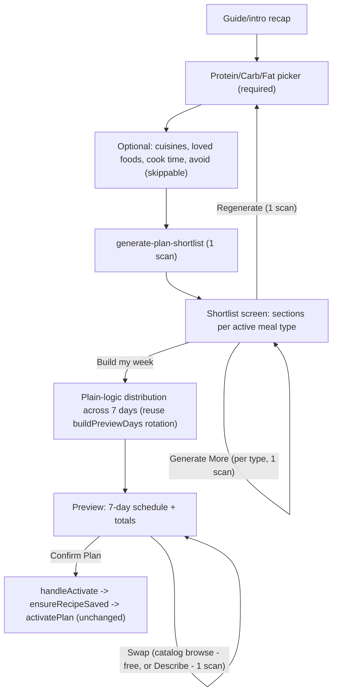

## Current state (confirmed via investigation)

`app/plan/build.tsx` (2559 lines) is one component with `Step = guide | onboarding(4 Qs) | pick | summary | preview`. Today: onboarding collects cuisines/cook-time/loves/avoid into ephemeral `WizardPrefs` (`app/plan/build.tsx:283-290`, never persisted to `UserProfile`) → per active meal slot, `pick` browses a ranked static catalog (`constants/recipeSeed.ts`, 15/category, ranked by `rankForGoal`) with pagination, "Suggest more" (AI top-up via `generate-meal-suggestions` on catalog exhaustion), and "Describe" (1-item AI call) → `summary` recaps a slot's picks with per-item Swap → repeats per slot → `preview` rotates picks across 7 days via `buildPreviewDays`'s `day % picks.length` (`app/plan/build.tsx:240-261`) → `handleActivate` persists any AI (`custom-`) cards into `savedRecipes` via `ensureRecipeSaved` then calls `activatePlan` (`store/useMealStore.ts:1400-1459`), which is the destructive-but-intentional foreground activation path (wipes today+future logs, preserves past — the actual sync-safety net is the separate `hydrateActivePlanIfNeeded`, only invoked by the sync engine on a fresh device, never by this wizard).

`generate-meal-suggestions` (`supabase/functions/generate-meal-suggestions/index.ts`) already implements the exact shared-helper pattern (auth, entitlement/free-scan, independent 30/hr rate bucket, Gemini call w/ timeout+retry, pinned `gemini-3.6-flash`) plus a prompt structure with hard constraints (allergies/avoid/dietary), ratio-based style cues (cuisines/loves, ~1-in-3/4 via `buildRatioInstruction`, `index.ts:150-164`), soft cook-time preference, and description-as-dominant-instruction override. This function stays fully untouched — it's reused as-is for the post-build Describe/catalog-topup swap flow.

## Decisions confirmed

- **Preferences structure**: protein/carb/fat picker (food-item chips, 3 categories) is the new primary/required step. Right after it, an *optional* secondary step resurfaces cuisines, loved foods, and cook time (unchanged, still using the existing ratio-based style-cue system) plus foods-to-avoid (hard constraint, same weight as allergies). Nothing from today's wizard is dropped — it's repositioned as skippable depth after the new picker, not a required gate.
- **AI architecture**: a new dedicated edge function, `generate-plan-shortlist`, makes one Gemini call whose response schema covers every requested meal type at once (e.g. `{ Breakfast: [...], Lunch: [...], Dinner: [...], Snacks: [...] }`). `generate-meal-suggestions` is not modified in behavior.
- **Generate More**: per meal type — a "More options" action under each type's shortlist section, same prefs (no re-picker), appends fresh options to just that type, 1 scan per tap. Distinct from **Regenerate**, which resets back to the protein/carb/fat picker and re-runs the full multi-type call, 1 scan.

## New flow

## Server: new `generate-plan-shortlist` edge function

New file `supabase/functions/generate-plan-shortlist/index.ts`, modeled directly on `generate-meal-suggestions/index.ts`'s structure (same `Deno.serve` handler shape, same shared-helper composition):

- **Auth/entitlement/rate limit**: identical composition (`_shared/auth.ts`, `_shared/entitlement.ts`, `_shared/rateLimit.ts`) with its **own independent bucket**, `FUNCTION_NAME = 'generate-plan-shortlist'`, `RATE_LIMIT = 30`/hour. `consumeFreeScan`/`logAiUsage` fire once per successful call regardless of how many meal types were requested in it (matches "one AI call = one scan," even for the multi-type initial call).
- **Request**: `mealTypes: MealType[]` (non-empty subset of Breakfast/Lunch/Dinner/Snacks — server derives which to actually request from the client's active, non-skipped slots), `proteins/carbs/fats: string[]` (new primary signal, sanitized like `loves`/`avoid` today — dedupe, trim, cap length/count), plus the existing optional secondary fields `cuisines/loves/avoid/cookTime` (sanitized identically to `generate-meal-suggestions` today), and an optional `countPerType` override (used by the client for "Generate More," e.g. `{ Lunch: 3 }`) — when omitted, server applies defaults: Breakfast/Lunch/Dinner = 4, Snacks = 2.
- **Response schema**: built dynamically per requested `mealTypes` (mirrors `buildResponseSchema(mealType)`'s per-type category enum locking, `index.ts:57-100`), producing one array per requested type with the same per-item shape as today (name, calories, cookTimeMin, difficulty, protein/carbs/fats grams, ingredients, steps).
- **Prompt**: protein/carb/fat preferences are the dominant personalization signal (each suggestion should draw primarily on them where sensible), stronger than the light-touch cuisine/loved-food cues. Hard constraints (allergies, avoid list, dietary preferences) always apply, same weight, no exceptions — reused verbatim. Cuisines/loved-food style cues keep today's ratio treatment (~1-in-3/4 per meal type's count, via the shared ratio helper below) so they nudge rather than dominate. Cook time stays a soft preference. No user-typed description field exists in this flow (that's Describe's job, unchanged, elsewhere).
- **Shared helper extraction**: pull `buildRatioInstruction` and the hard-constraint/style-cue string-building logic out of `generate-meal-suggestions/index.ts` into a new `supabase/functions/_shared/mealPromptHelpers.ts`, and have both functions import it. Pure extraction, no behavior change to `generate-meal-suggestions` — avoids duplicating and drifting the same ratio math across two functions.
- **Config**: add a `[functions.generate-plan-shortlist]` block to `supabase/config.toml` (same `enabled/verify_jwt` shape as the others), and document it in `supabase/README.md`.

## Client: new wrapper

New file `ai/generatePlanShortlist.ts`, modeled on `ai/generateMealSuggestions.ts` (`GeneratePlanShortlistError extends AIError`, `invokeAIFunction('generate-plan-shortlist', ...)`), mapping the response into `Record<RecipeCategory, RecipeConcept[]>` using the same per-item mapping helpers (`mapIngredients`/`mapSteps`/`toDifficulty`) already proven in `generateMealSuggestions.ts`.

## Client: `app/plan/build.tsx` rewrite

- **`Step` union simplifies** to `guide | macroPicker | secondaryPrefs | shortlist | preview` (drops `onboarding`'s 4-question-only framing and drops `summary` entirely — its recap+swap role is absorbed into the new `shortlist` step for initial picks, and into `preview`'s existing swap mechanics for everything after).
- **`WizardPrefs` extends** with `proteins: string[]`, `carbs: string[]`, `fats: string[]` alongside the existing `cuisines/cookTime/loves/avoid` fields. Stays ephemeral component state (matches the existing "people's mood changes day to day" rationale already in the code) — no new persisted `UserProfile` fields, so it's naturally "re-shown whenever they hit Regenerate."
- **`macroPicker` step** (new): three chip sections (Protein/Carbs/Fats), each with a curated option list (new constants `PROTEIN_OPTIONS`/`CARB_OPTIONS`/`FAT_OPTIONS`), multi-select, mirroring the existing chip UI pattern from today's "loves" question.
- **`secondaryPrefs` step** (new, optional): reuses today's 4 sub-question screens content-wise (cuisines/cook-time/loves/avoid, same components/validation, e.g. can't love+avoid the same token) behind one skippable step — a visible "Skip" exits straight to generation with only the macro picks + profile data.
- **Generation call**: replaces the old per-slot seeding effect with a single call to `generatePlanShortlist` (loading state shown), requesting `mealTypes = activeSlots` categories, using defaults for counts.
- **`shortlist` step** (new): one screen with a section per active meal type showing its small shortlist as selectable cards (reusing existing card UI), a "Generate More" action per section (calls `generatePlanShortlist` with `mealTypes: [thatType]` and an explicit smaller `countPerType`, appends to that section only), a "Regenerate" action (resets and returns to `macroPicker`), and a "Build my week" CTA. A type with zero favorites picked is treated as skipped for the week, consistent with today's skip semantics.
- **Distribution**: reuse `buildPreviewDays`'s existing `day % picks.length` rotation unchanged (it already produces exactly the desired emergent behavior — one favorite repeats every day, several favorites rotate with variety — matching "no explicit meal-prep-vs-variety question" from the brief) to turn the picked favorites-per-type into `previewDays`.
- **`preview` step and swap mechanics**: kept as-is — `handleCardPress`'s `preview-swap` branch and the quick-swap bottom-sheet modal, both entering the existing `pick`-style catalog-browse/Describe UI, are unchanged (this *is* "the existing browse/Describe interface already built" the brief calls for). The `summary-swap` `Mode` variant is removed since there's no more `summary` step.
- **Gentle nudge on swap**: add a small check run after any swap completes (both the button-swap path and the quick-swap modal path) — recompute that day's calorie total with the new meal in place, compare against `goals.dailyCalories`; if the delta is meaningfully large (proposed threshold: ±15%, easy to tune), show a non-blocking toast (e.g. "Heads up — this swap puts {day} about 15% over your calorie target."). Never blocks the swap, never shown for in-range swaps.
- **Activation**: `handleActivate`/`ensureRecipeSaved`/`activatePlan` are reused completely unchanged — shortlist-sourced favorites still carry `custom-` ids from `conceptToTemplate`, so they funnel through the exact same "save AI cards to `savedRecipes` before activating" logic already in place, and activation still goes through the same protected `activatePlan` path (no changes needed here — already satisfies "must still go through the existing protected plan-activation logic").

## Assumptions flagged for your review (reasonable defaults, easy to adjust)

- Default shortlist sizes: Breakfast/Lunch/Dinner = 4 options each, Snacks = 2. "Generate More" top-up default = 3 per tap.
- Gentle-nudge threshold: ±15% of daily calorie target, calories only (not per-macro) for this first pass.
- Shortlist screen shows all active meal types on one scrollable screen (sections), rather than stepping through one meal type at a time like today's per-slot flow — a deliberate simplification since each section is now only 2-4 cards instead of a full paginated catalog.

## Files touched

- `supabase/functions/generate-plan-shortlist/index.ts` (new)
- `supabase/functions/_shared/mealPromptHelpers.ts` (new — extracted from `generate-meal-suggestions`)
- `supabase/functions/generate-meal-suggestions/index.ts` (refactor only, to import the extracted helpers — no behavior change)
- `supabase/config.toml`, `supabase/README.md` (new function entry)
- `ai/generatePlanShortlist.ts` (new)
- `app/plan/build.tsx` (major rewrite of the wizard flow; activation/swap internals reused)
- `store/types.ts` (only if `WizardPrefs`-equivalent types are shared/exported; otherwise stays local to `build.tsx`)
</plan>
<todos>
[{"id":"shared-prompt-helpers","content":"Extract buildRatioInstruction + hard-constraint/style-cue builders into supabase/functions/_shared/mealPromptHelpers.ts; refactor generate-meal-suggestions to use them (no behavior change)"},{"id":"new-edge-function","content":"Build supabase/functions/generate-plan-shortlist/index.ts (multi-meal-type shortlist, protein/carb/fat primary signal, per-type dynamic schema, own rate-limit bucket) + config.toml/README entries"},{"id":"client-wrapper","content":"Add ai/generatePlanShortlist.ts client wrapper mapping the response into Record<RecipeCategory, RecipeConcept[]>"},{"id":"macro-picker-step","content":"Add the protein/carb/fat picker step (new chip option constants + UI) to app/plan/build.tsx"},{"id":"secondary-prefs-step","content":"Reposition cuisines/cook-time/loves/avoid as an optional, skippable secondary step after the macro picker"},{"id":"shortlist-step","content":"Add the shortlist step: per-meal-type sections, favorite selection, per-type Generate More, and Regenerate"},{"id":"distribution-reuse","content":"Wire shortlist favorites into the existing buildPreviewDays rotation to populate previewDays"},{"id":"remove-summary-step","content":"Remove the old onboarding/pick/summary steps and the summary-swap Mode variant now superseded by the shortlist + preview-swap flow"},{"id":"swap-nudge","content":"Add the gentle over/under-target toast check to both swap paths (preview-swap button and quick-swap modal)"},{"id":"verify-activation","content":"Verify handleActivate/ensureRecipeSaved/activatePlan work unchanged against shortlist-sourced custom cards"},{"id":"manual-test-pass","content":"Manual test: macro picker -> optional secondary prefs (skip and not) -> shortlist generation -> favorites incl. Generate More/Regenerate -> preview -> swap (catalog + Describe) -> nudge message -> activate -> confirm logged history preserved"}]