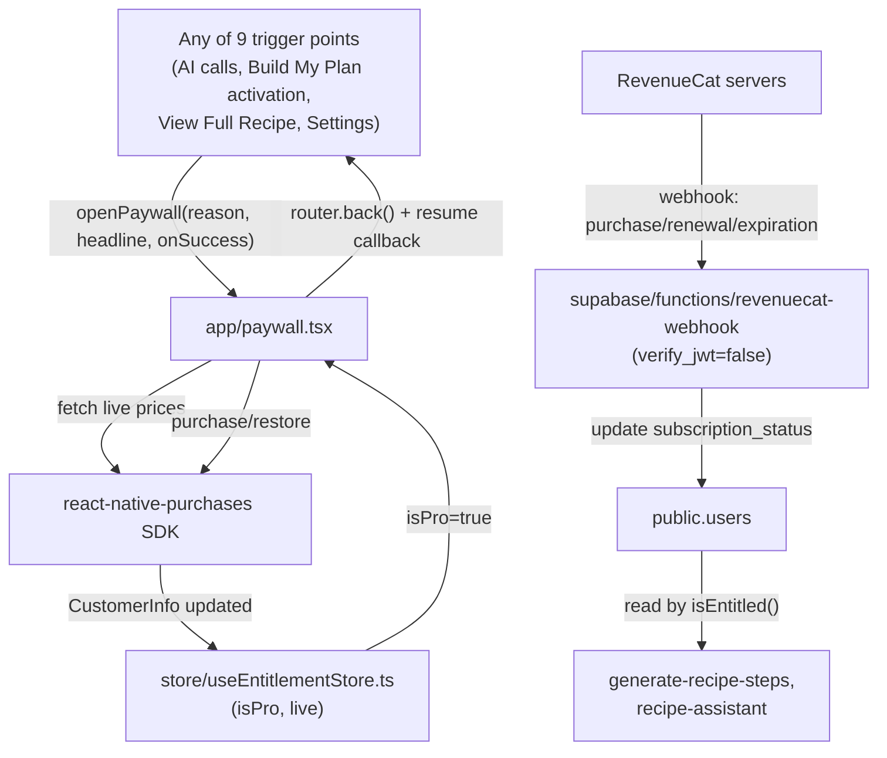

# Reusable Paywall + RevenueCat Integration

## Confirmed decisions
- RevenueCat account/entitlement/offering already exist: entitlement id `Pro`, offering `Default`, packages `monthly`/`yearly`, matching real App Store Connect products at $14.99/$49.99. A working **Test Store** API key (`test_[REDACTED-RevenueCat-test-key-typo-ending-zero]`) will be used now; production key swap is a one-line `.env` change later.
- Android: no Play Console setup exists. Use the same test key for both platforms for now; structure the code so a separate Android key slots in later without a rewrite.
- `is_free` split confirmed for premade recipes: some premade recipes stay free forever, others require Pro. `source: 'manual'` (the plain "Manual" add-meal tab — [components/addMeal/ManualTab.tsx](components/addMeal/ManualTab.tsx)) is a meal the user typed in by hand with zero AI involvement and zero server cost, so — to stay consistent with the app's actual pattern of gating cost, not arbitrary features — it stays free like `'premade'`. Only `source: 'ai'` always requires Pro. A saved bookmark of a premade recipe (`source: 'premade'`) follows that premade recipe's own `isFree` flag, not a blanket rule.
- A RevenueCat→Supabase webhook is in scope, must handle purchase, renewal, and actual expiration (not just the "auto-renew turned off" cancellation event) — see the dedicated section below for why those are different events.
- Critical, easy to miss: **this app currently runs only in Expo Go** (`package.json` — no `eas.json`, no `ios`/`android` folders, no `expo-dev-client`). `react-native-purchases` is a native module and cannot load in Expo Go. This plan adds `expo-dev-client`, but actually producing a runnable build (`npx expo run:ios` locally, or an EAS dev build) is a manual step for you to run — same as the existing precedent of documenting `supabase functions deploy`/`db push` for you to run rather than the agent running them.

## Architecture

Two parallel sources of entitlement truth, both rooted in RevenueCat:
- **Client-side, instant**: `useEntitlementStore.isPro`, fed by `Purchases.addCustomerInfoUpdateListener` and refreshed immediately after a purchase/restore. Used for the two brand-new client-only gates (Build My Plan activation, View Full Recipe) since they need no server round-trip and must unlock the instant a purchase completes.
- **Server-side**: `users.subscription_status`, still read by `isEntitled()`/`resolveEntitlement()` in the 4 already-built subscription-gated edge functions. Kept fresh by the new webhook (typically fires within seconds of a real purchase). There's a small, accepted race window right after purchase before the webhook lands — not solved by this plan, consistent with how every real RevenueCat integration works.

## 1. RevenueCat SDK setup

- `npx expo install react-native-purchases` and `npx expo install expo-dev-client`.
- Add to `.env`: `EXPO_PUBLIC_REVENUECAT_API_KEY=test_[REDACTED-RevenueCat-test-key-typo-ending-zero]` (one shared key for iOS+Android today; swapping to a real per-platform key later is editing this one line, or splitting into `EXPO_PUBLIC_REVENUECAT_IOS_KEY`/`_ANDROID_KEY` if/when Play Console exists).
- New [lib/purchases.ts](lib/purchases.ts):
  - `configurePurchases()` — calls `Purchases.configure({ apiKey })` once, called from `app/_layout.tsx` at root mount (guarded so it only runs once).
  - `syncPurchasesIdentity(userId: string | null)` — `Purchases.logIn(userId)` when signed in, `Purchases.logOut()` when signed out. Wired into the existing session-change effect in [lib/auth.tsx](lib/auth.tsx) (`AuthProvider`'s `onAuthStateChange` handler) so RevenueCat's `app_user_id` always equals the Supabase `auth.users.id` — this is what lets the webhook match a purchase event back to the right `users` row.
  - `fetchProPackages()` — `Purchases.getOfferings()`, pulls the `Default` offering, returns `{ monthly, yearly }` by matching `availablePackages[].identifier`.
  - `purchasePackage(pkg)` / `restorePurchases()` — thin wrappers; swallow RevenueCat's `userCancelled` error silently (no error UI), surface real failures.
  - Registers `Purchases.addCustomerInfoUpdateListener(...)` once (inside `configurePurchases()`) to push every update into the entitlement store below.
- New [store/useEntitlementStore.ts](store/useEntitlementStore.ts) (NOT persisted — always live from the SDK, like [store/useToastStore.ts](store/useToastStore.ts) is for toasts): `{ isPro: boolean, customerInfo, loading, refresh() }`. `isPro` = `customerInfo.entitlements.active['Pro'] !== undefined`.

## 2. Reusable paywall trigger + resume-after-purchase handoff

- New [store/usePaywallStore.ts](store/usePaywallStore.ts) (not persisted): holds `pendingResume: (() => void) | null`. Mirrors the existing `pendingSwap`/`pendingRecipeConcept` Zustand-handoff pattern in [store/types.ts](store/types.ts), but a direct in-memory callback works here since we never leave the running JS process — simpler than serializing retry state through router params.
- New [lib/paywall.ts](lib/paywall.ts): `openPaywall({ reason: 'scan_limit' | 'premium_feature', headline?: string, onSuccess?: () => void })` — stores `onSuccess` in `usePaywallStore`, then `router.push({ pathname: '/paywall', params: { reason, headline } })`. This single function replaces every existing `Alert.alert('Premium feature', ...)` block.
- In `app/paywall.tsx`, on a successful purchase or restore: refresh `useEntitlementStore`, `router.back()`, then call and clear `pendingResume`. For most call sites `onSuccess` is literally "re-run the same function that just failed" (it's already a closure with everything it needs) — e.g. `handleActivate` in `app/plan/build.tsx` passes `onSuccess: handleActivate` itself.

## 3. `app/paywall.tsx` — the screen

Registered in [app/_layout.tsx](app/_layout.tsx) as `<Stack.Screen name="paywall" options={fullScreenSlide} />`, matching every other full-screen flow (`ai/custom`, `plan/build`, etc.) — a pushed card, not a native modal, per this app's established convention. Header has a close `X` (→ `router.back()`, no unlock, rest of app stays usable — never a hard paywall).

- **Headline** (from `reason` route param):
  - `scan_limit` → fixed copy, ignores any passed headline: "You've used all 5 free AI scans."
  - `premium_feature` → uses the passed `headline` param verbatim, one per call site (see wiring table below).
- **Benefits list** (static, same for both reasons): unlimited AI scans, full recipes, Custom Recipe generation, the Recipe Assistant, Build My Plan.
- **Plan cards** — prices come only from `fetchProPackages()`, never hardcoded:
  - Yearly card: bordered/emphasized, default-selected (filled checkmark). Badge = `Math.round((1 - pkg.yearly.product.price / (pkg.monthly.product.price * 12)) * 100)+ '% off'`, computed live so it can't drift from real pricing.
  - **Hierarchy is the whole point here**: the dominant, largest text is `pkg.yearly.product.priceString + ' billed annually'`. A visibly smaller line below/beside it shows `pkg.yearly.product.price / 12`, formatted with `Intl.NumberFormat(locale, { style: 'currency', currency: pkg.yearly.product.currencyCode })`, labeled "≈ X/mo equivalent" — never implying that's the actual charge. This exact ordering is required, not a style choice.
  - Monthly card: plain `pkg.monthly.product.priceString + '/mo'`, no badge, no de-emphasis beyond simply not having one.
  - Tapping a card updates local `selected: 'monthly' | 'yearly'` state; filled checkmark follows selection, reusing the existing radio/checkmark visual convention already used in `app/ai/custom.tsx`'s `MealTypeScreen`.
- **Primary button** "Get Macrotri Pro" → `purchasePackage(selected === 'yearly' ? pkg.yearly : pkg.monthly)`.
- **Restore Purchases** (smaller link below) → `restorePurchases()`; if nothing found, a plain toast, not an error.
- **Fine print**: standard auto-renewal/cancel-via-App-Store disclosure text, plus Terms of Use / Privacy Policy links defined as named constants at the top of the file (`const TERMS_URL = 'https://example.com/terms'`, `const PRIVACY_URL = 'https://example.com/privacy'`) opened via `Linking.openURL` — a one-line swap once real docs exist.
- Loading state while offerings are being fetched (skeleton/spinner on the cards) since prices are never allowed to be hardcoded fallback text.

## 4. `isFree` for premade recipes (new, since nothing like this exists client-side today)

- The DB's `premade_recipe_access.is_free` table only covers the original 6 seeded placeholder recipes and isn't fetched by the client at all — the actual 60-recipe catalog in [constants/recipeSeed.ts](constants/recipeSeed.ts) is 100% local and never touches Supabase. Given that, the consistent fix is a local flag, not a new network fetch layer.
- Add `isFree?: boolean` to `RecipeTemplate` in [store/types.ts](store/types.ts). Default (unset) = Pro-only.
- In `constants/recipeSeed.ts`, mark the first 2 recipes of each of the 4 categories (`Breakfast`/`Lunch`/`Dinner`/`Snacks`) as `isFree: true` — 8 of 60 free, a genuine-but-limited preview matching the 5-free-scans philosophy. This is a one-line-per-recipe, trivially adjustable default; flag it for you to reassign to specific named recipes if you'd rather choose deliberately.
- New helper (in `lib/paywall.ts` or a small `lib/recipeAccess.ts`): `recipeRequiresPro(resolved): boolean` — premade → `!premade.isFree`; saved with `source: 'premade'` → look up the referenced premade's `isFree`; saved with `source: 'ai'` → always `true`; saved with `source: 'manual'` → always `false` (no AI cost, stays free).

## 5. Wiring every trigger point

Mechanical replacement of the existing `Alert.alert('Premium feature', ...)` blocks with `openPaywall(...)`, using deterministic `reason` mapping by which backend the call site hits (no server changes needed for this split — a `not_premium` from a free-scan-pool function always means "scans exhausted"; from a subscription-only function it always means "not subscribed"):

**`reason: 'scan_limit'`** (calls generate-plan-shortlist / generate-meal-suggestions / generate-recipe-concept / estimate-nutrition / fix-meal / scan-meal / scan-kitchen / suggest-kitchen-recipes):
- [app/plan/build.tsx](app/plan/build.tsx) `handleAIError` (3 call sites: shortlist build, generateMoreForType, Describe)
- [app/ai/custom.tsx](app/ai/custom.tsx) `handleAIError` (submitDescribe, submitFix)
- `app/ai/what-can-i-make.tsx`, `components/grocery/KitchenScanModal.tsx`, `components/addMeal/AITab.tsx`, `components/addMeal/ScanTab.tsx`
- Each `onSuccess` just re-invokes the same function that failed.

**`reason: 'premium_feature'`** (calls generate-recipe-steps / recipe-assistant — already subscription-only):
- `app/ai/custom.tsx` `handleGenerate` catch → headline "Unlock the full recipe with Pro", `onSuccess: handleGenerate`
- `app/recipe/detail/[id].tsx` `RecipeAiChat` catch → headline "Chat with the Recipe Assistant is a Pro feature", `onSuccess`: retry sending the same last message

**New gates (`reason: 'premium_feature'`, checked via `useEntitlementStore.isPro`, no AI call involved):**
- `app/plan/build.tsx` `handleActivate` — gate at the very top, before the `plan` object is built. Headline "Unlock Build My Plan with Pro", `onSuccess: handleActivate`.
- `app/recipe/detail/[id].tsx` — when `recipeRequiresPro(resolved)` and `!isPro`, replace the Ingredients/Steps sections with a locked-state card (mirrors the `unlockCard` pattern already built in `app/ai/custom.tsx`'s concept-preview screen) with an "Unlock with Pro" button. Headline "Unlock the full recipe with Pro".

**Settings entry** (browsing context, not blocked by anything):
- [app/settings.tsx](app/settings.tsx) — new `ACCOUNT` section row "Upgrade to Pro" → `openPaywall({ reason: 'premium_feature', headline: 'Upgrade to Macrotri Pro' })`, no `onSuccess` needed.
- [app/profile.tsx](app/profile.tsx) — the existing "Upgrade to Premium"/"Manage Subscription" button currently points at `/settings/coming-soon`; redirect it to the same paywall (generic headline, same as Settings) instead.

## 6. RevenueCat → Supabase webhook (keeps server-side gates in sync)

New [supabase/functions/revenuecat-webhook/index.ts](supabase/functions/revenuecat-webhook/index.ts) — the first function in this project with `verify_jwt = false` (RevenueCat's servers call it directly, no Supabase user session exists). Security: compare a static `Authorization` header against a `REVENUECAT_WEBHOOK_SECRET` env var (set via `supabase secrets set`, and separately entered into the RevenueCat dashboard's webhook config — that dashboard step is manual, cannot be done from the codebase).

- Uses `createAdminClient()` from `_shared/auth.ts` as-is; `getAuthedUser` is not applicable here (identifies the target user via the payload's `app_user_id`, which is the Supabase `auth.users.id` set via `Purchases.logIn`).
- Event handling, based on RevenueCat's `event.type`:
  - `INITIAL_PURCHASE`, `RENEWAL`, `UNCANCELLATION`, `PRODUCT_CHANGE`, `NON_RENEWING_PURCHASE`, `TRANSFER` → `subscription_status = 'active'`, `subscription_provider = 'revenuecat'`, `subscription_expiry_date` from `event.expiration_at_ms`.
  - `EXPIRATION` → `subscription_status = 'expired'`. This is the actual "subscription really ended" event.
  - `CANCELLATION` → **intentionally does not downgrade status.** This event only means auto-renew was turned off; the entitlement (and the period already paid for) remains active until the real `EXPIRATION` event fires later. Downgrading immediately here would cut off access the user already paid for — this is the correct behavior for "flip back down when it actually ends," not a gap.
  - `BILLING_ISSUE` → no-op (Apple/Google are still retrying; entitlement typically stays active during the grace period).
  - Unknown/other types → log and no-op.
  - Always return `200` quickly (even for no-op events) so RevenueCat doesn't retry-storm; updates are naturally idempotent (applying the same event twice yields the same end state), so no separate dedupe table is needed for this scope.
- Register in `supabase/config.toml` (`verify_jwt = false`) and document in `supabase/README.md` (deploy command, the `REVENUECAT_WEBHOOK_SECRET` secret, and the manual "paste this function's URL into RevenueCat's dashboard webhook settings" step that only you can do).

## Files touched (summary)
- New: `lib/purchases.ts`, `lib/paywall.ts`, `store/useEntitlementStore.ts`, `store/usePaywallStore.ts`, `app/paywall.tsx`, `supabase/functions/revenuecat-webhook/index.ts`
- Edited: `lib/auth.tsx` (identity sync), `app/_layout.tsx` (configurePurchases call + route registration), `store/types.ts` (`RecipeTemplate.isFree`), `constants/recipeSeed.ts` (mark free recipes), `app/plan/build.tsx` (handleAIError sites + new activation gate), `app/ai/custom.tsx` (handleAIError sites), `app/recipe/detail/[id].tsx` (chat gate + new View Full Recipe gate), `app/ai/what-can-i-make.tsx`, `components/grocery/KitchenScanModal.tsx`, `components/addMeal/AITab.tsx`, `components/addMeal/ScanTab.tsx`, `app/settings.tsx`, `app/profile.tsx`, `.env`, `supabase/config.toml`, `supabase/README.md`, `package.json`
