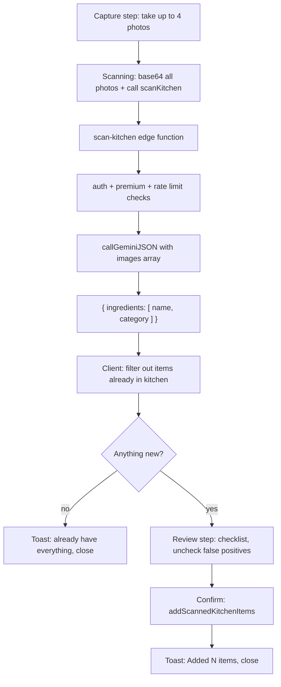

# scan-kitchen — photo-based ingredient scanning

## Current state (investigated)

- The whole feature is a UI-only shell: [`components/grocery/KitchenScanModal.tsx`](components/grocery/KitchenScanModal.tsx). It already supports multiple photos via a repeated single-shot loop (`ImagePicker.launchCameraAsync` per tap, appended to a `photos: string[]` of URIs, with a thumbnail strip + remove button). Photos are captured **without** `base64: true`, unlike `ScanTab`. There is no true multi-select, but the loop-and-append UX already covers "take several photos in one session."
- `finish()` is a pure fake: a `setTimeout` then an `Alert` saying AI isn't wired up yet. Photos are discarded. No AI call, no old client, nothing to rip out.
- Entry points: [`app/kitchen.tsx`](app/kitchen.tsx) and `app/ai/what-can-i-make.tsx` both open the same `KitchenScanModal` — wiring the modal covers both.
- There is currently **no review/confirm screen** anywhere in this flow.
- Data model: kitchen items are `GroceryItem` (in [`store/types.ts`](store/types.ts)) with `section: 'kitchen'`, keyed by normalized name — no separate id/quantity. `IngredientCategory` is an 8-value union:
  ```167:175:store/types.ts
  export type IngredientCategory =
    | 'Proteins' | 'Carbs & Grains' | 'Fruits & Vegetables' | 'Dairy'
    | 'Oils & Fats' | 'Spices & Seasonings' | 'Condiments' | 'Other';
  ```
- [`constants/ingredientCategories.ts`](constants/ingredientCategories.ts)'s `classifyIngredient()` is a keyword-based MVP stand-in whose own header comment says it'll be "replaced by AI categorization once the AI client is wired up" — confirms the AI should assign category directly rather than going through this function.
- Manual add today is `addManualKitchenItem(name)` in [`store/useMealStore.ts:1069`](store/useMealStore.ts) — normalizes name, classifies category, inserts into `grocery.items`, dedupes silently if already in kitchen.
- Sync is fully generic: kitchen items sync to a `kitchen_items` Supabase table automatically. The `Projector` in [`lib/sync/projector.ts`](lib/sync/projector.ts) diffs `state.grocery.items` on every store change and enqueues to the outbox — **no new sync code needed**, as long as new items land in `grocery.items` via `set()`.
- `_shared/gemini.ts`'s `callGeminiJSON` currently only accepts a single `imageBase64`/`imageMimeType` — needs generalizing to accept multiple images for this feature.

## Decisions (confirmed with user)

- **Review screen, scoped down**: add a confirm-and-remove checklist (detected ingredients, grouped by category, uncheck to exclude) before committing to My Kitchen. No "add a missed item" capability in this screen — that's what the existing manual add row is for. Reuse existing ingredient-row UI patterns rather than designing new ones.
- **Max 4 photos** per scan-kitchen request.
- **Free-scan gap** (investigated, confirmed real): `users.free_scans_remaining` exists in the schema (`default 5`, trigger-protected from client writes) but none of the three shipped AI functions ever read it — `_shared/entitlement.ts`'s `isEntitled()` only checks `subscription_status ∈ {'active','trial'}`. Every free-tier user has been hitting `not_premium` on their first AI call, with 0 of their 5 free scans ever granted. **Decision: fix this now, across all four functions** (estimate-nutrition, fix-meal, scan-meal, scan-kitchen), not just scan-kitchen.
- **Photo compression gap** (investigated, confirmed real): no image is ever resized anywhere in the app — capture calls only set a JPEG `quality` (0.4-0.5), which does not touch pixel dimensions, so a modern phone photo can still be several MB. The ~500KB-1MB compression target from the original spec was never implemented, even for scan-meal's single image. **Decision: fix this now, in both scan-kitchen and scan-meal's capture paths** (`KitchenScanModal.tsx` and `ScanTab.tsx`), via one shared resize+compress helper rather than writing it twice.

## Server side

### 1. Generalize `_shared/gemini.ts` for multiple images

Replace the single `imageBase64?`/`imageMimeType?` options with `images?: { base64: string; mimeType: string }[]`, building one `inlineData` part per image (images first, then text — same ordering rule as today). Update [`scan-meal/index.ts`](supabase/functions/scan-meal/index.ts)'s one call site to pass `images: [{ base64: imageBase64, mimeType }]` — mechanical change, no behavior difference for scan-meal, but it does mean redeploying scan-meal alongside scan-kitchen since they share the `_shared/` bundle.

### 2. New edge function `supabase/functions/scan-kitchen/index.ts`

Mirrors `scan-meal/index.ts`'s structure exactly:
- `handlePreflight`, `getAuthedUser`, `isEntitled` (premium gate), `isRateLimited`/`logAiUsage` with **`FUNCTION_NAME = 'scan-kitchen'`** — independent 30/hour bucket, same `RATE_WINDOW_MS`.
- Request body: `{ images: [{ base64, mimeType }, ...] }`. Validate: 1–4 images, each ≤ existing 10MB base64 abuse cap, plus a combined-total cap (~16MB) as defense-in-depth against Gemini's inline-payload ceiling.
- `GEMINI_MODEL = 'gemini-3.6-flash'` (same pinned model — multimodal, already proven working).
- Slightly longer `GEMINI_TIMEOUT_MS` (~25s) than scan-meal's 20s, since up to 4 images take longer to process.
- Response schema — object-wrapped array (consistent with estimate-nutrition/fix-meal's convention), with `category` constrained to the exact 8-value enum so Gemini can't invent categories:
  ```json
  { "ingredients": [ { "name": "string", "category": "enum of the 8 IngredientCategory values" } ] }
  ```
- Prompt instructs: identify distinct food/ingredient items visible across all provided photos, one entry per unique ingredient even if it appears in multiple photos, assign the best-fitting category from the fixed list (default `Other` if unsure), ignore non-food items and packaging text.
- No `ai_usage_log` charge on failure — matches existing pattern.

### 3. Config + docs

- `supabase/config.toml`: add `[functions.scan-kitchen]` (`enabled = true`, `verify_jwt = true`).
- `supabase/README.md`: add a `scan-kitchen` row to the Edge Functions table; update the `_shared/gemini.ts` row to describe multi-image support; add `deploy scan-kitchen` (and redeploy `scan-meal`) to the deploy section.

## Client side

### 4. New client wrapper `ai/scanKitchen.ts`

Mirrors `ai/scanMeal.ts`: calls `invokeAIFunction('scan-kitchen', { images }, { logPrefix: '[scanKitchen]', makeError: (code, msg) => new ScanKitchenError(code, msg), ... })`, returns a mapped `{ name: string; category: IngredientCategory }[]`, defaulting/validating `category` against the known 8 values (defense in depth beyond the schema enum). A `ScanKitchenError extends AIError`, same pattern as `ScanError`/`FixError`.

### 5. Store: bulk add action

Add `addScannedKitchenItems(items: { name: string; category: IngredientCategory }[]): number` to [`store/useMealStore.ts`](store/useMealStore.ts) (declared in `AppStore`, `store/types.ts`), next to `addManualKitchenItem`. Same normalize-key/dedupe-if-already-in-kitchen logic, but takes the AI-assigned category directly instead of calling `classifyIngredient`. Returns the number actually added (post-dedupe) for the confirmation toast.

### 6. Shared category constants

`CATEGORY_ORDER`/`CATEGORY_DOT` currently exist as two independent copies — [`app/kitchen.tsx`](app/kitchen.tsx) and `app/ai/what-can-i-make.tsx` (confirmed via investigation) — with slightly different hex values between the two. Extract a single shared version into `constants/ingredientCategories.ts` and update **both** call sites to import it, so the My Kitchen list, the "What can I make?" grouping, and the new review checklist all render categories identically.

### 7. Rework `KitchenScanModal.tsx`

- Capture: add `base64: true` to `launchCameraAsync`; `photos` becomes `{ uri: string; base64: string; mimeType: string }[]`. Cap at 4 — disable/hide "Take Another Photo" past the limit with a short inline note.
- Add a `step: 'capture' | 'scanning' | 'review'` state machine in the same modal, rather than a routed screen. Considered following this app's other precedent of full routed screens for substantial review/confirm steps (`app/ai/what-can-i-make.tsx`, `app/ai/custom.tsx`), but rejected it here: the review step needs the in-memory base64 photo data and raw scan results, which aren't practical to pass through router params (string-only, size-limited) — keeping capture → scan → review in one component avoids re-fetching or re-encoding photos across a navigation boundary. The review step's JSX will still be broken out into its own render function/section (or a local sub-component in the same file) so the file stays readable despite the added step.
- `finish()` calls `scanKitchen(...)`; on success, filter out any ingredient whose normalized name is already in the kitchen (mirrors `addManualKitchenItem`'s existing dedupe), then:
  - if nothing new remains, skip straight to a toast ("You already have everything found") and close;
  - otherwise show the **review step**: a checklist grouped by category (reusing the extracted `CATEGORY_ORDER`/`CATEGORY_DOT`), each row defaulting checked with a tap-to-toggle affordance (no existing checkbox component — a simple icon-toggle row, consistent with existing `Ionicons` usage), footer "Add N items" (disabled at 0 selected) and a discard/cancel action.
- On confirm: `addScannedKitchenItems(selected)`, `showToast(`Added ${n} item${n===1?'':'s'} to your kitchen`)`, close + reset.
- Error handling mirrors `ScanTab`'s `handleScanError`: `not_premium` → `Alert` with the existing paywall CTA (`router.push('/settings/coming-soon', { title: 'Subscription' })`), `rate_limited`/`ai_failed`/`unauthorized` → `showToast`, generic fallback toast otherwise.

## Free-scan entitlement fix (all 4 AI functions)

### 8. New migration: atomic `consume_free_scan` RPC

New file `supabase/migrations/20260726010000_consume_free_scan.sql` (next after `20260718010000_plan_sync.sql`), following the existing `security definer plpgsql` style already used for `handle_new_user`/`protect_user_columns` in the base schema migration:

```sql
create or replace function public.consume_free_scan(p_user_id uuid)
returns boolean
language plpgsql
security definer
set search_path = public
as $$
declare
  remaining integer;
begin
  update public.users
  set free_scans_remaining = free_scans_remaining - 1
  where id = p_user_id and free_scans_remaining > 0
  returning free_scans_remaining into remaining;
  return remaining is not null;
end;
$$;
```

A single `UPDATE ... WHERE free_scans_remaining > 0 RETURNING ...` is atomic under Postgres row locking — safe against concurrent requests decrementing past zero — without needing a separate row lock/read step. Returns `true` only if a scan was actually consumed.

### 9. `_shared/entitlement.ts`: add `resolveEntitlement`

Keep `isEntitled(status)` as-is (still used for the plain paid/trial check) and add:

```ts
export async function resolveEntitlement(
  admin: SupabaseClient,
  status: string | null | undefined,
): Promise<{ allowed: boolean; freeScansRemaining: number }> { ... }
```

Gating logic per function, matching the existing "only charge on success" philosophy already used for rate-limit logging (`logAiUsage` is only called after a successful Gemini response, so failures don't burn quota):
1. **Pre-check (gate)**: `isEntitled(status) || profileRow.free_scans_remaining > 0` — if neither, return `not_premium` (403), same as today.
2. **Post-success**: only if the user is *not* on a paid/trial plan, call `admin.rpc('consume_free_scan', { p_user_id: user.id })` right alongside the existing `logAiUsage` call — so a free scan is only spent once the AI call actually succeeded, never on a Gemini failure/timeout.
3. Minor copy tweak to the `not_premium` message so it's accurate once free scans are exhausted (e.g. "You've used all your free AI scans. Upgrade to Premium for unlimited access.") — the error code/paywall trigger stays the same, no client-side branching changes needed.

### 10. Wire into all four functions

Apply the same two-line change (pre-check + post-success consume) to `estimate-nutrition/index.ts`, `fix-meal/index.ts`, `scan-meal/index.ts`, and the new `scan-kitchen/index.ts` — identical pattern in each, no per-function divergence. All four get redeployed together.

## Photo compression (scan-kitchen + scan-meal)

### 11. New dependency + shared helper

Add `expo-image-manipulator` (not currently installed) and a new shared helper, e.g. `lib/media/compressPhoto.ts`, using the current (non-deprecated) contextual API confirmed for this app's Expo SDK 54:

```ts
import { ImageManipulator, SaveFormat } from 'expo-image-manipulator';

const MAX_DIMENSION = 1280; // long edge, px — plenty for Gemini vision
const JPEG_COMPRESS = 0.6;

export async function compressPhotoToBase64(uri: string): Promise<{ base64: string; mimeType: string }> {
  const context = ImageManipulator.manipulate(uri);
  context.resize({ width: MAX_DIMENSION });
  const rendered = await context.renderAsync();
  const result = await rendered.saveAsync({ compress: JPEG_COMPRESS, format: SaveFormat.JPEG, base64: true });
  return { base64: result.base64!, mimeType: 'image/jpeg' };
}
```

Resizing the long edge (camera photos are full sensor resolution, often 3000px+) is the part that was missing — the existing `quality` flags only tune JPEG compression, not dimensions. 1280px + compress 0.6 should reliably land photos in the ~150-500KB range (comfortably inside the ~500KB-1MB spec target); exact numbers can be tuned after a quick real-device test during implementation.

### 12. Wire into both capture paths

- `ScanTab.tsx`: after `takePictureAsync`/`launchImageLibraryAsync` returns a `uri`, run it through `compressPhotoToBase64` instead of using the picker's own `base64`/`quality` output directly.
- `KitchenScanModal.tsx`: same, applied to each of the up to 4 captured photos.
- Server-side base64-length caps (per-image ~10MB, combined ~16MB) stay as defense-in-depth against a client bug/bypass, but with compression in place they should never actually be hit in normal use.

## Flow diagram



## Files touched

- `supabase/functions/_shared/gemini.ts` (generalize to multi-image)
- `supabase/functions/_shared/entitlement.ts` (add `resolveEntitlement`)
- `supabase/functions/scan-meal/index.ts` (multi-image call-site update + free-scan wiring)
- `supabase/functions/estimate-nutrition/index.ts`, `supabase/functions/fix-meal/index.ts` (free-scan wiring only)
- `supabase/functions/scan-kitchen/index.ts` (new)
- `supabase/migrations/20260726010000_consume_free_scan.sql` (new)
- `supabase/config.toml`, `supabase/README.md`
- `ai/scanKitchen.ts` (new)
- `store/types.ts`, `store/useMealStore.ts` (new bulk action)
- `constants/ingredientCategories.ts` (extract shared category display constants)
- `app/kitchen.tsx` and `app/ai/what-can-i-make.tsx` (both use the extracted constants instead of their own local copies)
- `lib/media/compressPhoto.ts` (new shared compression helper)
- `package.json` (add `expo-image-manipulator`)
- `components/addMeal/ScanTab.tsx` (wire compression into capture)
- `components/grocery/KitchenScanModal.tsx` (real capture + compression + review + wiring)
