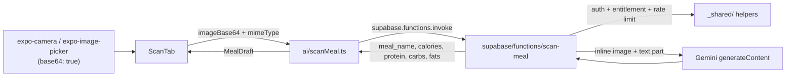

## Scope (per your decisions)

- **Transport**: inline base64 in the edge function request body — no Supabase Storage, no new infra. The camera/picker already produce base64 for free.
- **Coverage**: only `ScanTab`'s initial capture (`handleCapture`) and upload (`handleUpload`) paths. The image-based re-evaluate/fix flow (`handleReevaluate`) stays on the legacy OpenAI client for a future pilot — including its existing bug (sends a local `file://` path instead of the photo), left untouched.
- **Photo persistence**: out of scope. The pre-existing gap (meal photos aren't durably stored server-side) is unrelated and deferred.
- **Response shape**: minimal — `meal_name, calories, protein, carbs, fats` only, matching `ScanTab`'s current `MealDraft` (no ingredients/category/health_rating). Reuses `mapDraft` from `ai/aiEdgeClient.ts` as-is — zero new mapping code.

## 1. Extend `_shared/gemini.ts` to support an optional image part

`callGeminiJSON` currently builds a single text-only user part. Add optional `imageBase64`/`imageMimeType` fields to `CallGeminiJSONOptions`; when present, prepend an `inlineData` part to the request's `contents[0].parts` alongside the text part (image first, per Gemini's own guidance for single-image prompts). Fully backward-compatible — `estimate-nutrition`/`fix-meal` don't pass these fields, so their behavior is unchanged.

## 2. New edge function: `supabase/functions/scan-meal/index.ts`

Composes the same shared helpers as the other two functions:

- `handlePreflight`, `errorResponse`/`jsonResponse`, `createAdminClient`/`getAuthedUser`, `isEntitled`
- `isRateLimited`/`logAiUsage` with `FUNCTION_NAME = 'scan-meal'`, independent 30/hour bucket
- `callGeminiJSON`/`GeminiTimeoutError`, same `GEMINI_MODEL = 'gemini-3.6-flash'` (multimodal-capable), with an explicit `timeoutMs: 20000` (a bit more headroom than the 15s default for image processing)

Request body: `{ imageBase64: string, mimeType?: string }` (bare base64, no `data:...;base64,` prefix; `mimeType` defaults to `'image/jpeg'` since both capture paths always produce JPEG).

Validation: `imageBase64` required, non-empty, length-capped (~10MB base64 string, comfortably under Gemini's 100MB inline limit and Supabase's 150MB function memory ceiling — real captures from this pipeline are 0.5-2MB).

Response schema: `{ meal_name, calories, protein, carbs, fats }`, all required — no ingredients/meal_type/health_rating (minimal, per your decision).

Prompt: system instruction asks Gemini to identify the meal from the photo and estimate nutrition for the visible portion; reuses the same profile-context fetch (dietary preferences/allergies) as `estimate-nutrition` for consistency. No free-text description input (photo-only, matching today's `handleCapture`/`handleUpload`).

Error handling: same contract — `GeminiTimeoutError` → "The AI scanner took too long to respond. Please try again."; other failures → "Could not identify this meal. Please try again."; usage logged only after success.

Add `[functions.scan-meal]` to `supabase/config.toml` (`enabled = true`, `verify_jwt = true`).

## 3. New client wrapper: `ai/scanMeal.ts`

`scanMeal(imageBase64, mimeType)` → `Promise<MealDraft>`, built on `invokeAIFunction`/`mapDraft` from `ai/aiEdgeClient.ts` (same pattern as `estimateNutrition.ts`/`fixMeal.ts`). New `ScanError extends AIError`.

## 4. Wire into `components/addMeal/ScanTab.tsx`

- `handleCapture`/`handleUpload`: replace `aiClient.parseMeal({ imageUri: dataUri }, context)` with `scanMeal(shot.base64 / asset.base64, 'image/jpeg')` — simpler than today, since the data-URI construction was only needed for the old OpenAI call; the raw base64 the camera/picker already returns can be sent directly now. `capturedUri` (local file URI, used for the backdrop image + `photoUri` persistence) is untouched.
- **Add user-facing error handling** (currently just `console.warn`, no feedback at all): branch on `ScanError`/`AIError.code` the same way `AITab` does — `not_premium` → `Alert` pointing at the paywall (reuse the same copy/pattern as `AITab.handleAIError`); `rate_limited`/`ai_failed`/`unauthorized` → `showToast(...)` (already imported via `useToastStore` in this file for the bookmark toggle, so no new dependency).
- **Remove the `isStubAI` badge** (camera overlay currently shows "Stub mode (no API key)" based on `EXPO_PUBLIC_OPENAI_API_KEY`) — this is the same class of bug already fixed in `AITab`: the primary capture/upload paths no longer touch the OpenAI client at all, so the badge would now be actively misleading. Barcode mode never used AI either, so removing it is safe across all three modes.
- `handleReevaluate` and the `aiClient`/barcode paths are untouched.

## 5. Docs

- Add `scan-meal` row to the Edge Functions table in `supabase/README.md`, add its deploy command.

## 6. Deploy & verify

- Deploy `scan-meal` (and the updated `_shared/gemini.ts`, picked up by all three functions on next deploy of each).
- Manual test: capture a photo via Scan mode, confirm a real estimate comes back (not stub, not silent failure); also test Upload mode; confirm rate-limit/premium error paths surface visibly instead of silently failing.

## Files touched

- New: `supabase/functions/scan-meal/index.ts`, `ai/scanMeal.ts`
- Edited: `supabase/functions/_shared/gemini.ts` (optional image part), `supabase/config.toml`, `supabase/README.md`, `components/addMeal/ScanTab.tsx`