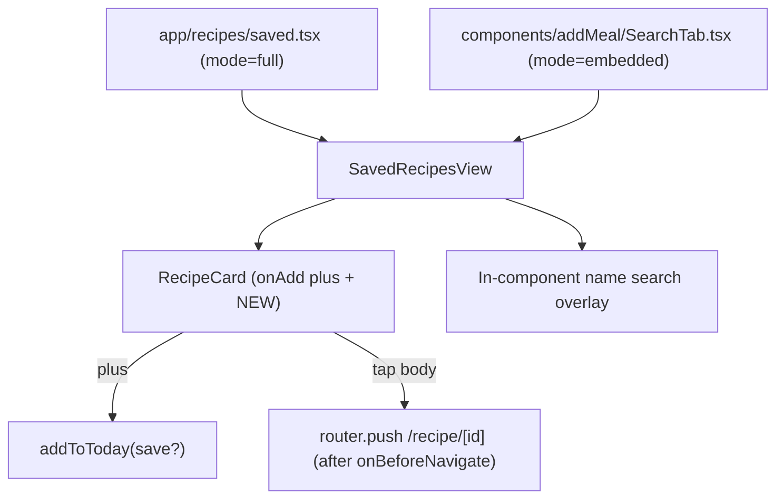

## Context / key findings

- The + button's `SearchTab` ([components/addMeal/SearchTab.tsx](meal-app/components/addMeal/SearchTab.tsx)) is currently an Open Food Facts database + "My Library" search. Per the confirmed decision it is fully replaced by the embedded Saved Recipes view (DB/library search removed from the + flow).
- `AddMealScreen` ([components/addMeal/AddMealScreen.tsx](meal-app/components/addMeal/AddMealScreen.tsx)) is a React Native `<Modal>` (fullScreen), NOT an expo-router screen. So router pushes from inside it render behind the modal. Therefore: the name-search is an in-component overlay, and "open preview"/"create new" from the embedded tab must close the modal first, then navigate.
- The favourite bookmark already lives on the preview ([app/recipe/[id].tsx](meal-app/app/recipe/[id].tsx)) and detail pages, so item 4's "favourite moves to preview/detail" is largely done already.
- AI chat result cards ("What can I make?", "Custom Recipe") stay unchanged with the heart (per confirmation).

## 1. Store changes — [store/types.ts](meal-app/store/types.ts), [store/useMealStore.ts](meal-app/store/useMealStore.ts)

- Add `viewedRecipeIds: string[]` to `AppStore` state + action `markRecipeViewed(id: string)` that appends an id (dedup). Initialize to `[]`; add to the persist `merge` fallback like the other new slices.
- Add an options arg to `addRecipeToToday(recipe, opts?: { save?: boolean })`. When `save === false`, skip the `ensureRecipeSaved(...)` call (lines ~1147) but still log the entry and ingest ingredients. Default remains `save: true`. Update the signature in `types.ts`.

## 2. Recipe actions hook — [hooks/useRecipeActions.ts](meal-app/hooks/useRecipeActions.ts)

- `addToToday(recipe, opts?: { save?: boolean })` forwards `opts` to `addRecipeToToday`. Change toast text to `"Added to today"` with the existing undo (`removeMealFromDay`). Premade cards call with `{ save: false }`; saved-recipe cards call with default (already saved).

## 3. RecipeCard — [components/recipes/RecipeCard.tsx](meal-app/components/recipes/RecipeCard.tsx)

- Add props: `onAdd?: () => void` and `isNew?: boolean`.
- `compact` and `row` variants: when `onAdd` is provided, render a circular green plus button (replacing the heart position) that calls `onAdd` and stops propagation. When neither `onAdd` nor `onToggleFavourite` is provided (swap mode), render no action icon.
- Keep the existing heart rendering only for the `ai` variant (unchanged AI chat cards).
- When `isNew`, render a small green "NEW" pill next to the name (reuse the `tagPill` styling pattern, distinct green fill).

## 4. New reusable view — `components/recipes/SavedRecipesView.tsx`

Extract all logic/UI currently in [app/recipes/saved.tsx](meal-app/app/recipes/saved.tsx) into this component. Props:

- `mode: 'full' | 'embedded'` — `full` renders back-arrow + title header (route); `embedded` renders a slim header row with just the search icon (AddMealScreen provides the app header + bottom tabs).
- `swapMode?: boolean`, `swapFilter?: RecipeCategory` — existing swap behavior.
- `onBeforeNavigate?: () => void` — called before any `router.push` (preview / create-new); embedded passes the modal `onClose`.

Behavior changes vs current screen:

- Remove the entire Sort row (New / A-Z) and `sort` state; always sort newest-first via `byAddedAtDesc`.
- Keep meal-type chips (All, Breakfast, Snacks, Lunch, Dinner) in one horizontal scroll line; `filter` state is the single source persisted across both tabs (already the case).
- "Recently Added" list = `savedRecipes.filter(s => s.source !== 'premade')` then filter/sort. "Favourites" unchanged (`favourited`).
- Add a search icon (top-right of the header row in both modes). Tapping toggles an in-component full-screen search overlay (absolute fill) with a back arrow, a `TextInput`, and live name-filtered results (`RecipeCard` rows). Works in both standalone and embedded (no router navigation).
- Each card in normal (non-swap) mode gets `onAdd` -> `addToToday(toRecipeInputFromSaved(r))` (already saved, default save) and `isNew` computed: `r.source !== 'premade' && withinLast3Days(r.addedAt) && !viewedRecipeIds.includes(r.id)`. Card body tap -> `onBeforeNavigate?.()` then `router.push('/recipe/[id]')`.
- "Create new recipe" -> `onBeforeNavigate?.()` then `router.push('/ai/custom', ...)`.
- In swap mode, no plus icon (tap = execute swap), keep `executeSwap` + helpers (move them into this file).

## 5. Saved Recipes route — [app/recipes/saved.tsx](meal-app/app/recipes/saved.tsx)

Replace body with `<Screen edges={['top','bottom']}><SavedRecipesView mode="full" swapMode={...} swapFilter={...} /></Screen>`, reading the same `useLocalSearchParams`.

## 6. + button Search tab

- Rewrite [components/addMeal/SearchTab.tsx](meal-app/components/addMeal/SearchTab.tsx) to render `<SavedRecipesView mode="embedded" onBeforeNavigate={onClose} />`. Drop the OFF/library implementation and the `onDraftReady` prop usage for search.
- Update [components/addMeal/AddMealScreen.tsx](meal-app/components/addMeal/AddMealScreen.tsx): the `search` tab renders `<SearchTab onClose={handleClose} />` (pass close so preview/create-new can exit the modal first). Plus taps add to today and keep the modal open on the Search tab (no nav). Note: toast/undo uses the global host; if it does not surface above the modal in testing, add a lightweight in-modal undo host (follow-up, not blocking).

## 7. Recipes tab + category cards — heart -> plus

- [components/recipes/CategoryRow.tsx](meal-app/components/recipes/CategoryRow.tsx) and [app/(tabs)/recipes.tsx](meal-app/app/(tabs)/recipes.tsx) (incl. its inline `SearchResults`): drop the `favourited`/`onToggleFavourite` wiring on cards and pass `onAdd={() => addToToday(toRecipeInputFromTemplate(r), { save: false })}` instead. Premade plus does NOT auto-save (item 6).
- [app/recipes/category/[type].tsx](meal-app/app/recipes/category/[type].tsx): same swap to `onAdd` with `{ save: false }`.
- Build My Plan meal selection and Day Detail/Customize swap result lists: confirm they don't use `RecipeCard` with `onAdd` (they use their own selection UI / swap-mode), so no plus appears there.

## 8. NEW tag dismissal on view — [app/recipe/[id].tsx](meal-app/app/recipe/[id].tsx)

- On mount (preview open), call `markRecipeViewed(resolvedId)` so the NEW pill clears once viewed.

## Reusability diagram

## Notes / decisions

- Name-search is an in-component overlay (not a new route) so it works identically inside the RN modal and standalone.
- Premade plus-tap logs to today without saving; only user-created recipes appear in Recently Added.
- AI chat result cards keep the heart (out of listed scope).