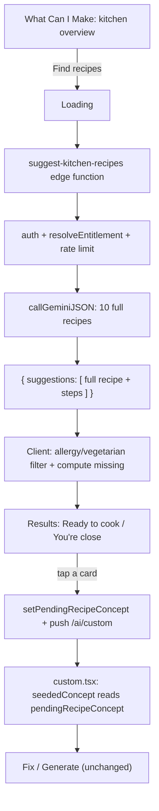

# suggest-kitchen-recipes — AI recipe suggestions from My Kitchen

## Current state (investigated)

- [`app/ai/what-can-i-make.tsx`](app/ai/what-can-i-make.tsx) has **no AI at all** today. Its `pool` memo (lines 67-86) does pure local substring matching: it scores every recipe in the static `recipes` array (`RECIPE_SEED`, seeded in [`store/useMealStore.ts`](store/useMealStore.ts)) by how many of its ingredients are already in the kitchen, applies a simple allergy/vegetarian keyword filter, and sorts by fewest missing ingredients. `findRecipes()` is a `setTimeout` fake loading spinner over this already-computed local pool — no network call, no real AI.
- Tapping a suggestion calls `openConcept(recipe)` → `router.push('/ai/custom', { recipeId: recipe.id })`. [`app/ai/custom.tsx`](app/ai/custom.tsx) looks that id up in the local `recipes`/`savedRecipes` arrays (`seededConcept` memo, lines 78-85) and converts it directly into a `Concept` (its local interface: name, category, calories, cookTimeMin, difficulty, macros, ingredients, steps) — landing straight on the Overview stage with the existing Fix / Generate machinery, no extra work needed since the data was already fully-formed locally.
- `ensureRecipeSaved` (called by `handleGenerate`) already accepts a fully-formed recipe object directly (`store/types.ts:389`) — no lookup-by-id required, so it works unchanged for AI-generated content.
- "Suggest More" (`setCount(c => c + MORE)`) combined with `shown = Array.from({ length: count }, (_, i) => pool[i % pool.length])` currently **wraps around and repeats** once `count` exceeds `pool.length` — a quirk of the local-match design that goes away once suggestions come from one real AI batch.
- The store already has a precedent for ephemeral, non-catalog transient state used to hand data across a navigation boundary: `pendingSwap` / `customizeDraft` (`store/types.ts:341-342`, actions at `useMealStore.ts:1635-1638`), both reset to `null` on every app launch (`useMealStore.ts:1939-1943`).

## Decisions (confirmed with user)

- **Full detail in one call**: the edge function returns complete recipe data for every suggestion in a single Gemini call (name, category, calories, macros, cookTimeMin, difficulty, ingredients with quantities, steps) — not a lightweight list requiring a second AI call per tap. Reason: a second per-tap AI call would burn a free-scan/rate-limit hit just from browsing, which could exhaust a free user's entire 5-scan allowance before they've committed to anything — undermining the free-trial funnel just fixed.
- **One batch, no refetch on "Suggest More"**: request 10 suggestions upfront; "Suggest More" just reveals more of that same batch (no extra AI call), disabling the button once exhausted. Same funnel-protection reasoning.
- **Matched/missing stays client-computed**: exactly like today, `missing` is computed by comparing normalized AI-returned ingredient names against the kitchen's keys — not something the AI is asked to self-report. More reliable, and reuses the exact filter already in `what-can-i-make.tsx`.
- **Allergy/vegetarian filtering stays defense-in-depth**: the prompt tells Gemini the user's allergies/diet, but the existing client-side substring safety filter (currently in the `pool` memo) is kept and reapplied to the AI response, same pattern as scan-kitchen's category-enum-plus-client-validation.

## Server side

### 1. New edge function `supabase/functions/suggest-kitchen-recipes/index.ts`

Mirrors `estimate-nutrition/index.ts`'s structure (text-only, no images):
- `handlePreflight`, `getAuthedUser`, `resolveEntitlement` + `consumeFreeScan` (same free-scan-aware gate as all 4 existing functions), `isRateLimited`/`logAiUsage` with `FUNCTION_NAME = 'suggest-kitchen-recipes'` — independent 30/hour bucket.
- Request body: `{ kitchenItems: string[] }` (ingredient display names from My Kitchen only — no client-sent profile, matching the existing pattern of trusting only the server-fetched `users` row). Validate non-empty, cap at ~60 items (defense-in-depth, mirrors `fix-meal`'s `MAX_INGREDIENTS` cap).
- Profile context pulled server-side: `dietary_preferences`, `allergies`, `goal_type`, `daily_calorie_target` (same fields `estimate-nutrition` already reads).
- `GEMINI_MODEL = 'gemini-3.6-flash'` (same pinned model). `GEMINI_TIMEOUT_MS = 25000` (longer than the default — one call now returns ~10 full recipes with steps, more output than prior text-only functions).
- Response schema — object-wrapped array of exactly ~10 suggestions:
  ```json
  { "suggestions": [ { "name": "string", "category": "Breakfast|Lunch|Dinner|Snacks", "calories": "integer", "cookTimeMin": "integer", "difficulty": "Easy|Medium|Hard", "macros": { "protein": "number", "carbs": "number", "fats": "number" }, "ingredients": [ { "name": "string", "quantity": "number", "unit": "string" } ], "steps": ["string"] } ] }
  ```
  No per-ingredient calories/macros — the concept screen never displays them, so omitting keeps the schema and output leaner.
- Prompt: generate 10 distinct recipes that maximize use of the given kitchen ingredients (missing items are fine and expected, just minimize them), respect dietary preferences/allergies, keep to the given meal categories, and vary cook time/difficulty. No `ai_usage_log` charge on failure — matches existing pattern.

### 2. Config + docs

- `supabase/config.toml`: add `[functions.suggest-kitchen-recipes]`.
- `supabase/README.md`: add a table row + note it's the 5th and first purely-text non-vision function beyond estimate-nutrition/fix-meal to use `resolveEntitlement` from day one.
- No changes needed to `_shared/gemini.ts` or any other function this time (text-only, no image support needed) — so no redeploy of the other 4 required.

## Client side

### 3. Shared `RecipeConcept` type

Move `custom.tsx`'s local `Concept` interface into [`ai/types.ts`](ai/types.ts) as `RecipeConcept` (name, category, calories, cookTimeMin, difficulty?, macros, ingredients, steps?) so both the new AI wrapper and `custom.tsx` share one definition. `custom.tsx` imports it as `import type { RecipeConcept as Concept } from '@/ai/types'` — a one-line change, everything else in that file keeps using the local name `Concept`.

### 4. New client wrapper `ai/suggestKitchenRecipes.ts`

Mirrors `ai/scanKitchen.ts`: `suggestKitchenRecipes(kitchenItemNames: string[]): Promise<RecipeConcept[]>` calling `invokeAIFunction('suggest-kitchen-recipes', { kitchenItems }, { logPrefix: '[suggestKitchenRecipes]', makeError: (code, msg) => new SuggestRecipesError(code, msg), ... })`. Maps each raw suggestion into a `RecipeConcept`, assigning each ingredient a fresh `id` via `newId()` (same as `mapIngredients` does elsewhere), validating `category`/`difficulty` against their known enums (defense in depth beyond the schema enum, same pattern as `scanKitchen`'s category validation).

### 5. Store: transient concept handoff

Add to `AppStore` (`store/types.ts`) / `useMealStore.ts`, next to `pendingSwap`/`customizeDraft`:
- `pendingRecipeConcept: RecipeConcept | null` (initialized `null`, reset to `null` on the same rehydrate-reset block as the other ephemeral fields — never synced to Supabase).
- `setPendingRecipeConcept: (concept: RecipeConcept | null) => void`, `clearPendingRecipeConcept: () => void`.

### 6. Rework `app/ai/what-can-i-make.tsx`

- Replace the local `pool` memo with real state: `const [pool, setPool] = useState<Suggestion[]>([])` where `Suggestion = { recipe: RecipeConcept; missing: string[] }`.
- `findRecipes()` becomes async: sets phase `'loading'`, calls `suggestKitchenRecipes(kitchenItems.map(i => i.name))`, applies the existing allergy/vegetarian safety filter, computes `missing` per suggestion via `normalizeIngredientName` against `kitchenKeys` (unchanged logic, new data source), sets `pool`, moves to phase `'results'`.
- On failure: a `handleSuggestError` mirroring `ScanTab`/`KitchenScanModal`'s pattern — `not_premium` → paywall `Alert`, `rate_limited`/`ai_failed`/`unauthorized` → toast, generic fallback toast otherwise — and revert to phase `'overview'`.
- `shown`/`count` logic keeps its shape but drops the `i % pool.length` wraparound: `count` is clamped to `pool.length`, and the "Suggest More" button hides once `count >= pool.length` (no more local pool to reveal, no refetch).
- `openConcept(suggestion)` changes to: `setPendingRecipeConcept(suggestion.recipe); router.push({ pathname: '/ai/custom', params: { fromKitchenAI: 'true' } })` instead of passing a `recipeId`.

### 7. `app/ai/custom.tsx`: accept the transient concept

- Add `fromKitchenAI` to `useLocalSearchParams`.
- In the `seededConcept` memo: if `fromKitchenAI === 'true'`, read and return `useMealStore.getState().pendingRecipeConcept` directly (already fully-formed, no `conceptFromRecipe` conversion needed) instead of the `recipeId` lookup; then clear it via `clearPendingRecipeConcept()` so it can't leak into a later unrelated session.
- No changes needed to Fix / Generate / discard logic — all of that already operates generically on `concept` state regardless of how it was seeded.

## Flow diagram



## Files touched

- `supabase/functions/suggest-kitchen-recipes/index.ts` (new)
- `supabase/config.toml`, `supabase/README.md`
- `ai/types.ts` (add shared `RecipeConcept`)
- `ai/suggestKitchenRecipes.ts` (new)
- `store/types.ts`, `store/useMealStore.ts` (new `pendingRecipeConcept` slot + actions)
- `app/ai/what-can-i-make.tsx` (real AI call, error handling, updated pagination, stash-and-navigate)
- `app/ai/custom.tsx` (shared `Concept` type import, read/clear the transient slot)
