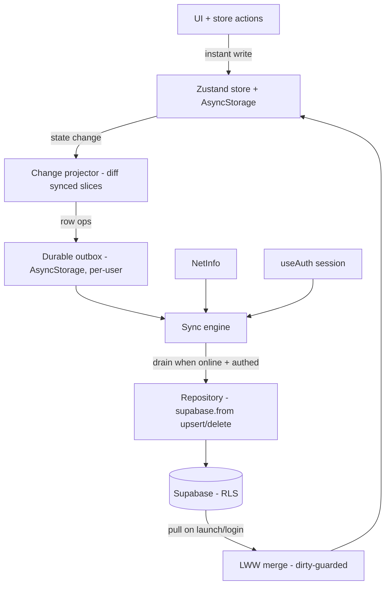

# Phase 2 - Zustand <-> Supabase Sync (Offline-First)

## Assumptions (questions were skipped - using recommended defaults; adjust here if wrong)
- **Scope = pragmatic subset.** Sync `users`(profile), `meal_logs`(+ingredients), `weight_logs`, `saved_recipes`(with recipe normalization), and `kitchen_items`/`cart_items`/`planned_ingredients`. **Defer** `plans`/`plan_slots`/`plan_day_meals` (the local model is recurrence `templates`, not a normalized plan - a lossy translation better done in its own phase) and `progress_daily` (derivable from `meal_logs`). Deferred data keeps working locally.
- **IDs = client-generated UUIDs.** New syncable records get a `uuid` used as both local id and server PK; a one-time store migration backfills UUIDs for existing records. Grocery (by name) and weight (by date) use server-side natural-key upserts.

## Why a mismatch exists (drives the whole design)
- Local IDs are non-UUID strings (`tpl-plan-...`, `${date}-${templateId}`, `sav-...`, grocery key = normalized name); every server PK/FK is `uuid`.
- Local `savedRecipes` are denormalized (full nutrition/ingredients/steps); server `saved_recipes` is a `(user_id, recipe_id)` join into `recipes`(+`recipe_ingredients`+`recipe_steps`).
- Local grocery is one `Record<key, GroceryItem>` with a `section` field; server splits into 3 tables with no columns for `struckThrough`/`mealNames`/`weekStart`/`hasSeenTip`/`cartOldWeekItems` (these stay local-only).

## Architecture

The engine wraps the store via a single `store.subscribe` change projector (no per-action edits), satisfying "dedicated sync layer, not inline in every action."

## 1. Dependencies
- Add `@react-native-community/netinfo` (network detection) and `expo-crypto` (`Crypto.randomUUID()`), via `npx expo install`.

## 2. New sync module under `lib/sync/`
- [lib/sync/uuid.ts](meal-app/lib/sync/uuid.ts) - `newId()` wrapping `Crypto.randomUUID()`; `isUuid()`.
- [lib/sync/units.ts](meal-app/lib/sync/units.ts) - metric<->display helpers (kg/lbs, cm/ft-in, cups<->liters). Internal store stays metric; only mappers/display convert.
- [lib/sync/mappers.ts](meal-app/lib/sync/mappers.ts) - pure local<->row mappers per table (details in section 4).
- [lib/sync/repository.ts](meal-app/lib/sync/repository.ts) - typed `push(table, rows)` (upsert), `remove(table, ids)`, `pullSince(table, userId, since)` using `supabase.from(...)`.
- [lib/sync/outbox.ts](meal-app/lib/sync/outbox.ts) - persisted queue keyed by user id: `{ id, table, op: 'upsert'|'delete', entityKey, payload, attempts, nextAttemptAt }`; enqueue/coalesce (same entityKey collapses), dead-letter after `MAX_ATTEMPTS`.
- [lib/sync/projector.ts](meal-app/lib/sync/projector.ts) - diffs prev vs next state for synced slices (ref-equality at collection level, then per-item compare) and emits outbox ops incl. tombstones for removed items.
- [lib/sync/engine.ts](meal-app/lib/sync/engine.ts) - orchestrates: initial reconcile (pull + LWW merge, or push-all when server empty), drain outbox with backoff, gate on `session && online && hydrated`.
- [lib/sync/SyncProvider.tsx](meal-app/lib/sync/SyncProvider.tsx) - mounts the engine; triggers sync on launch, on `SIGNED_IN`, and on regaining connectivity; exposes `useSyncStatus()` (`idle|syncing|offline|error`, pending count, dead-letter count).
- Mount `<SyncProvider>` inside `AuthProvider` in [app/_layout.tsx](meal-app/app/_layout.tsx).

## 3. Store changes ([store/useMealStore.ts](meal-app/store/useMealStore.ts))
- Switch id generators for syncable entities (MealEntry, SavedRecipe) to `newId()` (UUID).
- Bump persist `version` and add `migrate`: assign UUIDs to existing MealEntry/SavedRecipe ids (keep `templateId` field intact - meal id no longer needs to encode it), leave templates/grocery/weight keys as-is.
- No sync fields added to the store itself; the engine holds `lastSyncedAt`/dirty metadata in its own persisted map (keyed by user id) so switching accounts can't cross-contaminate.

## 4. Mapping (local -> server)
- **profile -> users** (PK = auth uid): `heightCm`->`height_value`+`height_unit='cm'`; `weightKg`->`current_weight_value`+`current_weight_unit='kg'`; `targetWeightKg`->`target_weight_value`+`'kg'`; goals `dailyCalories/protein/carbs/fats`->`daily_calorie_target`/`*_target_grams`; `waterTargetCups`->`water_target_liters` (convert); `dietaryRestrictions`->`dietary_preferences`; `allergies`->`allergies`; `trackedNutrients`->`secondary_nutrient_priorities`; plus `gender/age/birthday/goal_type/activity_level/pace_value/goal_date/notification_permission`. Never push trigger-protected columns (`free_scans_remaining`, `subscription_*`).
- **MealEntry -> meal_logs (+ meal_log_ingredients)**: `id`(uuid), `date`, `time`, slot name via `mealSlots` lookup -> `slot_name`, `name`->`meal_name`, macros->`*_grams`, `servings`, `status==='completed'`->`is_completed`, `isAdHoc`->`is_ad_hoc`, `photoUri`->`image_url`, optional `recipe_id`. Ingredients -> child rows.
- **WeightLogEntry -> weight_logs**: `weightKg`->`weight_value`+`weight_unit='kg'`, `date`->`logged_at` (UTC midnight). Natural-key upsert on `(user_id, date)`.
- **SavedRecipe -> recipes + saved_recipes (+ ingredients + steps)**: premade -> map local slug to seeded premade uuid; ai/manual -> upsert a user-owned `recipes` row(+children) then `saved_recipes(recipe_id, is_bookmarked=favourited)`.
- **grocery.items -> kitchen_items | cart_items | planned_ingredients** by `section`; natural-key upsert on `(user_id, ingredient_name)`. `section==='none'` -> delete.

## 5. New SQL migration ([supabase/migrations/](meal-app/supabase/migrations))
- `0003_sync_constraints.sql`: add UNIQUE `(user_id, ingredient_name)` to `kitchen_items`, `cart_items`, `planned_ingredients`; add UNIQUE index on `weight_logs (user_id, (logged_at AT TIME ZONE 'UTC')::date)` - all required for LWW natural-key upserts.
- `0004_seed_premade_recipes.sql` (**seed early, before plan-creation testing**): insert ~6 placeholder premade recipes (fixed UUIDs, `is_premade=true`, `user_id=null`) with `recipe_ingredients`, `recipe_steps`, and `premade_recipe_access` rows (exactly 5 `is_free=true`). Add a matching `PREMADE_RECIPE_UUIDS` slug->uuid constant in the app so saved premade recipes reference real server ids.

## 6. Conflict resolution, retry, gating
- **LWW**: on pull, apply server row when its `updated_at` is newer than the record's `lastSyncedAt` AND the record has no pending outbox op (dirty-guard); otherwise local wins and pushes. Concurrent multi-device writes resolve by DB `updated_at` trigger timestamp.
- **Retry/dead-letter**: per-item `attempts` with exponential backoff; after `MAX_ATTEMPTS` (5) move to dead-letter and continue draining so one poison item never blocks the queue. Items processed independently.
- **Triggers**: sync on launch (post-hydration, if session), on login (`SIGNED_IN`), and when connectivity returns (queue flush only - not real-time subscriptions).

## 7. Edge cases and concerns to handle
- **Unverified users** have no session -> no sync; outbox accumulates locally and flushes on first confirmed session (ties into the verify banner).
- **Sign-out / account switch**: outbox + engine metadata are per-user; on sign-out clear them; on sign-in with a different uid, pull that user's data rather than pushing the previous user's local cache. (Phase 2 assumes one primary account per install.)
- **Cross-device meal materialization** could duplicate `meal_logs` (different uuids, same date/slot); mitigate by pulling logs before `resolveDayFromTemplates` fills empty days, and de-duping on `(date, slot_name, templateId)`.
- **Local-only gaps** (won't sync this phase): `logs[date].waterMl` (no table until `progress_daily`), grocery extras, templates/active-plan structure, streak (derived).

## Remaining open questions (can proceed on defaults if unanswered)
- Confirm the pragmatic subset + defer plan tables (vs full normalization).
- Confirm UUID adoption + one-time migration (vs a persisted id-map).
- On sign-out, keep or wipe local cache? (Default: keep cache, clear sync metadata.)