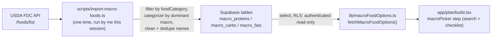

## Data flow

## 1. Supabase migration — three reference tables

New file `supabase/migrations/20260731230000_macro_food_options.sql` (single file, schema + RLS together, matching the recent single-file-per-feature style like [`20260726010000_consume_free_scan.sql`](supabase/migrations/20260726010000_consume_free_scan.sql)):

- Three tables: `macro_proteins`, `macro_carbs`, `macro_fats`. Each: `id uuid primary key default gen_random_uuid()`, `name text not null`, `created_at timestamptz not null default now()`, plus a case-insensitive unique index (`create unique index ... on public.macro_proteins (lower(name))`) so re-running the import is idempotent.
- RLS mirrors the existing world-readable reference-table pattern used by `premade_recipe_access` ([`supabase/migrations/20260714010100_rls.sql:216-227`](supabase/migrations/20260714010100_rls.sql)): `for select to authenticated using (true)`, plus `for all to authenticated using (public.is_admin())` for completeness (Table Editor itself uses a privileged dashboard connection and bypasses RLS regardless).

## 2. One-time import script

New file `scripts/import-macro-foods.ts`, plus add `tsx` as a devDependency (no `ts-node`/`tsx` currently installed) and a `package.json` script: `"import:macro-foods": "tsx scripts/import-macro-foods.ts"`.

**Fetching**: Page through `GET https://api.nal.usda.gov/fdc/v1/foods/list?dataType=Foundation,SR Legacy&pageSize=200&pageNumber=N` until exhausted (~40-50 requests for the full SR Legacy + Foundation dataset — no server-side food-group filter exists on this endpoint, so pulling everything once and filtering client-side is more complete than keyword search and avoids missing items). Uses `USDA_API_KEY` env var (your non-demo api.data.gov key).

**Food-group filter**: keep only items whose `foodCategory` field matches the target USDA food groups: `Dairy and Egg Products`, `Poultry Products`, `Beef Products`, `Pork Products`, `Finfish and Shellfish Products`, `Lamb, Veal, and Game Products`, `Legumes and Legume Products`, `Nut and Seed Products`, `Cereal Grains and Pasta`, `Baked Products`, `Fats and Oils`. (Exact category strings will be verified against real API responses during implementation — USDA's naming is stable but I'll confirm rather than assume.)

**Categorization**: read nutrient ids `1003` (Protein, g/100g), `1004` (Total lipid/fat, g/100g), `1005` (Carbohydrate, g/100g) from `foodNutrients`. Skip items where all three are ~0 (e.g. water/stub records). Otherwise assign to whichever gram value is largest — **except** items from `Legumes and Legume Products`, which are force-assigned to Proteins regardless of dominance (per your override decision — beans/lentils are carb-dominant by raw grams but conventionally treated as a protein source).

**Name cleanup**: rule-based, not AI-assisted — split on the first comma for the base food (e.g. "Beef", "Chicken", "Rice"), preserve a curated list of meaningful qualifiers (cuts like breast/thigh/ground/sirloin, grain variants like white/brown/whole wheat, forms like bread/pasta), and strip known noise tokens via regex/keyword list (cooking methods, "% lean meat / % fat" and similar fat-trim qualifiers, USDA grading terms, "meat only"/"meat and skin", boneless/skinless, etc.). Title-cases the result. **This will get most entries clean automatically but not all** — some USDA descriptions are unusually specific and will leave residual awkward qualifiers after stripping. This is expected and is exactly why the data lives in an editable table rather than app code; a manual pass in the Table Editor after import is a normal, anticipated step, not a sign the pipeline failed.

**Dedup**: after cleanup, dedupe case-insensitively within each of the three buckets — first occurrence wins (given the fetch order isn't meaningful, "first" is essentially arbitrary; easy to swap for a different tie-break later).

**Write**: insert cleaned/deduped names into the three Supabase tables via `upsert(..., { onConflict: 'name', ignoreDuplicates: true })` using the **service role key** (needed because RLS blocks anon/authenticated writes — this is the first time this repo's tooling touches the service role key outside of Edge Functions, so it'll be read from a plain env var for this one-off script, never committed, never bundled client-side).

No artificial cap on final list size — whatever survives the food-group filter, cleanup, and dedup ships as-is (likely tens to 100+ per bucket). Easy to trim later via Table Editor if any bucket ends up too large or messy.

## 3. Running the import (this session)

You'll register at api.data.gov for a standard (non-demo) key and paste it here. I'll also need your Supabase project's **service role key** (Settings → API → service_role secret in the Supabase dashboard) to bypass RLS for the bulk insert — this has never been needed client-side before, so it isn't in `.env` yet. Both go into a local `.env` (git-ignored) only for this run; add placeholder entries (no real values) to `.env.example` for documentation, matching the existing pattern there.

## 4. Client fetch helper

New file `lib/macroFoodOptions.ts`: `fetchMacroFoodOptions(): Promise<Record<MacroGroup, string[]>>`, running three `supabase.from('macro_proteins').select('name').order('name')`-style queries in parallel via `Promise.all`, using the existing app-wide `supabase` client from [`lib/supabase.ts`](lib/supabase.ts) (anon key + RLS, no changes needed there).

## 5. Picker UI rewrite — `app/plan/build.tsx`

- Remove the hardcoded `PROTEIN_OPTIONS`/`CARB_OPTIONS`/`FAT_OPTIONS` constants (currently [`build.tsx:314-327`](app/plan/build.tsx)).
- Fetch all three option lists once when the wizard mounts, with loading + error/retry states shown on the `macroPicker` step.
- Replace the chip-grid body (currently [`build.tsx:801-933`](app/plan/build.tsx), `MACRO_META`/chip rendering) with: a search `TextInput` at the top (styled like the existing pattern in `components/recipes/SavedRecipesView.tsx:251-264` / `app/grocery/planned-ingredients.tsx`), filtered via `useMemo` on a case-insensitive substring match, rendered as a continuous vertical `ScrollView` list (no section headers) of rows with a checkmark/highlighted state instead of chips — following the checklist pattern already used in `components/grocery/KitchenScanModal.tsx:207-268` (`Ionicons` checkbox/square-outline, dimmed/off styling for unselected).
- Keep the free-text "add your own" input, de-emphasized (smaller, below the list, not the primary interaction) — covers genuine gaps in the USDA set and is the fallback if the Supabase fetch ever fails.
- Selection logic, per-screen navigation (Proteins → Carbs → Fats → secondaryPrefs), per-screen required-pick gating, and the `MacroGroup` type/`toggleMacroOption`/`addMacroToken`/`removeMacroToken` helpers are unchanged — only the list *source* and *rendering* change. Downstream consumers (`shortlistPrefsPayload`, `generatePlanShortlist`) already just take `string[]`, so no changes needed there.

## Files touched

- `supabase/migrations/20260731230000_macro_food_options.sql` (new)
- `scripts/import-macro-foods.ts` (new)
- `package.json` (add `tsx` devDependency + `import:macro-foods` script)
- `.env.example` (document `USDA_API_KEY` / `SUPABASE_SERVICE_ROLE_KEY` placeholders)
- `lib/macroFoodOptions.ts` (new)
- `app/plan/build.tsx` (macroPicker step body rewrite; constants removed)
