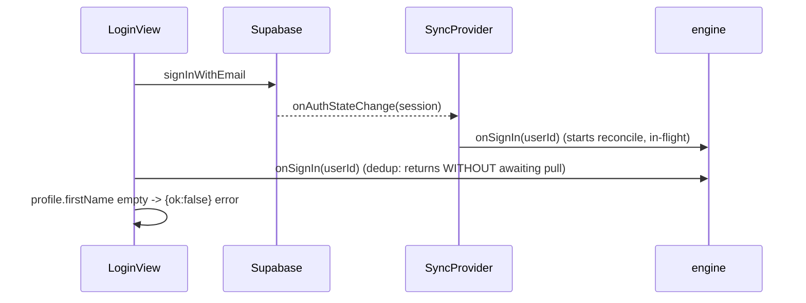

# Login, verification, and relogin fixes

Three independent issues from testing. Item 2 is the priority (real data/UX bug); items 1 and 3 are UX polish.

## Item 2 — Returning confirmed user bounced through onboarding + verify banner

The duplicate-account theory is ruled out (one confirmed account). Two real code bugs cause this:

### Bug A: `onSignIn` dedup returns before the in-flight reconcile finishes
- In [engine.ts](meal-app/lib/sync/engine.ts), track the in-flight reconcile promise and await it on a duplicate call:
  - Add `private reconcilePromise: Promise<void> | null = null`.
  - `onSignIn(userId)`: if `this.userId === userId` and `this.reconcilePromise` exists, `await this.reconcilePromise` then return; else `void this.flush()`. On the fresh path, set `this.reconcilePromise = this.reconcile(userId).finally(() => this.reconcilePromise = null)` and `await` it.
- This makes `confirmLoginData()` in [onboarding.tsx:1045](meal-app/app/onboarding.tsx) reliably wait for the pull regardless of whether `SyncProvider` called `onSignIn` first. Update the stale header comment at [onboarding.tsx:1037-1044](meal-app/app/onboarding.tsx).

### Bug B: re-signup with an existing email re-arms `pendingEmailVerification`
- In `signUpWithEmail` ([auth.tsx:45-65](meal-app/lib/auth.tsx)), detect the already-registered case: Supabase returns `data.user.identities?.length === 0` with no session. Return `{ error: 'An account with this email already exists. Please log in.', alreadyRegistered: true }` and do NOT set `pendingEmailVerification`.
- Add `alreadyRegistered?: boolean` to `AuthResult`.
- In `AccountStep.handleCreate` ([onboarding.tsx:773-791](meal-app/app/onboarding.tsx)): when `alreadyRegistered`, show the message and offer a "Log in instead" action. Pass a new `onExistingAccount` prop from `OnboardingScreen` that calls `setMode('login')`.

## Item 1 — Silent re-auth on foreground clears the verify banner

- Add dependency `expo-secure-store` via `npx expo install expo-secure-store` (works in Expo Go).
- New helper `lib/pendingCredentials.ts`: `savePendingPassword(email, pw)`, `getPendingCredentials()`, `clearPendingPassword()` backed by SecureStore (Keychain/Keystore).
- In `signUpWithEmail` ([auth.tsx](meal-app/lib/auth.tsx)) on a genuine new signup (needsVerification, not `alreadyRegistered`), call `savePendingPassword(email, pw)`.
- In `AuthProvider` ([auth.tsx:169-220](meal-app/lib/auth.tsx)): add an `AppState 'active'` listener `trySilentReauth()` — if `pendingEmailVerification && !isConfirmed(session)`, read stored creds and call `supabase.auth.signInWithPassword`. On success the existing `onAuthStateChange` -> confirmed-session effect clears the banner; also `clearPendingPassword()` there. Throttle to avoid spamming (e.g. skip if attempted < ~15s ago); fail silently when email still unconfirmed ("Email not confirmed").
- Clear stored password on logout in [settings.tsx](meal-app/app/settings.tsx) (`finishLogout` and `finishUnverifiedLogout`).

## Item 3 — Immediate login spinner + bounded, clear failure

- In `LoginView` ([onboarding.tsx:971-1033](meal-app/app/onboarding.tsx)): render a full-screen loading overlay (absolute `View` + `ActivityIndicator` + "Signing you in…") while `loading`, so tapping Log In immediately covers the form instead of only changing the button label. Keep the existing inline `error` text.
- Add a bounded timeout in `confirmLoginData` ([onboarding.tsx:1045-1058](meal-app/app/onboarding.tsx)) so the awaited reconcile can't hang indefinitely; on timeout return a clear `{ok:false, error: "We couldn't load your account data. Check your connection and try again."}`. Bug A's fix ensures this normally resolves fast.

## Verification
- Log in as the existing confirmed account after logout: lands in tabs with profile/meals/weight restored, no verify banner, no onboarding.
- Re-run onboarding with the same email: shows "already exists, log in" instead of re-arming the banner.
- Sign up fresh, tap the emailed link in the browser, return to app: banner clears automatically on foreground.
- Tapping Log In shows an immediate spinner; a bad password shows a clear error, not an endless spinner.