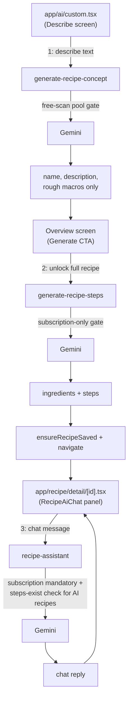

# Wire generate-recipe-concept, generate-recipe-steps, recipe-assistant

## Confirmed decisions (from clarifying questions)
- **generate-recipe-steps** locked-content signal: reuse the existing `not_premium` `AIError` code/shape (HTTP 402) — there is no separate lock pattern in the app; this code already triggers the standard paywall `Alert.alert` used by every other AI feature.
- **recipe-assistant** gating: active subscription is **unconditionally mandatory** — chat is a premium-only feature with no free-tier path at all, regardless of which recipe.
- **recipe-assistant** "recipe unlocked" check: for AI/Custom recipes, verify the request's `steps` array is non-empty (proof `generate-recipe-steps` already ran for it) — this is a sequencing check, not an access check. For premade recipes, no additional check beyond subscription (a subscriber already has full access to every premade recipe; the unused `is_free` flag is irrelevant here).

## Architecture reuse
All three functions follow the existing skeleton (see [supabase/functions/generate-meal-suggestions/index.ts](supabase/functions/generate-meal-suggestions/index.ts) as template): `handlePreflight` → method check → `GEMINI_API_KEY` env check → `createAdminClient` → `getAuthedUser` → parse/sanitize body → load profile row → entitlement gate → (rate limit gate, where applicable) → `callGeminiJSON` → (usage logging / free-scan consumption, where applicable) → `jsonResponse`.

Reused as-is, no changes needed:
- [supabase/functions/_shared/auth.ts](supabase/functions/_shared/auth.ts) — `createAdminClient`, `getAuthedUser`
- [supabase/functions/_shared/entitlement.ts](supabase/functions/_shared/entitlement.ts) — `isEntitled` (subscription-only check) and `resolveEntitlement` (free-scan-pool layered check), `consumeFreeScan`
- [supabase/functions/_shared/rateLimit.ts](supabase/functions/_shared/rateLimit.ts) — `isRateLimited`, `logAiUsage`
- [supabase/functions/_shared/gemini.ts](supabase/functions/_shared/gemini.ts) — `callGeminiJSON` (timeout + single 429/503 retry), `GeminiTimeoutError`
- [supabase/functions/_shared/errors.ts](supabase/functions/_shared/errors.ts), [cors.ts](supabase/functions/_shared/cors.ts)
- [supabase/functions/_shared/mealPromptHelpers.ts](supabase/functions/_shared/mealPromptHelpers.ts) — `buildUserContext`, `buildHardConstraints` (generic despite the filename; reused directly for profile/allergy context in all three new functions)



## 1. `generate-recipe-concept` (free-scan-pool gated, matches the other 6 scan-pool features)

New file [supabase/functions/generate-recipe-concept/index.ts](supabase/functions/generate-recipe-concept/index.ts):
- `FUNCTION_NAME = 'generate-recipe-concept'`, own rate-limit bucket (30/hour), `GEMINI_TIMEOUT_MS` ~15s (lightweight output).
- Request: `{ description: string, mealType?: RecipeCategory }`.
- Profile select: `subscription_status, free_scans_remaining, dietary_preferences, allergies, goal_type` (no calorie target needed for a rough estimate).
- Entitlement: `resolveEntitlement(profileRow.subscription_status, profileRow.free_scans_remaining)` — identical block to every existing scan-pool function; `not_premium` / 402 on failure.
- Rate limit: `isRateLimited` — identical block.
- Prompt: reuse `buildUserContext`/`buildHardConstraints` from `mealPromptHelpers.ts` (no avoid list — pass `[]`) plus the freeform `description`. System instruction explicitly says this is a rough preview only — no ingredients/steps.
- Response schema: `{ name: string, description: string, calories: integer, protein: number, carbs: number, fats: number }` — matches the flat macro shape already used in `generate-meal-suggestions`'s `suggestionItemSchema`.
- On success: `logAiUsage` + `consumeFreeScan` if `!entitlement.isSubscriber` (identical pattern).

## 2. `generate-recipe-steps` (subscription-only gated — NEW entitlement shape)

New file [supabase/functions/generate-recipe-steps/index.ts](supabase/functions/generate-recipe-steps/index.ts):
- `FUNCTION_NAME = 'generate-recipe-steps'`, own rate-limit bucket (30/hour — still rate-limited per the umbrella "same shared-helper pattern," only the entitlement model differs), `GEMINI_TIMEOUT_MS` ~20s (heavier output: ingredients + numbered steps).
- Request: since concepts aren't stored server-side, the client resends the concept context needed to generate matching steps: `{ name, description, calories, protein, carbs, fats, mealType? }`.
- Profile select: `subscription_status, dietary_preferences, allergies` (no `free_scans_remaining` needed at all).
- Entitlement (the key difference): import `isEntitled` directly instead of `resolveEntitlement` —
  ```typescript
  if (!isEntitled(profileRow.subscription_status)) {
    return errorResponse(
      'not_premium',
      'Unlock the full recipe (ingredients + steps) with Premium.',
      402,
    );
  }
  ```
  No free-scan-pool fallback at all — non-subscribers are always rejected regardless of `free_scans_remaining`.
- Rate limit: same `isRateLimited` block as always.
- Prompt: reuse `buildUserContext`/`buildHardConstraints`, plus the concept's name/description/macros as the target to build ingredients + steps around (macros should stay consistent with what the user already saw in step 1).
- Response schema: `{ ingredients: [{name, quantity, unit}], steps: string[] }`.
- On success: `logAiUsage` only — **no `consumeFreeScan` call at all** (this function never touches the free-scan pool since entitlement is subscription-only).

## 3. `recipe-assistant` (subscription-mandatory + sequencing check, unmetered)

New file [supabase/functions/recipe-assistant/index.ts](supabase/functions/recipe-assistant/index.ts):
- `FUNCTION_NAME = 'recipe-assistant'`, `GEMINI_TIMEOUT_MS` ~15s (conversational reply, lighter output).
- Request: `{ recipeName: string, recipeSource: 'ai' | 'premade', ingredients: [...], steps: string[], messages: { role: 'user'|'assistant', text: string }[] }` (full chat history including the new user message as the last entry — matches the existing local-only `ChatMsg` shape in `RecipeAiChat`).
- Profile select: `subscription_status, dietary_preferences, allergies` (for substitution-safety context in replies).
- Entitlement gate 1 (subscription, unconditional): `if (!isEntitled(profileRow.subscription_status)) return errorResponse('not_premium', 'Chat with the Recipe Assistant is a Premium feature.', 402);`
- Entitlement gate 2 (sequencing, AI recipes only): `if (body.recipeSource === 'ai' && (!body.steps || body.steps.length === 0)) return errorResponse('not_premium', 'Generate the full recipe before chatting about it.', 402);` — reuses the same code so the client's existing paywall-alert handling needs no special-casing.
- **Deliberately skip** `isRateLimited` / `logAiUsage` / `consumeFreeScan` entirely — per the explicit "unlimited and unmetered" requirement. This is the one function that does NOT follow the rate-limiting part of the shared pattern; comment this clearly in the file so it reads as intentional, not an oversight.
- Prompt: system instruction frames this as a natural conversation about the given recipe (name, ingredients, steps as context) with dietary/allergy awareness for substitution suggestions (via `buildHardConstraints`/`buildUserContext`), and the full `messages` history as conversation turns.
- Response schema: `{ reply: string }`.

## Config + docs
- [supabase/config.toml](supabase/config.toml): add three `[functions.<name>]` blocks (`enabled = true`, `verify_jwt = true`), matching existing entries.
- [supabase/README.md](supabase/README.md): add the three functions to the Edge Functions table and deployment list.

## Client wrappers (new files, following [ai/generateMealSuggestions.ts](ai/generateMealSuggestions.ts) pattern)
- [ai/generateRecipeConcept.ts](ai/generateRecipeConcept.ts) — `GenerateRecipeConceptError extends AIError`; maps response into a `RecipeConcept`-shaped object with `ingredients: []`, `steps: undefined`.
- [ai/generateRecipeSteps.ts](ai/generateRecipeSteps.ts) — `GenerateRecipeStepsError extends AIError`; takes the concept fields, returns `{ ingredients, steps }` to merge into the concept.
- [ai/recipeAssistant.ts](ai/recipeAssistant.ts) — `RecipeAssistantError extends AIError`; takes recipe context + message history, returns the reply string.

All three follow the identical `invokeAIFunction(functionName, body, { logPrefix, makeError, timeoutMessage, notAvailableMessage })` wrapper shape.

## Client wiring: [app/ai/custom.tsx](app/ai/custom.tsx)
- Replace `buildConcept()`'s local token-matching + fake `setTimeout` with a real call to `generateRecipeConcept({ description, mealType: category })`.
- Replace `refineConcept()`'s regex-based "Fix" heuristics with another `generateRecipeConcept` call, folding the refinement text into the description sent — no new endpoint needed, reuses the same function.
- `handleGenerate` (currently saves + navigates immediately) becomes two-step: first call `generateRecipeSteps(concept)` to fetch ingredients + steps, merge into the concept, **then** `ensureRecipeSaved(...)` + navigate. On a `not_premium` error from this call, show the same `Alert.alert` paywall pattern already used in this file's sibling screens (e.g. `app/plan/build.tsx`'s `handleAIError`) instead of saving/navigating.
- Both AI calls need the existing `AIError`/`not_premium` handling pattern for the free-scan-pool case too (concept generation can hit `not_premium` if free scans are exhausted).

## Client wiring: [app/recipe/detail/[id].tsx](app/recipe/detail/[id].tsx)
- `RecipeAiChat`'s `handleSend` currently fabricates a canned reply synchronously. Replace with a call to `recipeAssistant({ recipeName, recipeSource, ingredients, steps, messages })`, where `recipeSource` is derived from the recipe's `SavedRecipeSource` (`'ai'` maps to `recipeSource: 'ai'`, `'premade'`/`'manual'` map to `'premade'` for gating purposes since only AI/custom recipes need the steps-exist check).
- On a `not_premium` response (either subscription gate or the steps-not-generated gate), show the same paywall `Alert.alert` pattern and close the chat panel rather than adding a fake assistant message.
- Add a loading/typing indicator state while the call is in flight (the current shell has none since replies were synchronous).

## Todos
